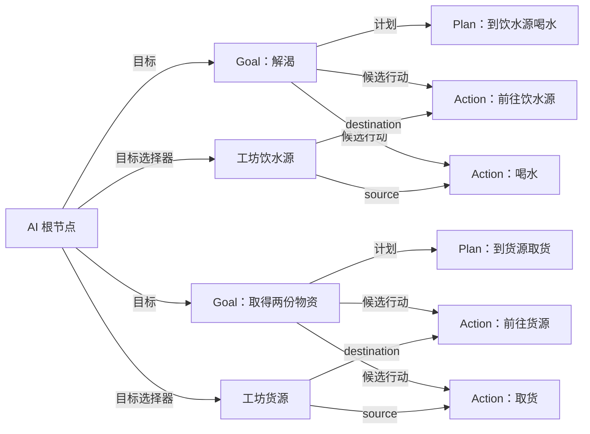

# 正式关卡示例：居民跨关卡喝水、取货

更新：2026-10-24。[文档入口](README.md) · [NPC 配置手册](NPC_AI_GUIDE.md) · [世界配置手册](WORLD_GUIDE.md)

本例直接使用正式森林小镇和仓储间。主菜单选择“新游戏”后，灰绿居民 `town_resident_01` 初始口渴为 0.8，先到仓储间喝水，再取得 2 份物资。玩家可以留在小镇；居民通过世界名册继续旅行和离屏行动，玩家随后进入仓储间时恢复同一个角色。

## 1. 从哪里打开配置

| 内容 | 实际资源 |
| --- | --- |
| 正式小镇 | [forest_town_level.tscn](../assets/scenes/levels/forest_town_level.tscn)，选择根节点下的 Resident |
| 角色初值与知识 | [profile.tres](../assets/resources/character/gray_green_resident/profile.tres) |
| 本例 AI 图 | [daily_goals.tres](../assets/resources/npc/gray_green_resident/daily_goals.tres) |
| 离屏转现场使用的角色 Scene | [resident.tscn](../assets/scenes/npc/resident.tscn) |
| 仓储间 | [world_workshop.tscn](../assets/scenes/levels/world_workshop.tscn) |
| 世界入口 | [default_world.tres](../assets/resources/world/default_world.tres) |
| 往返路线 | 两个关卡的传送门导出，保存在 default_world.tres.Routes |

选择正式关卡中的 Resident → Components → AiAgentComponent3D → Graph，打开图编辑器。这样表达式参数列表会读取同一角色的 Profile。场景中有两个 NPC，跑腿员仍使用自己的基础图。

森林小镇是独立 Scene，直接作为世界初始关卡；环境、相机、天气与世界角色组件均在这个正式关卡中配置。关卡记录和默认地点由根节点的“导出关卡配置”生成，Id 为自动保存的稳定身份，不再使用手写的关卡 Id。

## 2. 角色 Scene 与 WorldActor

正式 Resident 的 GameObject3D 保持 `PersistentId = town_resident_01`，Components 包含：

| 组件 | 本例配置 |
| --- | --- |
| WorldActorComponent3D | 正式关卡中 ScenePathOverride 指向 resident.tscn；DetailedDistance=30、AbstractDistance=45、MinimumResidencySeconds=2 |
| CharacterDataComponent3D | Profile 指向上表的角色配置 |
| AiAgentComponent3D | Graph 指向 daily_goals.tres，Running 开启 |
| NpcNavigationComponent3D | 使用 PhysicsBody 下的 NavigationAgent3D |
| CharacterMovementComponent3D | Free3D，MoveSpeed=2.2 |
| CharacterAnimationComponent3D | 使用已有 locomotion.tres |
| AbilitySystemComponent3D、CharacterPersistenceComponent3D | 沿用现有角色组件 |

本例正式关卡中的 Resident 是内嵌节点，所以填写 ScenePathOverride，告诉世界系统恢复现场时加载哪个可复用 Scene。直接拖入 resident.tscn 实例时可以留空，系统读取实例的 SceneFilePath。可复用 resident.tscn 自身也挂有 WorldActor。

每个长期 NPC 必须有独立 PersistentId。同一个角色的逻辑代理与现场实例使用同一身份；在关卡中复制成第二名角色时要更换身份。

WorldActor 接入后，WorldPopulation 统一保存角色数据、AI 检查点和逻辑位置，运行时会关闭各组件独立存档，配置者不需要手动维护两套存档。保存正式关卡后，编辑器自动更新生成目录；不要手写 generated 里的角色条目。

## 3. 配置角色数据

在 CharacterDataComponent3D.Profile 展开以下项目。

### 口渴

Needs 中已有 `thirst`，本例使用：

| 字段 | 值 |
| --- | --- |
| NeedId / DisplayName | thirst / 口渴 |
| Minimum / Maximum | 0 / 1 |
| Initial | 0.8，方便新游戏立即演示 |
| ChangePerHour | 0.18，每游戏小时增加 |
| HigherIsUrgent | true |
| UseDefaultThresholds | false |
| EnterThreshold / ExitThreshold | 0.65 / 0.25 |

公式中可以选择 `needs.thirst.value`（当前值）、`needs.thirst.urgent`（是否紧急）和 `needs.thirst.urgency`（紧迫程度）。修改 Initial 影响新初始化角色；继续旧存档会恢复旧状态。

### 取货进度

在 Profile.Facts.Facts 添加 CharacterFactDefinition：

| 字段 | 值 |
| --- | --- |
| Key | private.cargo |
| Type | Number |
| Minimum / Maximum / Step | 0 / 100 / 1 |
| Initial | CharacterScalarDefinition：ValueType=Number，Number=0 |

此处记录“已取得物资数量”。当前 `take_stock` 负责扣世界对象库存，Action Results 增加这个计数；本例没有向背包生成具体 ItemStack。需要物品种类、重量和背包容量时，应接入相应业务操作，不能仅靠一个数量事实替代背包。

### 世界知识

Profile.World 使用 CharacterWorldDefinition：

- Locations：`home` → 小镇地点；`work` → 仓储间地点。
- KnownObjects：选择仓储间的两个储物箱和水瓶，保存它们的稳定摆放身份。
- KnownRoutes：本例路线公开，可以留空。私有路线才需要显式授予对应路线身份。

地点绑定自动授予该地点的初始知识。知道地点或对象，不等于能读取它现在的库存、液体余量；下面会单独配置查询权限。

## 4. 配置对象与道路

仓储间已有两个 storage.tscn 实例和一个 bottle.tscn 实例：

| 项目 | 储物箱 | 饮水瓶 |
| --- | --- | --- |
| ObjectType | storage.tres，储物服务点 | bottle.tres，瓶子 |
| 能力 | Interaction、Stock、UsageCapacity、OpeningHours | Interaction、Liquid |
| 初始状态 | 每箱库存 50，使用名额 1，全天开放 | InitialLiquid=water，InitialVolume=0.75，VolumeLimit=1 |
| 操作 | take_stock / 使用物资 | pour_liquid / 倒出液体 |
| 操作 RequireCapacity | true | false |
| 标签 | storage，由类型提供 | bottle，由类型提供；正式仓储间额外设置 drinking_water |

操作在 ObjectType.Capabilities 的 WorldInteractionCapability.Operations 里配置。数量由 NPC 的执行图传入：取货 2、喝水 0.25，不会改对象的默认 Amount。喝水的角色效果在 Action 配置，因此玩家按 E 使用原来的“倒出液体”操作也不会自动降低玩家口渴。

对象的 InteractionArea 必须有启用的 CollisionShape3D；UsePosition 放在区域内且实体碰撞外。NPC 导航到参考位置，交互仍按整个区域判断。仓储间本例已配置 NavigationRegion3D 和 [导航网格](../assets/resources/world/workshop_navigation.tres)，避开两个箱体和水瓶实体。移动这些障碍物后应重新烘焙导航。

导航使用 Static Colliders，按 `workshop_navigation_source` 分组收集仓储间的实体碰撞。CellSize=0.1、CellHeight=0.025、AgentHeight=0.8、AgentRadius=0.3；较小的高度精度避免网格高出地面过多，使角色无法通过路径点到达判定。调整布局后选择 World/NavigationRegion3D，执行 Bake NavigationMesh。关卡 Context 已开启 RequireNavigation。

本例已清除旧手工道路，并按以下流程重新生成世界配置：

1. 在小镇和仓储间根节点的 WorldLevelContextComponent3D 分别点击“导出关卡配置”，生成 Level 和默认 Location。
2. 按下表设置两个现有传送门，再分别导出一次。
3. Profile.World.Locations 的 home、work 分别选择两个新 Level.Location；KnownObjects 继续引用场景内原有对象的稳定身份。

| 场景 / 门 | TargetLevel | TargetEntry | Automatic | NpcTravelHours |
| --- | --- | --- | --- | --- |
| ForestTownLevel / WorkshopPortal | 仓储间导出的 Level | default | true | 0 |
| WorldWorkshop / TownPortal | 小镇导出的 Level | default | true | 0 |

两个门生成两条单向路线，直接内嵌在 default_world.tres.Routes；不需要手建 Route 文件。NPC 走到门位置后即时跨关卡，再从对端 default 入口走向目标。当前没有额外道路耗时；需要时在门的 NpcTravelHours 设置游戏小时。移动门或 Arrival 后保存即可更新路线坐标。具体流程见 [关卡导出按钮](WORLD_GUIDE.md#2-配置关卡与入口)。

本次重建重新分配了关卡与地点身份，旧存档仍包含旧身份。验证示例请选择“新游戏”；日常保存或再次点击导出会复用现有身份，无需再次重建。

## 5. 主图如何连接



根节点的模块连线继续保留感知、记忆、决策预算。本例的两个 Goal 不依赖事件记忆。每组的两个 Action 必须连接同一个选择器节点，表示本次计划共享选中身份；不能分别复制两个同配置选择器来表达共享。

Plan 检查器手动添加允许使用的两个 Action。主图没有 Action → Action 的顺序线，行动次序由到达条件和 GOAP 预测决定。

## 6. 两个选择器逐项配置

新建两个目标选择器，分别命名“工坊饮水源”和“工坊货源”，并连接根节点的“目标选择器”端口。

| 字段 | 工坊饮水源 | 工坊货源 |
| --- | --- | --- |
| Adapter | 场景交互点 point | 场景交互点 point |
| Source | 世界目录 WorldDirectory | 世界目录 WorldDirectory |
| Scope | 角色地点绑定 CharacterPlace | 角色地点绑定 CharacterPlace |
| LocationBinding | work | work |
| Information | 权威读取 Authoritative | 权威读取 Authoritative |
| ObjectType | 瓶子 bottle.tres | 储物服务点 storage.tres |
| RequiredCapabilities | liquid | stock |
| RequiredOperations | pour_liquid | take_stock |
| AllTags | drinking_water | storage |
| Selection / CandidateLimit | 多候选 Candidates / 4 | 多候选 Candidates / 4 |
| RequireUsable / RequireReachable | 全部开启 | 全部开启 |
| MaximumDistance / Filter / Score | 0 / 留空 / 留空 | 0 / 留空 / 留空 |

**本例明确允许读取工作地点内这两类对象的权威状态。** 这样居民离开玩家所在关卡后，仍能规划有库存、有水的目标；它不会把整个世界所有对象都加入候选。这个权限是本例的配置选择，不是所有 NPC 的推荐默认值。

如果你的玩法要求“只有看见才知道库存”，可以改用感知对象；或使用世界目录的已知对象／公开服务权限，再接相应观测。尤其当前最后观测没有保存液体余量和空余名额，仅填 KnownObjects 不足以保证远处喝水、容量请求可规划，不能简单切换权限而期待效果一样。

标签 drinking_water 用来限定本例可饮用对象。pour_liquid 本身只负责消耗液体，不检查可饮用性；今后加入毒液、燃油时应增加对应业务校验，避免仅凭瓶子类型判断。

## 7. Goal 和 Plan 逐项配置

表达式通过检查器“编辑公式…”里的参数、常量、运算符配置。以下是公式含义，使用参数选择器选择同名项即可，无需在节点上粘贴代码。

| 字段 | 解渴 Goal | 取得两份物资 Goal |
| --- | --- | --- |
| Activation | needs.thirst.urgent = true | private.cargo < 2 |
| Utility | 100 + needs.thirst.urgency × 100 | 20 |
| Completion | needs.thirst.value ≤ 0.25 | private.cargo ≥ 2 |

解渴评分更高，所以开局先喝水。喝水完成后解渴目标退出，取货目标继续参与。取得两份物资后停止取货；任务系统要派发新一次取货任务时，应更新对应任务进度，本例不会每帧自动清零。

| Plan | Eligibility | Priority | “+ 添加可用行动”选择 |
| --- | --- | --- | --- |
| 到饮水源喝水 | 留空 | 0 | 前往饮水源、喝水 |
| 到货源取货 | 留空 | 0 | 前往货源、取货 |

Goal 的候选行动端口也要连接上述行动；只在 Plan 里选择、没有加入 Goal 的候选范围，仍是无效配置。

## 8. 移动 Action

“前往饮水源”和“前往货源”配置相同，区别是连接哪个选择器。

| 字段 | 配置 |
| --- | --- |
| Inputs | 添加目标输入 destination，类型“目标 · 场景交互点”；资源要求留空 |
| Preconditions | 留空 |
| Cost | 1 + input.destination.travel_hours × 10 |
| Predictions | Key=self.location，Mode=Set，Value=input.destination.id |
| SuccessConditions | input.destination.at = true |
| Results | 留空 |
| TimeoutSeconds | 180 |

在主图，把选择器输出连到该 Action 的 destination 入口。点击“进入执行图”：

```text
入口 → 前往输入地点（Input=destination）─成功→ 返回 Success
                                     └失败→ 返回 Failure
```

本地目标走实际导航，远处目标由 WorldPopulation 使用路线推进。跨关卡成本使用 travel_hours；远处对象的 distance 可能为 Unknown，不能直接把它用于必须是数字的成本。

Predictions 中的 self.location 只告诉搜索“这一步成功后会到达那里”。真实移动由执行图完成，SuccessConditions 检查实际到达；不要在 Results 写 self.location。

## 9. 喝水 Action

| 字段 | 配置 |
| --- | --- |
| Inputs | source，目标 · 场景交互点，连接“工坊饮水源”；资源要求留空 |
| Preconditions | 全部满足：input.source.at = true；input.source.liquid ≥ 0.25 |
| Cost | 1 |
| Predictions | needs.thirst.value，Set，0.2 |
| Results | needs.thirst.value，Set，0.2 |
| SuccessConditions | input.source.at = true |
| TimeoutSeconds | 15 |

执行图：

```text
入口 → 等待图内时长（Seconds=2）
     → 执行对象交互（Input=source，OperationId=pour_liquid，Amount=0.25）
     → 返回 Success
```

每个能力节点的失败输出连接返回 Failure。等待在本例中表示动作耗时，没有新增喝水动画。现有瓶子没有 usage_capacity，所以不要给该输入添加使用容量要求，也不要加 input.source.available 条件。

角色的 Predictions 和 Results 都要配置：前者让 GOAP 知道能解渴，后者在行动成功后更新真实口渴。液体扣减由交互节点自动提供预测并在提交时执行，不要额外手写 input.source.liquid 的预测或结果。

SuccessConditions 在 Results 提交前检查，所以不要把“口渴已经降到 0.2”填在那里；降低口渴是成功结果，Goal.Completion 负责确认目标完成。

## 10. 取货 Action

| 字段 | 配置 |
| --- | --- |
| Inputs | source，目标 · 场景交互点，连接“工坊货源” |
| 输入的资源要求 | 添加“使用容量” capacity |
| Preconditions | 全部满足：input.source.at = true；input.source.stock ≥ 2 |
| Cost | 1 |
| Predictions | private.cargo，Add，2 |
| Results | private.cargo，Add，2 |
| SuccessConditions | input.source.at = true |
| TimeoutSeconds | 15 |

执行图：

```text
入口 → 等待图内时长（Seconds=2）
     → 执行对象交互（Input=source，OperationId=take_stock，Amount=2）
     → 返回 Success
```

失败输出分别返回 Failure。使用容量只在取货这个 Action 中申请，前往货源时不占用名额。成功后一个储物箱减少 2、角色 private.cargo 增加 2；取消或库存不足时不会提交这一组收益。当前库存没有提前预留，其他角色先取走物资会使最终检查失败并重新规划。

## 11. 在正式游戏中观察

1. 保存角色配置、AI 图、正式关卡和世界资源。从主菜单开始新游戏，进入森林小镇。
2. F8 → NPC 查看灰绿居民：解渴激活，运行时计划选择前往饮水源和喝水；“共享目标”可以看到两个步骤绑定同一个对象。
3. F8 → 世界查看 `town_resident_01` 的名册条目、所在关卡和旅行进度。NPC 离开小镇后，现场 NPC 列表可能不再列出它，世界名册仍保留它。
4. 玩家可以留在小镇等待，或快进约 0.2 游戏小时并等待补算结束。道路本身耗 0.05 小时，前后移动和交互另计。
5. 完成后，水瓶从 0.75 变为 0.50；两个箱子的库存合计从 100 变为 98；角色 cargo=2，口渴接近 0.2，随后继续随时间增长。
6. 通过现有门进入仓储间。居民在当前位置生成；靠近时按同一图处理后续行为。返回小镇不会从原摆放位置再生成一名居民。
7. 在 F8 的角色数据页把口渴提高到 0.8，点“应用并重规划”，可以再次观察现场喝水。瓶子每次消耗 0.25，初始 0.75 只够三次，不会自动补水。

玩家按 E 执行瓶子的“倒出液体”，也从同一个世界对象扣除 0.25；这不会替 NPC 完成解渴。F8 → NPC → 交互点可查看液体余量。少于 0.25 时，喝水行动不满足前置条件，解渴会显示找不到合法计划并按策略间隔重试；手动重规划不会补水。补水逻辑可调用该对象 `WorldLiquidComponent3D.TryFill("water", amount)`，补足后 NPC 会自动重试。修改类型的 InitialVolume 只影响新世界的初始状态，继续旧存档会保留已经消耗的余量。

| 现象 | 先检查 |
| --- | --- |
| 没有目标 | 正式 Resident.Graph 是否指向 daily_goals.tres，Goal 是否连接根节点 |
| 有 Goal 但无方案 | Plan 是否手动选择了两个 Action；Goal 是否连接它们 |
| 选择器无候选 | work 绑定、类型、drinking_water 标签、操作、查询权限、路线开关 |
| 能看到对象但数量 Unknown | 知识与当前动态读取权限不同；本例使用工坊范围的权威读取 |
| 到了还不交互 | at 范围、区域高度、UsePosition、容量和最终余量 |
| 喝水后数值不变 | 是否配置 Results；检查交互提交是否失败 |
| GOAP 说无解 | 是否漏配角色 Predictions，移动是否预测 self.location；饮水瓶余量是否至少 0.25（玩家和 NPC 共用） |
| 出生初值与文档不同 | 是否继续了旧存档；旧状态优先于 Profile 初值 |

## 12. 自动验证

[daily_goals_validation.tscn](../scripts/tools/npc/daily_goals_validation.tscn) 使用正式世界定义、正式关卡、实际居民图与 Profile，验证远处旅行与两种交互、资源扣减、现场生成与再次喝水、返回原关卡以及存档恢复。测试存档写入忽略目录 `.godot/npc-daily-goals/saves`。

```powershell
dotnet build yu.csproj --no-restore
& '<本项目 Godot Mono 路径>' --headless --path . --rendering-method gl_compatibility --audio-driver Dummy --fixed-fps 60 res://scripts/tools/npc/daily_goals_validation.tscn
```

成功标记为 `NPC_DAILY_GOALS_OK`。测试还检查居民现场走到小镇出发点、恢复现场时不在场景原点产生临时碰撞、现场再次取货，以及玩家耗尽共用水瓶后解渴无解、冷却倒计时和补水后自动恢复。headless 检查验证行为与场景接线；DDGI 需要正常 Forward+ Vulkan 渲染环境，不能用 headless 的 DDGI 提示判断正式画面是否正常。

2026-10-24 已通过：本例 31 项（包含共用水瓶耗尽与补水恢复）、选择器绑定 100 项、图参数 47 项、世界模拟 44 项，以及名册逐帧预算压力测试。另在正常 Vulkan 模式检查正式小镇画面，DDGI 状态为 running。
