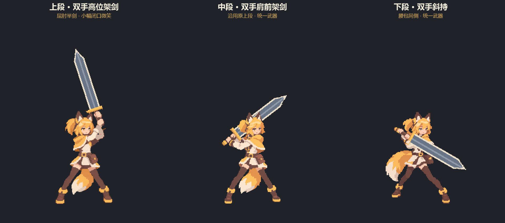
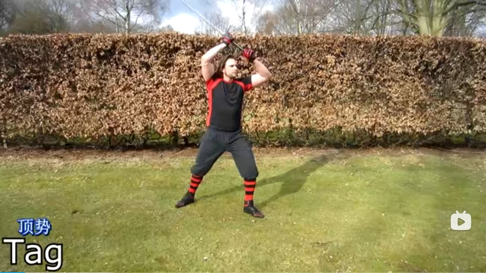
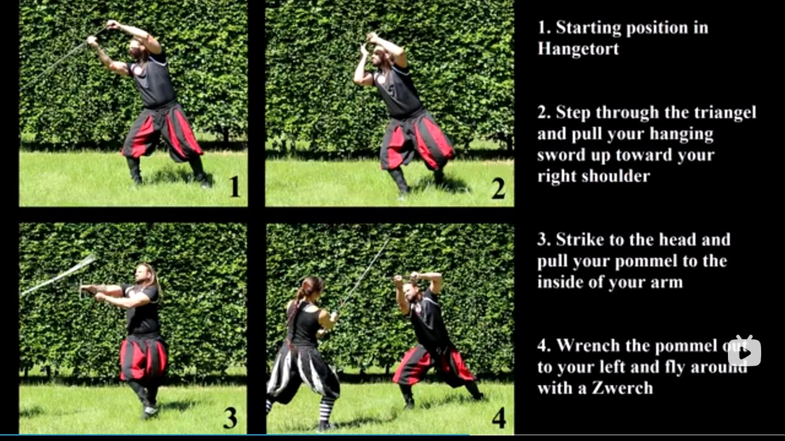

# 双手大剑攻击参考与制作

更新：2026-11-18。当前采用用户确认的 **v27**，三架势各一次完整普攻、各 64 帧。预览和操作说明见[主角人物档案](../characters/protagonist.md)。下方“下一轮架势参考候选”是研究记录，尚未替换现用动作；旧版时长、已撤下的关键图提示词和失败方案不再作为制作要求。

快速查看：[配图对照](#配图对照) · [三段轮廓](#三段轮廓与优先方向) · [10 组 Bilibili 候选](#bilibili-候选清单) · [选择顺序](#选择顺序与后续拆解) · [骨骼源转序列帧](#骨骼来源与序列帧交付)。

## 当前动作

| 架势 | 动作与收势 | 蓄势 | 挥出 | 触点 | 收势 | 总时长 |
| --- | --- | --- | --- | --- | --- | --- |
| 上段 | 蹬腿送髋、胸肩下压带刀下劈；低位承重，收肘后慢提剑回高架 | 300 ms | 75 ms | 25 ms | 1200 ms | 1.600 秒 |
| 中段 | 从后侧蓄剑，腰肩带刃向前横切；继续随挥、承重收柄，再回肩架 | 301.875 ms | 194.063 ms | 43.125 ms | 840.938 ms | 1.380 秒 |
| 下段 | 先收柄到腰侧，后腿蹬地向前平刺，再沿原线收回低架 | 376.14 ms | 79.19 ms | 59.39 ms | 752.28 ms | 1.267 秒 |

上段第 12–15 帧累计前移为 0、14、34、48 原生像素，对应 0.300–0.375 秒、总距离约 0.1986 米。实际位移通过 CharacterBody3D 碰撞执行；触点完成前移，之后站在落点收势。中、下段没有额外前移。

上段 23–62 帧使用原角色完整的站定收势，身体、头肩、双手和腿来自同一姿势，不分段拼接，不逐帧居中。上段 40 帧和中段 31 帧的钢刃以现用待机母版修整，按护手连接并保留人物遮挡。首末帧精确接回原待机。

## 动作参考

以下来源用于动作分析，第三方视频或截图不进入游戏素材。表中时间是此前查阅范围；本项目的帧数和时长为自行设计，并非参考招式实测值。

| 来源 | 查阅位置与用途 | 本项目取舍 |
| --- | --- | --- |
| [Monster Hunter 官方大剑演示](https://www.youtube.com/watch?v=t2h3Uxj7nNg) | 重点查看 10–15 秒蓄力、下劈及低位承重；后续对照 9.7–11.3、15.3–18.5 秒连续画面 | 借鉴腰腿带动和落刀后的承重，缩减长蓄力和多段追击 |
| [LIER：How to Cut with a Longsword 05 - Horizontal Cuts](https://www.youtube.com/watch?v=jCFmBmdRU-U) | 0–7.6 秒试斩、170–177.6 秒示范；连续帧观察双手、转刃与切过后的控制 | 中段朝面向方向切出；刃口、护手与手腕处于同一切割平面，避免用宽剑面横拍 |
| [Sean Franklin：Physics, Push-Pull with the longsword, bad cuts… and you!](https://swordstem.com/2018/05/23/physics-push-pull-with-the-longsword-bad-cuts-and-you/) | Follow Through、Body Structure、Edge Control | 以身体带动稳定双手结构，保留随挥与刃向控制 |
| [Wapenkunst：Figueyredo 简单规则 1–16](https://www.youtube.com/watch?v=3ARRdoA35Po)；[Figueyredo 译本](https://oakeshott.org/wp-content/uploads/2016/10/Figueiredo_Montante_Translation_Myers_and_Hick_v2.pdf) | Rule 11 横切；Rule 4/5 收臂和平刺；Rule 2 上方斩击与回架。译本印刷页 14 的 Rule XI | 只取一次面向前方的横切或平刺，控制步幅和转身 |
| [PlayStation Japan：《浪人崛起》大剑演示](https://www.youtube.com/watch?v=mjPeqAJJH2Q)；[官方系统页](https://teamninja-studio.com/ronin/us/system/) | 全片 58 秒，每 2 秒关键帧 | 对照双手间距、腰肩承重和长剑减速，保持原角色视角 |
| [Onos Gaming：Nioh 2 Odachi Weapon Showcase](https://www.youtube.com/watch?v=zCyY5fjI7dU)；[《仁王 2》官方操作手册](https://www.gamecity.ne.jp/manual/t2wNiSht/steam/bri/2020.html) | 前 96 秒教学区域与 Quick Attack / Change Stance | 比较三段轮廓与回架；沿用三段直选，不扩展残心或属性机制 |
| [Genshin Impact 官方：Eula: Surging Frost](https://www.youtube.com/watch?v=deByypNHedI)；[官方发布页](https://genshin.hoyoverse.com/en/news/detail/103931) | 普通攻击及舞步式剑法介绍 | 只取身体线条、步法和发尾韵律，保持当前角色与双手握剑 |

## 下一轮架势参考候选（2026-11-18）

用户要求先多找几组与主角上、中、下段持剑姿势相近的参考，优先 Bilibili。筛选基准是[现用三段设定图](../characters/media/protagonist/greatsword-stances.png)，同时比较双手高度、剑尖方向、手臂交叉关系和剑身相对躯干的位置。下文“适合参考”表示候选用途，不代表已选定为制作母版。

### 配图对照

**图 1 · 主角现有三段设定。** 从左到右为上段、中段、下段。这张图是改编基准：上段额前高举，中段肩后斜架，下段胸前交叉斜持。参考动作最终要回到这里的手位、剑尖方向与人物轮廓。

**图 2 · 上段候选：Tag 高举剑。** 来自 [R02《德国梅耶流长剑：架势演示》](https://www.bilibili.com/video/BV1wx411r7vj/)，截图时间 **00:19.694**。双手在头顶、双肘弯曲、双脚分开承重，与主角上段有可比较的结构；这张图用于比较起始架势，不单凭静帧判断下劈的力量和连贯性。

**图 3 · 下段候选：Hangetort 悬垂架分解。** 来自 [R01 的 P40](https://www.bilibili.com/video/BV19E411w7wk/?p=40)，截图时间 **01:00.912**。图中第 1 格是剑尖斜向下的护身起手，第 2–4 格展示后续变化。示范的双手明显高于主角胸前的交叉握持；适合分析转刃路线，不能把整套追击直接替换成主角当前的低架平刺。

两张参考截图均为 **Björn Rüther** 的演示：图 2 由口胡智障大绅士搬运，[原视频](https://www.youtube.com/watch?v=4aQ4_7xf8Ic)；图 3 由求真学会搬运，[原作者系列](https://www.youtube.com/playlist?list=PLRRwBtI2PdRFoFOvkUJhU2TdP36pMqo_1)。截取于 2026-11-18，仅随文档用于动作比较，保留画面内标识。第三方参考图版权归原作者，不适用项目代码许可证，也不作为游戏素材。

**中段配图状态：** 图 1 已展示主角原肩架；R01 P7、P38 和 R03 保留为视频候选。本轮未取得足够清楚且与主角剑尖方向相符的肩架定帧，因此不把转换中的模糊画面列为定稿参考。下表继续保留相关差异与待核验事项。

### 三段轮廓与优先方向

以下左右均指设定图中的屏幕方向；角色转向时应整体镜像。

| 主角架势 | 必须保持的轮廓 | 优先寻找的参考 | 已发现的偏差 |
| --- | --- | --- | --- |
| 上段 | 双手在额前至头顶，屈肘高举；剑尖近乎朝上；双脚承重 | Tag / 高位 Vom Tag，从高架发起的下劈 | 部分示范会把双臂完全伸直，或把剑横放头顶，不能直接替换主角起手 |
| 中段 | 双手在肩侧，剑身经过头后，剑尖斜向右上 | 肩位 Vom Tag；肩侧蓄剑后带出横切 | Zornhut 虽然也从肩侧蓄剑，常见剑尖却向后下；Mittelhut 的手位也较低，二者只作发力或切割路线补充 |
| 下段 | 双手交叉位于胸肩附近，剑身斜跨胸前，剑尖指向右下 | Hangen / Hangetort 的斜向护身与转刃 | 已看到的 P40 起始示范双手举过头，明显高于主角；低位 Schrankhut 又偏低。目前没有确认到完全贴合的完整动作 |

术语与姿势的对应依据：[梅耶 1570 年长剑架势章节译文](https://sprechfenster.org/meyer/1570/longsword-chapter-3-the-guards/)、[AHF 的次要架势教学](https://swordfight.uk/secondary-guards-of-the-longsword/)、[Keith Farrell 的 Vom Tag 教学说明](https://www.keithfarrell.net/blog/2017/06/learning-position-vom-tag/)。这些资料支持高架、肩架和悬垂架的结构区别；与主角的匹配程度是本项目的改编判断，不是资料对本角色的结论。

### Bilibili 候选清单

共 **10 组视频或合集**。同一合集的不同分集不重复计为独立来源。“页面已核对”仅代表核对标题、简介或选集信息；“局部画面”也不等同于完整连续动作或逐帧检查。

| 编号 | 来源 | 对应架势与入口 | 候选用途与差异 | 本轮核验 |
| --- | --- | --- | --- | --- |
| R01 | 求真学会搬运 Björn Rüther：[梅耶长剑：从架势开始的技术](https://www.bilibili.com/video/BV19E411w7wk/) | 上段 [P1 高架汇总，4:05](https://www.bilibili.com/video/BV19E411w7wk/?p=1)、[P2 Tag 1，1:19](https://www.bilibili.com/video/BV19E411w7wk/?p=2)；中段 [P7 肩架汇总，1:12](https://www.bilibili.com/video/BV19E411w7wk/?p=7)、[P38 Mittelhut 1，1:37](https://www.bilibili.com/video/BV19E411w7wk/?p=38)；下段 [P40 Hangetort 1，1:42](https://www.bilibili.com/video/BV19E411w7wk/?p=40) | 优先拆看的架势专题。中段肩架的剑尖方向、下段悬垂架的手位高度均需改编；对练中的连续追击不能整段当作一次普攻 | 42 集目录已核对；P1、P7 看过局部对练画面；P2 看过说明和速度标题；P40 看过慢动作标题及四步姿势图，其中起手双手过头。P38 未看动作画面 |
| R02 | 口胡智障大绅士搬运：[德国梅耶流长剑：架势演示](https://www.bilibili.com/video/BV1wx411r7vj/) | 三段轮廓对照，6:27 | 用于辨认架势和换架路径；与 R01 为同一示范者，不能算不同风格的独立验证 | 已保存 00:19.694 的 Tag 高架图；约 1:01 看过 Ochs 示例，后续看过部分转换画面。未完整逐帧检查 |
| R03 | [梅耶体系：怒火势、侧位势、铁门势、公牛势技术演练](https://www.bilibili.com/video/BV1dT41157ye/) | 中段肩架的补充候选 | 比较不同架势发起动作的方式；怒火势与主角中段的剑尖方向仍可能不同 | 页面已核对，未查看动作画面 |
| R04 | 德剑阿枭：[从零开始的德式长剑第二讲：站姿与斩击](https://www.bilibili.com/video/BV1G34y1r7CU/) | 上段为主，7:37 | 下一轮重点核对站姿、迈步与下劈的联系；保持主角原屈肘高架，不因教学架势改变角色轮廓 | 页面已核对，未查看动作画面 |
| R05 | 德剑阿枭：[第五讲：自架势开始，以架势结束](https://www.bilibili.com/video/BV1MY41137KP/) | 三段收势，8:43 | 优先研究攻击如何结束在稳定架势，服务“完整后摇结束才能切段”；片名与主题适合，具体回架路线尚需看片确认 | 页面已核对，未查看动作画面 |
| R06 | 环列之尹搬运：[主要招式：下劈、上撩、横斩和怒击](https://www.bilibili.com/video/BV1RW411L73G/) | 上段下劈、中段横切，5:37 | 补充出刀方向和切割平面；不能因为包含“横斩”就认定其起手与主角肩架一致 | 页面已核对，未查看动作画面 |
| R07 | 剑术叁戈：[梅耶长剑技术——制边 Absetzen](https://www.bilibili.com/video/BV1Li4y1m7Ry/) | 下段转刃、切段弹反的补充 | 优先核对护身转刃与刺击衔接。只借动作表达，游戏仍采用任意切到另一段的时机弹反规则 | 页面及授权翻译说明已核对，未查看动作画面 |
| R08 | 老板求求别加辣：[《仁王2》大太刀入门](https://www.bilibili.com/video/BV1na4y1t7KK/) | 三段游戏节奏的补充 | 后续比较动作可读性、攻击后重新持剑的时间；“同样分三段”不能作为轮廓相近的证据 | 页面已核对，未查看动作画面 |
| R09 | CG阿天：[Blender 大刀 Rigify 武器绑定](https://www.bilibili.com/video/BV1xq4y1b7wA/) | 骨骼源动作制作流程 | P2 武器绑定，P4 姿态库与 Blocking，P5 曲线打磨，P9 渲染输出。可作为离线制作方法参考，当前还不能判定其成品三段架势匹配 | 9 集目录已核对；P2 约 1:08 看到 Blender 绑定操作画面，未查看完整成品动作 |
| R10 | Hodor_11：[大剑技能攻击，动画资产动作参考](https://www.bilibili.com/video/BV1YD421V7B6/) | 可编辑骨骼资产的候选展示 | 简介指向 Grruzam 的 Burst Great Sword Action Asset；有重武器动画来源价值，是否能保留主角三种起手仍需逐招核对 | 页面及原作者产品来源已核对，未查看动作画面、未购买或导入 |

R01 [原作者播放列表](https://www.youtube.com/playlist?list=PLRRwBtI2PdRFoFOvkUJhU2TdP36pMqo_1)；R02 [原作者视频](https://www.youtube.com/watch?v=4aQ4_7xf8Ic)；R07 [Scholar Victoria 原视频](https://www.youtube.com/watch?v=63IoJ944ah4)；R10 [原作者演示](https://www.youtube.com/watch?v=LZrev-QXak0)及[正式资产页](https://assetstore.unity.com/packages/3d/animations/burst-great-sword-action-asset-183617)。搬运页的存在不表示可以提取其中的人物或动画资产用于游戏。

### 选择顺序与后续拆解

1. **上段先看 R01 的 P1/P2，再看 R04。** 先比较额前高举的起手轮廓，再取下劈中的腰腿配合；保持进身发生在下劈中、触地后停步的既有要求。
2. **中段先比较肩位 Vom Tag 的结构，再看 R01 的 P7/P38 和 R06。** 原中段已得到用户肯定，保留肩后斜架与朝前横切；主要研究切过后的减速、承重和回肩，不把肩架参考中的剑尖朝后下照搬进待机。
3. **下段先看 R01 的 P40，再用 R07 补充转刃。** P40 的手位偏高，必须回到主角胸前交叉握剑的轮廓。当前下段攻击是收柄、平刺和回架，找到新的参考不等于已决定改成上撩或连斩。
4. **三段后摇一起参考 R05 的主题。** 下一轮逐帧记录“起始架势 → 蓄势 → 命中 → 随挥/承重 → 收柄 → 回到原架势”；回架结束才允许切段。延长后摇应增加可读的减速与回架过程，避免用静止等待或反复摆动充时长。

下一轮精看时，每个候选应另行记录实际动作时间段、视角、关键姿势和完整回架过程；本轮未测量参考动作帧数，也没有完成逐帧复刻。浏览器能打开部分 Bilibili 播放页，现已保存上方两张静态参考截图；登录提示与媒体提取失败限制了检查，尚未取得可用的本地视频素材。

### 骨骼来源与序列帧交付

用户已允许寻找骨骼动画作为制作参考，离线转成序列帧。优先检查 R09 的绑定方法和 R10 的原作者资产；另保留 [GameDevHero Two Handed Sword Animations V2](https://gamedev-hero.itch.io/two-handed-sword-animations-v2) 与 [Kevin Iglesias 免费近战动画](https://kevdev.itch.io/human-melee-animatons-free) 作为后续可编辑源候选。这些不是已选中的动作，三段轮廓、文件内容及使用范围应在实际选用时核对。

后续采用骨骼来源时，应把动作调整到现用人物、大剑和三种持剑基准上，再以固定视角和脚底锚点离线渲染、修帧。游戏内继续使用透明序列帧；本轮只整理参考，没有替换 v27、导入第三方资产或恢复已取消的实时骨骼方案。

## 制作约束与来源

- 原生画布 512×384、脚底锚点 (256,347)，由 320×384 待机水平加边；推理输入 1024×768，人物尺度不变。
- 双手握同一连续剑柄，保持人物比例、衣服、腰包侧别及大剑结构；中段刀刃朝前切出，不倒放出刀作为收势。
- 不在贴图上绘制刀光、模糊或粒子；当前三架势无武器攻击特效。换势周身粒子由独立场景管理。
- 现用完整动作的制作来源是本地 ComfyUI MiniMax H3，Aseprite 负责选帧、定时、透明化及局部修整；不将视频生成称为逐帧手绘。下一轮也允许采用骨骼动画离线渲染序列帧，见上方研究记录。
- [制作配置](../../assets/resources/sprites/amber_fox_style_v2/greatsword_stance_attack/production.json)中的 `source_parts` 和 `source_pose_map` 是当前来源依据。v10、v12、v17、v21、v22 的文件名可能仍是现用源，不能仅按版本号删除。
- `generation_input_files` 保存现用工作流与原始输入的对应关系；[关键姿势](../../assets/resources/sprites/amber_fox_style_v2/greatsword_stance_attack/keyposes.json)只保留当前制作所需记录及提示词。中段整段试片仅用于关键图来源，未直接作为播放片段。
- [逐像素修正](../../assets/resources/sprites/amber_fox_style_v2/greatsword_stance_attack/pixel-corrections.json)记录 alpha 与钢刃修改；原始视频、RGB 源帧、可编辑 Aseprite 和独立导出一起保留。PNG/APNG 是像素依据，GIF 用于观看。

## 重新封装与验证

读取当前 `production.json`，使用含 PyAV、NumPy、Pillow 的 Python 运行 `scripts/tools/art/package_stance_attacks.py --assemble` 无损拼接，再运行 `--prepare` 提取 RGB；随后在 Aseprite 执行 `scripts/tools/art/build_stance_attacks.lua`，最后运行 Python 包装脚本生成 APNG、审计映射及技能时间轴。

每招使用 64 个等长 Godot 播放条目，上段 40 fps，中段约 46.376812 fps，下段约 50.513023 fps。Aseprite/APNG 按累计边界取整到毫秒；`records` 分别保存整数 `duration_ms` 与运行时 `runtime_duration_ms`。`holds` 记录节奏点，`phases` 使用从 0 开始、右端不含的帧范围。

高架攻击的 `root_motion.source_forward_pixels` 描述源图提取偏移，`root_motion.forward_pixels` 描述物理前移，两者独立。当前源图不需要逐帧水平抵消。技能 Timeline 与冷却覆盖完整动作；换势等待收势完成，连续点击不续招。

v27 已核对 192 帧源图与修正台账、独立 Aseprite 导出、图集、APNG、Godot 导入，以及左右各两次实际播放。完整玩法、碰墙和取消检查沿用运行逻辑未变的 v26 结果。导出一致不能替代角色结构、力量感或连贯性的目视检查；没有独立全轮廓人工标注或盲审。详见[当前复核记录](../../assets/resources/sprites/amber_fox_style_v2/greatsword_stance_attack/visual-review.json)。
