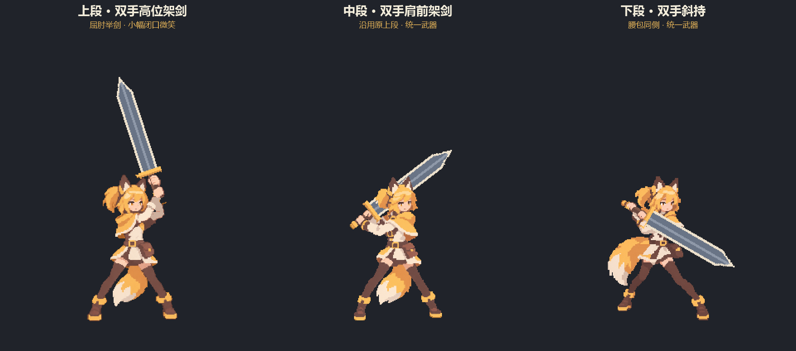
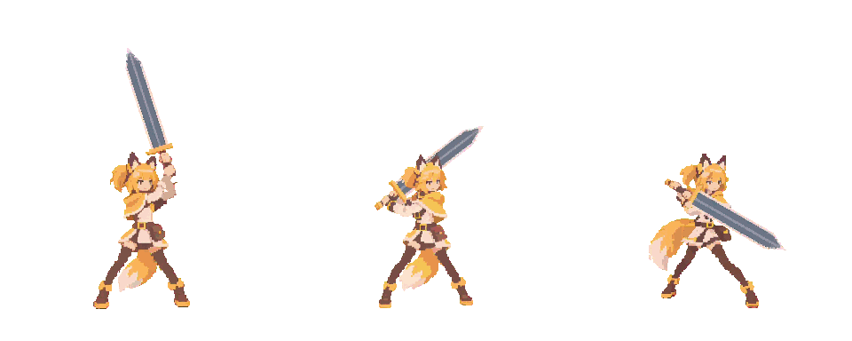
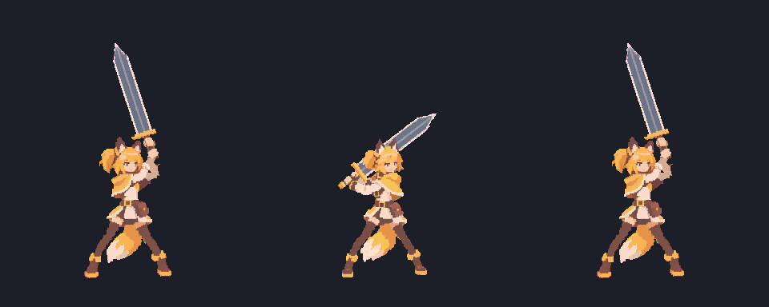
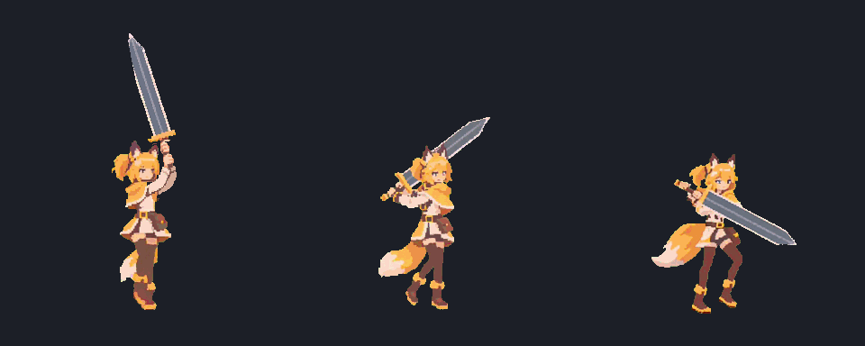
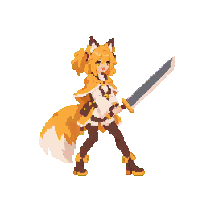
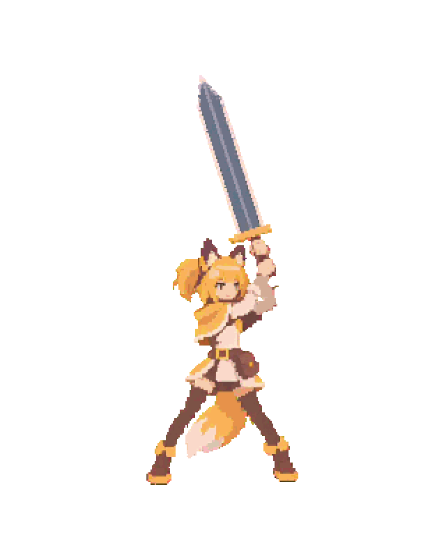
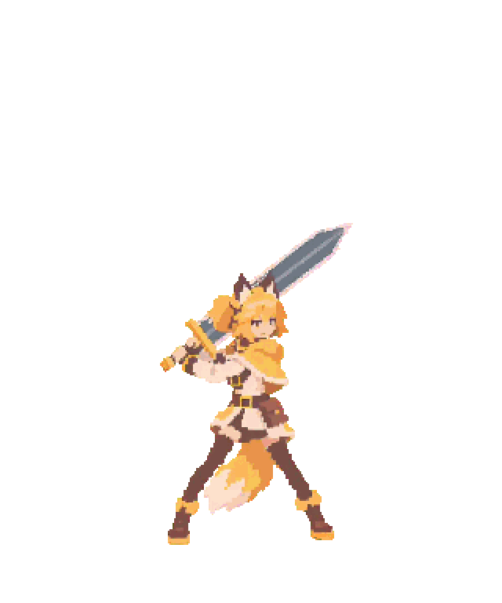
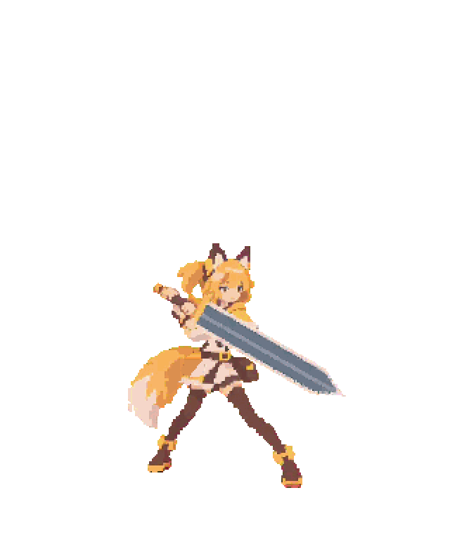
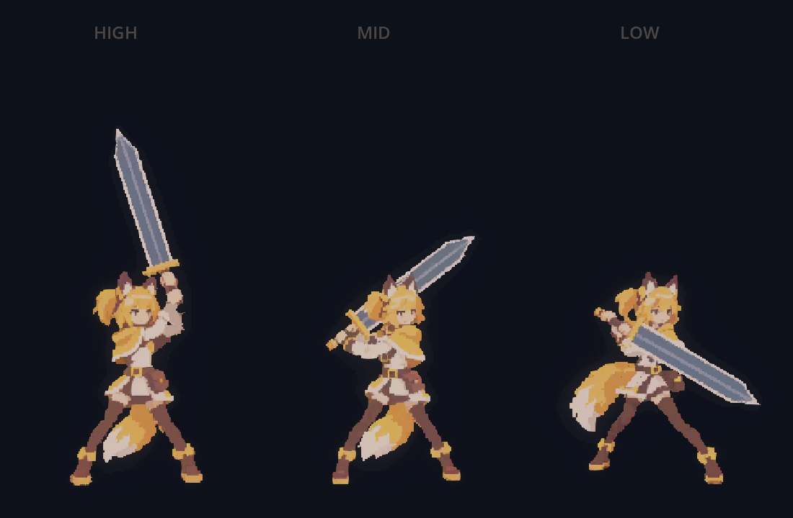
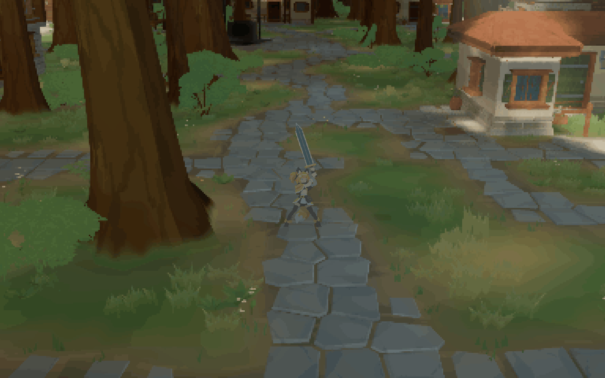

# 主角人物档案

更新：2026-11-09。主角的人设、动作和新需求统一在本页维护。

## 人设

| 项目 | 当前设定 |
| --- | --- |
| 定位 | 暂称“狐耳剑士”；玩家操控的狐耳少女，仅使用大剑 |
| 外观 | 琥珀色眼睛、金色短发与单侧马尾、棕色耳尖；单条金黄尾巴，末端奶油色 |
| 服装 | 暖黄短披肩、奶油色长袖旅行装、棕色腰带和腿部服装、黄边靴；腰包统一在画面右侧 |
| 表情 | 小幅闭口微笑；上段静帧嘴宽两像素，待机保留短眨眼 |
| 大剑 | 灰蓝剑面、浅色刃缘与中脊、金色直护手、棕色剑柄；三段采用同一武器母版 |
| 画风 | 连贯的大像素色块、少量明确明暗；不加连续黑描边，不用整图减色修视频 |
| 头顶 | 头发连成整块并遮住耳根下缘，耳旁不加碎发或深色竖块 |
| 剧情 | 年龄、身世、性格和人物关系尚未确定 |

## 动作

**工程约定：跳跃只展示完整动作。** 三段待机、持剑移动及六向换势已接入游戏，默认中段；完整跳跃和游戏现用普攻沿用运行资源。旧 idle 动画条目已移除。

<!-- BEGIN GENERATED ACTIONS -->

| 动作 | GIF | 动作相关信息 |
| --- | --- | --- |
| 三段待机 |  | 各 72 帧 · 24 fps · 3 秒循环 已加大肩部起伏与尾摆；保留眨眼，脚底不增加位移 |
| 三段攻击 | 暂缓 | 先完成三段移动；后续每段一招普攻，按新动作确定时长与冷却 |
| 架势过渡 |  | 上↔中 7 帧 / 0.112 秒，中↔下及上↔下 10 帧 / 0.160 秒；均为 62.4 fps |
| 三段移动 |  | 上、中段保留三分之四朝向、轻微身体扭转 循环各 36 帧 / 36 fps / 1 秒，起步各 12 帧 / 0.333 秒；下段 34 帧 / 1.4 秒 |
| 完整跳跃 |  | 15 帧 · 18 fps · 0.833 秒 跳高约 0.6 米；全程可平移 |
| 游戏现用普攻 |  | 30 帧 · 25 fps · 1.2 秒 冷却 1.35 秒 |
| 受击 |  | 8 帧 · 20 fps · 0.4 秒 已有素材，当前玩家图未接入 |
| 倒地 |  | 16 帧 · 24 fps · 0.667 秒 已有素材，当前玩家图未接入 |

<!-- END GENERATED ACTIONS -->

### 动作相关信息

| 架势 | 最新待机 GIF | 姿势说明 |
| --- | --- | --- |
| 上段 |  | 双手屈肘在额前高位架剑，剑尖向上略偏左。 |
| 中段 |  | 剑在脑袋后边、指向右上；Shift + 左键切入。 |
| 下段 |  | 双手交叉斜持，剑尖朝右下；腰包位于画面右侧。 |

- **待机幅度**：沿用当前视频动作，在 Aseprite 中额外增加最多 2 个原生像素的上身起伏；头、肩、手和剑一起移动，胸部不单独鼓起。尾尖额外增加上段左右各 5 像素、中下段各 3 像素的弯摆；中下段叠加原有摆动后约左右各 6 像素。尾根不增加横移，尾摆峰值滞后呼吸 9 帧。
- **节奏与对齐**：三段均为 72 帧、24 fps、3 秒循环，共 216 帧。画布 320×384，脚底锚点 (160,347)；人物比例不变，脚底不增加位移。
- **持剑移动**：当前 v12 保留用户确认的脚步和轻微身体扭转，只修正上段手臂、手与剑。双手握在连续剑柄上，前后臂的袖口与手腕相连；采用已确认待机的剑刃和护手，随双手及肩部整体起伏。局部握剑基准由 imagegen 修正，再由 Aseprite 应用到原 ComfyUI 序列。上、中段循环各 36 帧 / 36 fps / 1 秒，起步各 12 帧 / 0.333 秒；下段 34 帧 / 1.4 秒。

共 130 帧。上段 48 帧已逐帧检查双手、袖口、握柄和肩部衔接；腰胯、腿脚从 y=245 起与 v11 逐像素一致，五官局部也未变化。中、下段及中段起步 PNG 与 v11 逐文件一致。上段原视频对比保留有意修改造成的颜色差异，另有修补层和未修改区域的精确核验。该版本仍是序列帧，握剑部分作为一组稳定形状运动，没有增加独立肘关节动画。

本轮构建、130 帧 Godot 导入核验、完整武器/架势玩法检查和实际录制均完成，进程退出码为 0。构建保留 8 条既有字段警告，录制保留既有 RID 清理警告；v11 的退出访问异常未在本轮复现，尚未确认修复。检查摘要见[视觉复核记录](../../assets/resources/sprites/amber_fox_style_v2/greatsword_stance_movement/visual-review.json)。

- **三段攻击**：历史失败资源和未采用试稿已清理；本轮先制作移动。后续每段一招普攻，从各自架势起刀并收回；不沿用旧动作时长和冷却。
- **完整跳跃**：约 0.6 米，松键可截短上升；起跳、腾空和落地均可左右、前后及斜向平移。GIF 时长不等于实际腾空时间。
- **游戏现用普攻**：时长 1.20 秒、冷却 1.35 秒，期间限制移动和跳跃。伤害、命中判定和连招尚未接入。
- **架势切换**：恢复 Shift + 滚轮上／左键／滚轮下直选上／中／下段；普通左键普攻。手柄 R1/RB + △/Y、□/X、×/A 同样直选。换势完成后进入目标待机，地面短暂站稳，跳跃和技能中排队；连续输入只执行最后一个目标，无额外冷却。实际换势开始时播放 0.32 秒周身细小金色粒子，贴近身体微微上飘并淡出。本轮不加入残心、精力、属性相性或三段独立攻击。详见[架势切换](../gameplay/combat-stances.md)。
- **过渡资源**：使用三条动作正反向覆盖六个方向；与 idle 同为 320×384、脚底 (160,347)。[资源及源帧记录](../../assets/resources/sprites/amber_fox_style_v2/greatsword_stance_transition/manifest.json)。
- **其他能力**：仅装备大剑，冲刺已移除；三段持剑移动已接入，四向朝向仍暂缓。

**粒子与像素后处理**：外置 CPUParticles3D 通过深度匹配保留小粒子亮芯，不再被大像素采样吞掉；仍受场景遮挡、调色与泛光影响。预览为 Forward+ 森林镜头，按固定 60 fps 录制。渲染验证包含 MSAA、像素滤镜和前景墙遮挡，详见[后处理](../rendering/relink-post.md)。

**一致性复核**：已重看三组过渡共 27 张正向帧，人物服装、发色、尾巴、腰包与大剑设计一致；原上↔中剑刃孔洞、细线问题未复现。六向共 54 帧通过导入逐像素校验，首尾与对应 idle 首帧完全一致；中间帧仍有透视和细微轮廓变化。粒子使用独立特效场景，不改人物与剑的贴图或精灵材质。

当前制作资源

| 架势 | 可编辑动画 | 无损预览 |
| --- | --- | --- |
| 上段 | [Aseprite](../../assets/textures/sprites/amber_fox_style_v2/greatsword_stance_idle/high/sources/idle.aseprite) | [APNG](../../assets/textures/sprites/amber_fox_style_v2/greatsword_stance_idle/high/idle.apng) |
| 中段 | [Aseprite](../../assets/textures/sprites/amber_fox_style_v2/greatsword_stance_idle/mid/sources/idle.aseprite) | [APNG](../../assets/textures/sprites/amber_fox_style_v2/greatsword_stance_idle/mid/idle.apng) |
| 下段 | [Aseprite](../../assets/textures/sprites/amber_fox_style_v2/greatsword_stance_idle/low/sources/idle.aseprite) | [APNG](../../assets/textures/sprites/amber_fox_style_v2/greatsword_stance_idle/low/idle.apng) |

- [三段静帧源文件](../../assets/textures/sprites/amber_fox_style_v2/greatsword_stance_idle/sources/stances.aseprite) · [武器母版](../../assets/textures/sprites/amber_fox_style_v2/greatsword_stance_idle/sources/greatsword-master.aseprite)。各架势目录保留透明 PNG 序列、图集及实际使用的制作基准 `source.aseprite`。
- [三段待机 Godot 资源](../../assets/resources/sprites/amber_fox_style_v2/greatsword_stance_idle/sprite_frames.tres) · [幅度参数](../../assets/resources/sprites/amber_fox_style_v2/greatsword_stance_idle/motion.json) · [制作清单](../../assets/resources/sprites/amber_fox_style_v2/greatsword_stance_idle/manifest.json)。仅包含 `idle_high`、`idle_mid`、`idle_low`。
- [选定视频、输入、工作流和种子](../../assets/resources/sprites/amber_fox_style_v2/greatsword_stance_idle/sources.json) · [中文制作说明](../art/prompts/protagonist-idle.prompt.txt) · [像素核验](../../assets/resources/sprites/amber_fox_style_v2/greatsword_stance_idle/media-validation.json) · [Godot 导入核验](../../assets/resources/sprites/amber_fox_style_v2/greatsword_stance_idle/godot-validation.json)。PNG/APNG 为像素基准，GIF 仅供观看；自动检查未包含独立全轮廓标注。
- [游戏现用动作](../../assets/resources/sprites/amber_fox_style_v2/greatsword_v4/sprite_frames.tres) · [大剑配置](../../assets/resources/weapons/greatsword_animation.tres)。基础跑步、跳跃和攻击为 256×256、脚底 (128,219)；新 idle 与过渡已按脚底对齐。
- [三段移动资源与帧映射](../../assets/resources/sprites/amber_fox_style_v2/greatsword_stance_movement/manifest.json) · [当前资源目录](../../assets/textures/sprites/amber_fox_style_v2/greatsword_stance_movement/) · [制作配置](../../assets/resources/sprites/amber_fox_style_v2/greatsword_stance_movement/production.json)。v12：上、中段起步均为 0–11、循环 12–47；下段沿用 17–50。帧号从 0 开始，起步与对应循环直接连续。
- [移动导入核验](../../assets/resources/sprites/amber_fox_style_v2/greatsword_stance_movement/godot-validation.json) · [人物复核](../../assets/resources/sprites/amber_fox_style_v2/greatsword_stance_movement/visual-review.json)。每段保留原始 RGB、透明 PNG、无损 APNG、Aseprite、精简全帧对照和核验记录；工作流、提示词、种子与原视频已归档。上段另有握剑修补层和逐帧位移配置。
- 后续修改同步本页图片、GIF 和参数。[动作表同步工具](../../scripts/tools/art/export_protagonist_docs.lua)只更新上方自动生成区，保留用户添加的需求。

### 新需求与状态

- **上段握剑修正**：“脚没问题了，上端的手臂，手和剑这块不太对”——v12 已修正双手握柄、手腕与屈肘连接；保留已确认脚步，并通过逐像素核对。

- **清理与提交**：“生成玩把临时资源，代码，无用的部分都删掉，然后把项目push一下”——保留现用资源和重建来源，清理历史预览、临时制作文件及废弃分支；检查后提交推送。

- **轻微扭转**：“转的不要这么明显，只是身体轻微扭转”——已生成并接入 v11：上、中段保留三分之四朝向，肩、腰胯只随步伐小幅调整，脸部、胸前和腰带保持可见；已完成逐帧对照、导入核验和实际运行检查。

- **侧身行走**：“上中段看着跟平移一样。。。你能不能先侧身然后走”——v10 曾实现完整侧身，随后用户要求减小转向；当前 v11 改为轻微身体扭转配合前后迈步，保留起步与循环衔接。

- **踱步修正**：“中段脚是挪动，不要交叉；上端这个腰的位置都错了”——v9 曾按此生成，但随后被指出像平移；v10 侧身幅度又被指出过大，当前 v11 改为轻微扭转。保持前后换脚与小幅重心转移；当前三分之四视角下，换脚时仍会短暂出现腿部投影重叠。

- **自然踱步**：“腿部动作不够自然，我希望腰胯和腿这块更自然，比如都做成那种踱步”——经历 v9 踱步修订后，上、中段按最新反馈改为 v11 轻微扭转与行走；下段保留之前的短步循环。当前节奏与预览见上。

- **最新制作路线**：“完全不行，用comfyui生成把”，讨论 Spine / 骨骼后再次确认“先comfyui生成”——已重生成并接入三段移动；最新 v11 上、中段改为轻微身体扭转，骨骼动画仅讨论，尚未接入。

- **全面复查与重整**：“为什么下段有个腿比另一个更靠前，有点怪；上段剑抖动不自然”“动画再重新都审查一遍，现在上段的扭胯太诡异了，中段和下端脚的位置和步伐也需要再优化”——v6 分层方案被否定并撤回；后续 v7 重生成完整身体运动，v9 再改为小步踱行后仍被指出像平移；v10 侧身幅度过大，最新 v11 收为轻微身体扭转。观感以上方新预览为准。

- **此前修脚、提速及稳剑**：“下段和上端的脚都得改一下，然后三段动作都再快一点”“上段那个剑也别一直抖了”——此前固定剑层方案已被源视频动作替代；v7 曾为 0.667 秒一轮，v9 按踱步要求改为 1.4 秒，当前 v11 上、中段步行各 1 秒。

- **上一轮提速与腿部复查**：“移动动画是不是得快点，然后再检查一波腿部动作”——整体循环缩短至约 0.75–0.79 秒；重做上段多余收脚，删掉下段重复抬腿保持帧，并逐帧检查膝部、靴子、支撑交替和循环接缝。下段一次新稿上浮更明显，已舍弃，最终沿用较稳定原稿的精选帧。

- **当前制作顺序**：“给每个架势做一套攻击和移动”，选择“每段一招普攻＋移动循环”；随后“先找点参考再生成动作，先做移动动作”“找那种双手剑的参考”——已参考双手宽刃大剑移动，完成三段移动，保留各段持剑位置；攻击暂缓。[参考与动作约束](../art/greatsword-movement-references.md)。
- **新动作节奏**：“不用参考现在的时长和cd”——后续新攻击按动作自身的准备、出手与收招确定时长；旧普攻参数只记录当前运行状态，不是制作限制。
- **保存崩溃**：“保存场景修改的时候”——已定位保存回调中编译/资源释放与 C# 包装对象回收的相关崩溃，改为去重延后编译并保留缓存资源身份，完成 12 次保存／24 次编译压力检查。另有一次原生文档扫描异常，不能归为同一问题；见[排查记录](../tools/godot-save-crash-2026-11-08.md)。
- **粒子后处理**：“这个粒子特效好像被像素滤镜影响了”——已让小粒子保留细节，并验证遮挡；上方预览更新为实际森林镜头。

- **特效细化**：“别做动画上，做成外置的特效”“周身有点粒子就行”“现在又有点太不显眼了”——使用独立 CPUParticles3D 场景；移除大光圈和角色材质闪光。最新为 18 颗带亮芯的小金色粒子，尺寸约为初版的 1.7 倍，持续 0.32 秒，发射范围仍贴近身体。
- **最新调整**：“改回仁王的键位”“切换时加上全身特效”，随后“冷却不要了，加特效就行，然后再核对一次各个姿态间人物和剑的一致性”——已恢复三段直选，取消 0.3 秒冷却，加入 0.32 秒周身细小金色粒子，并复核人物、剑和六向首尾帧。
- **已被新要求替代**：“为啥要整成shift+左键啊，不能是滚轮吗”——曾改为滚轮逐级选择，现按最新要求恢复仁王式直选。
- **姿势与速度确认**：“可以再加快1.3倍”“剑在脑袋后边的”——过渡已由 48 提高到 62.4 fps；脑后架剑保持中段命名，用户已确认该姿势可正常显示。

- **本轮修正**：“剑在运动过程中没保持一致性”“只要保持一致”“切不到下段”“切换动作搞快一点”——上↔中四张中间帧修正剑刃长度、宽度与孔洞；修复快速松开 Shift 丢失滚轮下段输入；六向过渡最新改为 62.4 fps（约 0.11 / 0.16 秒），比上一版再快 1.3 倍。

- **本轮调整**：“idle 感觉幅度有点太小了”“然后把 idle 幅度加大一点”——已加大三段呼吸与尾摆，保留小嘴、眨眼和脚底位置。
- **已清理**：“攻击则是完全不行”“临时资源、历史资源和其他参考资源用不到的都删了，没用的脚本也都删了”——删除失败攻击和旧制作链，只保留当前三段待机的必要源文件及游戏仍使用的资源。
- **待重做**：“把三个架势的 idle 和 attack 都做了，步幅差异别太大”——待机已调整；攻击需重新设计，三段步幅保持接近。
- **已接入**：“加入一个架势切换的系统，告诉我该怎么接入”；“先只做架势切换”；“切换是不是可以和仁王一样的键位”；“旧idle可以去了”；“几个架势之间切换我希望有过度动作”——三段待机、仁王式组合键和六向过渡已接入，旧 idle 动画条目已移除。
- **本轮范围已收敛**：“查看现在的三段idle动作……尽量和skill以及weapon系统结合紧密一点”；“架势的逻辑……直接参考仁王2和浪人崛起”——见[架势切换实现](../gameplay/combat-stances.md)。武器管理架势与过渡资源，Ability 保持技能执行与冷却；残心和属性机制暂不制作。
- **待制作**：“你得按中段架势来做移动和攻击啊”——须从当前双手肩前中段起步、起刀并回到同一架势；旧单手中段已删除。
- **暂缓**：“按 idle 的人设重新生成跑步动画，这次跑步时步幅别那么大，偏慢跑”，随后“算了，你先别生成”；四向朝向保留斜向移动的方案也暂缓。

> 可直接在这里追加主角需求，或引用上方 GIF 指出要调整的位置。

### 改动记录

| 日期 | 改动 |
| --- | --- |
| 2026-11-07 | 主角仅使用大剑；移除冲刺；跳高调为约 0.6 米，全程保留平移；人物档案统一到本页 |
| 2026-11-08 | 确定三段映射、双手高位上段、小嘴及画面右侧腰包；统一人物尺度与武器母版 |
| 2026-11-08 | 加大三段待机呼吸和尾摆；删除未采用的攻击、历史资源和旧脚本；当前待机集中到唯一目录 |
| 2026-11-08 | 最新三段待机对比 GIF 和各架势独立 GIF 均直接展示在本页 |
| 2026-11-08 | 接入三段待机、仁王式组合键与六向换势动画；移除旧 idle；完善攻击排队、读档与实例隔离检查 |
| 2026-11-08 | 恢复仁王式直选，取消额外换势冷却；新增外置周身粒子，复核 27 张正向帧及六向共 54 帧导入与首尾衔接 |
| 2026-11-08 | 依据双手大剑移动演示制作三段持剑移动，接入武器架势；按反馈提速并复查腿部，攻击继续暂缓；修正粒子像素后处理并记录保存崩溃排查 |
| 2026-11-08 | 再次修正上、下段脚步，三段统一为 0.667 秒；上段大剑拆为固定角度参考层，去掉左右转角抖动并保留握点跟随 |
| 2026-11-08 | v6 分层移动被用户以“完全不行”否定，已撤回；讨论骨骼动画后，最新仍选择先用 ComfyUI 重生成三段 |
| 2026-11-08 | 用 ComfyUI 重生成 v7 三段移动，上段追加稳定持剑版；选取连续 25 / 12 / 15 帧，完成透明化、来源归档和 52 帧导入检查 |
| 2026-11-09 | 按反馈用 ComfyUI 重做 v9 小步踱行，收紧步幅与抬脚、连接腰胯承重；三段采用连续 26 / 25 / 34 帧 / 1.4 秒，完成 85 帧复核、导入检查及实际运行预览 |
| 2026-11-09 | v10 上、中段改为先侧身再走；新增一次性起步片段，步行各 24 帧 / 1 秒，下段保留；117 帧导入核验、完整玩法检查与运行录制通过 |
| 2026-11-09 | v11 收小转向，保留三分之四朝向和轻微腰肩扭转；上、中段各 36 帧循环、12 帧起步。130 帧导入核验与播放断言通过；检查退出时资源释放异常，实际录制退出正常 |
| 2026-11-09 | v12 局部修正上段手臂、双手与剑；保留腿脚像素，完整玩法检查及录制正常退出；清理历史预览和制作中间文件 |
