# 主角人物档案

更新：2026-11-18。主角的人设、动作和新需求统一在本页维护。

## 人设

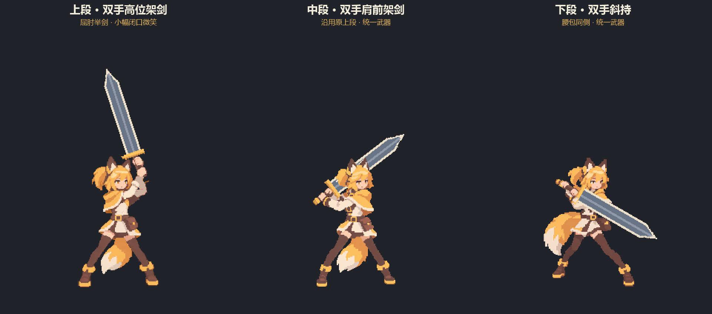

| 项目 | 当前设定 |
| --- | --- |
| 定位 | 暂称“狐耳剑士”；玩家操控的兽耳少女，当前外观为狐耳 |
| 性格 | 元气可爱，训练有素；平时轻快，出手时专注，收势后恢复放松 |
| 武器能力 | 人设上熟练使用各种武器；目前游戏可玩武器仍只有大剑 |
| 外观 | 琥珀色眼睛、金色短发与单侧马尾、棕色耳尖；单条金黄尾巴，末端奶油色 |
| 服装 | 暖黄短披肩、奶油色长袖旅行装、棕色腰带和腿部服装、黄边靴；腰包统一在画面右侧 |
| 表情 | 小幅闭口微笑；上段静帧嘴宽两像素，待机保留短眨眼 |
| 大剑 | 灰蓝剑面、浅色刃缘与中脊、金色直护手、棕色剑柄；三段采用同一武器母版 |
| 画风 | 连贯的大像素色块、少量明确明暗；不加连续黑描边，不用整图减色修视频 |
| 头顶 | 头发连成整块并遮住耳根下缘，耳旁不加碎发或深色竖块 |
| 剧情 | 年龄、身世和人物关系尚未确定 |

## 动作

**工程约定：跳跃只展示完整动作。** 三段待机、持剑移动、各架势单次普攻、六向换势和三段独立跳跃已接入游戏，默认中段。跳跃基于各自行走姿势制作，保持持剑架势，起落节奏一致，移动中落地直接接回行走循环。旧 idle 动画条目已移除。

<!-- BEGIN GENERATED ACTIONS -->

| 动作 | GIF | 动作相关信息 |
| --- | --- | --- |
| 三段待机 | 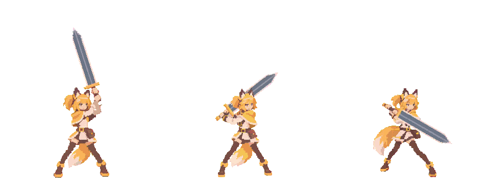 | 各 72 帧 · 24 fps · 3 秒循环 已加大肩部起伏与尾摆；保留眨眼，脚底不增加位移 |
| 三架势攻击 | 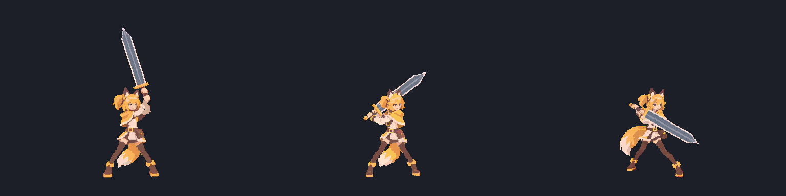 | 上段下劈 单次普攻 / 1.600 秒；中段横砍 单次普攻 / 1.380 秒；下段前刺 单次普攻 / 1.267 秒 点击左键执行完整攻击与收势 |
| 架势过渡 | 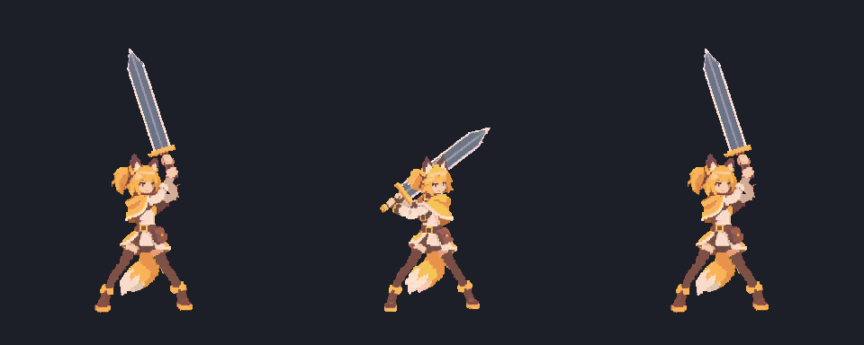 | 上↔中 7 帧 / 0.112 秒，中↔下及上↔下 10 帧 / 0.160 秒；均为 62.4 fps |
| 三段移动 | 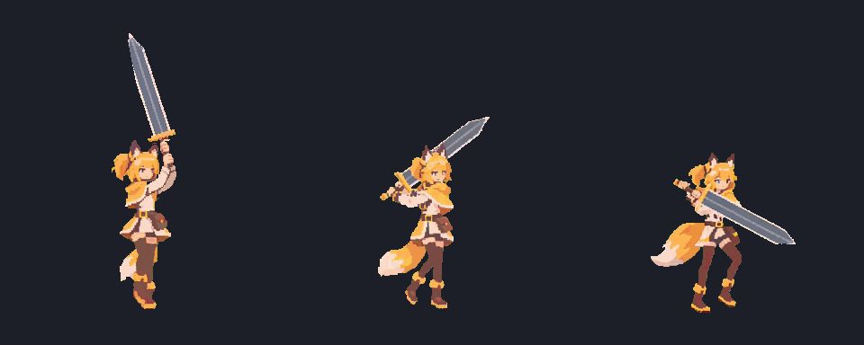 | 保留已确认的全部人物和剑像素，下段步频提高约 27%。上、中段循环各 36 帧 / 1 秒，起步各 12 帧 / 0.333 秒；下段 34 帧 / 1.1 秒。 |
| 三段完整跳跃 | 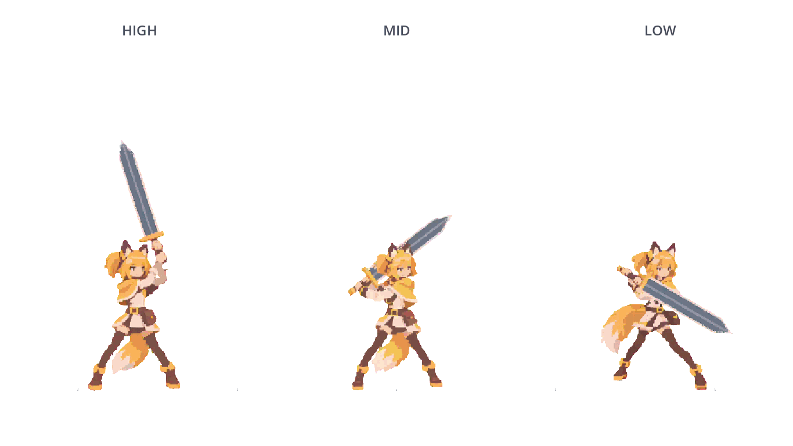 | 从各自行走姿势迈步蹬地，腾空收腿；保持持剑架势 80 毫秒预备，200 毫秒落地缓冲；移动中直接接回行走循环 |
| 受击 | 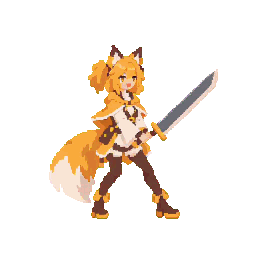 | 8 帧 · 20 fps · 0.4 秒 已有素材，当前玩家图未接入 |
| 倒地 |  | 16 帧 · 24 fps · 0.667 秒 已有素材，当前玩家图未接入 |

<!-- END GENERATED ACTIONS -->

### 动作相关信息

| 架势 | 最新待机 GIF | 姿势说明 |
| --- | --- | --- |
| 上段 | 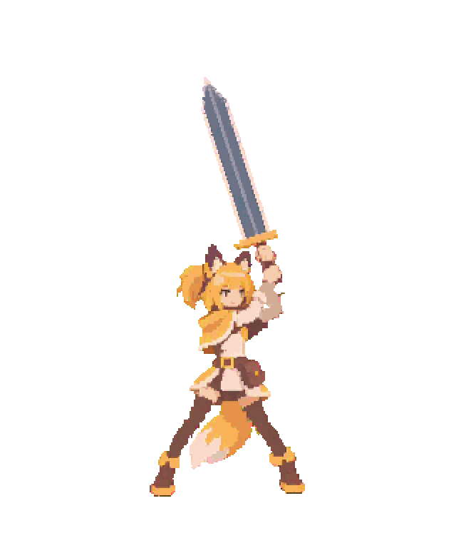 | 双手屈肘在额前高位架剑，剑尖向上略偏左。 |
| 中段 | 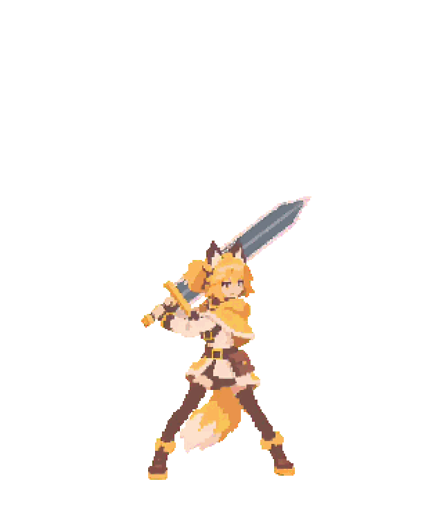 | 剑在脑袋后边、指向右上；Shift + 左键切入。 |
| 下段 | 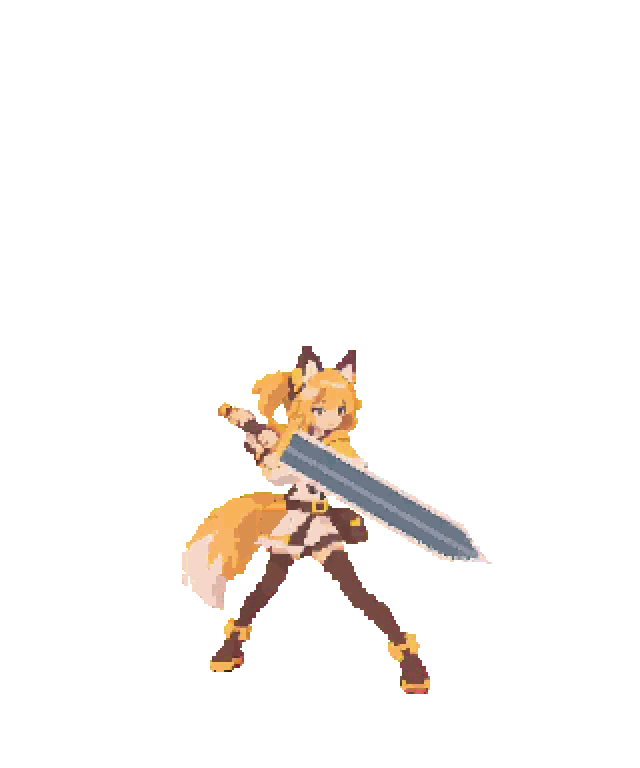 | 双手交叉斜持，剑尖朝右下；腰包位于画面右侧。 |

- **待机幅度**：沿用当前视频动作，在 Aseprite 中额外增加最多 2 个原生像素的上身起伏；头、肩、手和剑一起移动，胸部不单独鼓起。尾尖额外增加上段左右各 5 像素、中下段各 3 像素的弯摆；中下段叠加原有摆动后约左右各 6 像素。尾根不增加横移，尾摆峰值滞后呼吸 9 帧。
- **节奏与对齐**：三段均为 72 帧、24 fps、3 秒循环，共 216 帧。画布 320×384，脚底锚点 (160,347)；人物比例不变，脚底不增加位移。
- **持剑移动**：当前 v13 沿用 v12 的全部人物和剑像素，将下段循环从 1.4 秒缩短到 1.1 秒，步频提高约 27%。上段双手握在连续剑柄上，前后臂的袖口与手腕相连；采用已确认待机的剑刃和护手，随双手及肩部整体起伏。局部握剑基准由 imagegen 修正，再由 Aseprite 应用到原 ComfyUI 序列。上、中段循环各 36 帧 / 36 fps / 1 秒，起步各 12 帧 / 0.333 秒；下段 34 帧 / 30.909091 fps / 1.1 秒。

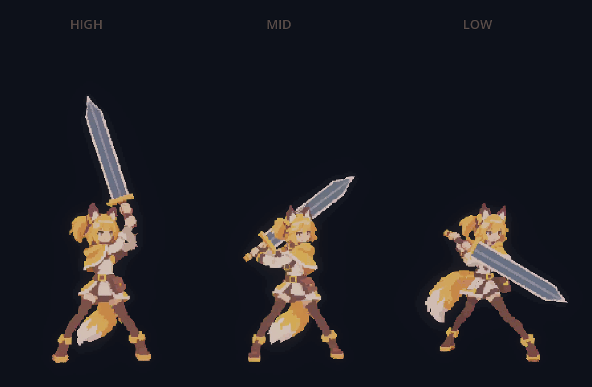

共 130 帧。上段 48 帧已逐帧检查双手、袖口、握柄和肩部衔接；腰胯、腿脚从 y=245 起与 v11 逐像素一致，五官局部也未变化。中、下段及中段起步 PNG 与 v11 逐文件一致。上段原视频对比保留有意修改造成的颜色差异，另有修补层和未修改区域的精确核验。该版本仍是序列帧，握剑部分作为一组稳定形状运动，没有增加独立肘关节动画。

v12 已通过构建和完整武器/架势玩法检查。v13 只调整下段播放时间，已核对全部 130 张交付帧及图集与 v12 一致，并完成 Godot 导入帧率、像素检查和实际录制。步频调整时未重复构建与完整玩法检查；本次接入三段攻击后已重新通过构建及完整检查。v11 的退出访问异常尚未确认修复。检查摘要见[视觉复核记录](../../assets/resources/sprites/amber_fox_style_v2/greatsword_stance_movement/visual-review.json)。

- **单次攻击 v27**：修正上段下砸后的反复晃动，使用原角色全身一致的站定收势，让承重、收肘和慢抬剑连在一起。撤下 v26 的上下身拼接及逐帧水平补偿；钢刃继续沿用原待机母版。下劈进身仍在 0.300–0.375 秒完成约 0.20 米，触地后停在落点。三招各 64 帧，上段 1.600 秒、中段 1.380 秒、下段 1.267 秒，中下段沿用。参见[逐帧参考与取舍](../art/greatsword-attack-references.md)。

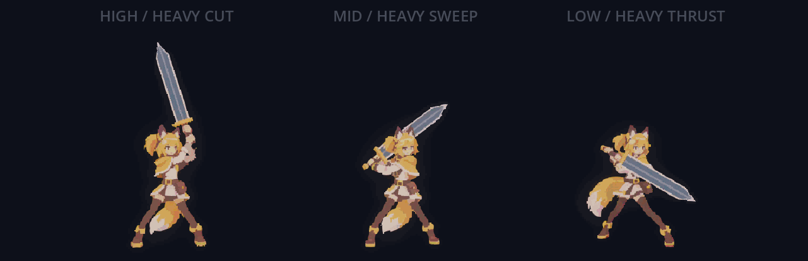

每次点击仍播放完整攻击与收势，共 192 张交付帧和 192 个 Godot 播放条目。上段 23–62 帧复用原人物的完整站定动作，身体、头肩、双手和腿部来自同一姿势，不再分段拼接；在 Aseprite 内统一这 40 帧的钢刃，保持原握柄与遮挡。其余 152 帧与 v26 一致，末帧精确接原待机。实际位移仍通过 CharacterBody3D 碰撞执行，触点之后保持落点。

上段 40 张、中段 31 张回收帧在 Aseprite 中使用原待机的同一钢刃修整，按各帧护手位置和方向连接，去除弯折、骤然伸缩及残留的双重轮廓；中段保留转刃和遮挡形成的合理投影变化。头脸、服装、双手和护手沿用原角色动作来源，没有贴静态脸或整图减色。详见[像素修正记录](../../assets/resources/sprites/amber_fox_style_v2/greatsword_stance_attack/pixel-corrections.json)。

已核对全部 192 帧的原始素材、逐像素修整记录、独立 Aseprite 导出、图集、APNG 和 Godot 导入，并录制左右朝向各两次实际攻击。诊断确认 v26 下砸后的世界坐标不变，抖动来自图内上身起伏；修正后 23–38 帧头部固定区域的最大相邻质心跳变由约 9.44 降到 1.41 原生像素。该值仅用于定位画面跳变，不能代替动作观感或人体结构评价。v27 通过构建、素材检查和实际播放核对；本次接入三段跳跃后，重新通过完整武器/架势、攻击位移、碰墙与取消回归检查。详见[动作复核记录](../../assets/resources/sprites/amber_fox_style_v2/greatsword_stance_attack/visual-review.json)。

**武器攻击特效**：按最新要求全部移除，三架势普攻仅播放人物与剑的完整动画。已删除 Timeline 刀光片段、取消动作、轨迹资源、专用粒子场景及播放代码；换势周身粒子继续沿用。

- **三段完整跳跃 v2**：基于现用行走帧分别重做，上、中段各 30 帧，下段 28 帧；保留窄步态与前后脚关系，迈步蹬地、腾空收腿、落地顺势继续走，各自保持原架势持剑。完整美术时序均为 0.780 秒，包含 80 毫秒预备和 200 毫秒落地缓冲。持续移动时落地直接进入行走循环；停止移动时仍回到对应待机。物理跳高实测约 0.519 米，准备期间松键的短跳约 0.114 米。全程保留左右、前后及斜向平移，空中阶段随实际速度和触地状态切换。预览录制了向右及向左的“行走→跳跃→行走”，GIF 时长不等于腾空时间。详见[制作与接入记录](../art/protagonist-jump.md)。
- **普攻执行**：角色图用一个武器注册节点展开三套架势 Ability；左键入口、完整攻击动画由技能图管理。每次普攻只有一个 Timeline 和一个 Return，不打开续招窗口；期间限制移动和跳跃，换势请求等完整收势后执行。通用连招窗口与分支继续保留，并由内存图回归检查覆盖。伤害和命中判定尚未接入。
- **架势切换**：恢复 Shift + 滚轮上／左键／滚轮下直选上／中／下段；普通左键普攻。手柄换势节点与专用输入绑定已暂时移除。换势完成后进入目标待机，地面短暂站稳，跳跃和技能中排队；连续输入只执行最后一个目标，无额外冷却。实际换势开始时播放 0.32 秒周身细小金色粒子，贴近身体微微上飘并淡出。不加入残心、精力或属性相性。详见[架势切换](../gameplay/combat-stances.md)。
- **过渡资源**：使用三条动作正反向覆盖六个方向；与 idle 同为 320×384、脚底 (160,347)。[资源及源帧记录](../../assets/resources/sprites/amber_fox_style_v2/greatsword_stance_transition/manifest.json)。
- **其他能力**：仅装备大剑，冲刺已移除；三段持剑移动已接入，四向朝向仍暂缓。

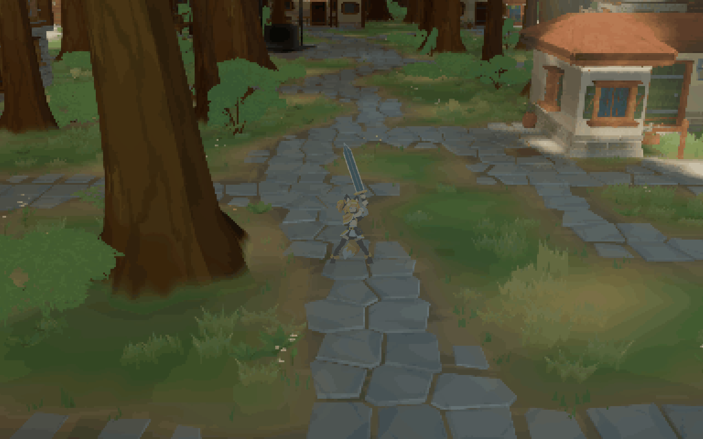

**粒子与像素后处理**：外置 CPUParticles3D 通过深度匹配保留小粒子亮芯，不再被大像素采样吞掉；仍受场景遮挡、调色与泛光影响。预览为 Forward+ 森林镜头，按固定 60 fps 录制。渲染验证包含 MSAA、像素滤镜和前景墙遮挡，详见[后处理](../rendering/relink-post.md)。

**脚下接触阴影**：玩家由 `CharacterContactShadowComponent3D` 控制原生 Decal，通过排除自身碰撞体的向下射线贴合地面。站立尺寸约 1.1×0.72 米、强度 0.65；随离地高度扩大并淡出，1.8 米后或下方无地面时隐藏。人物左右翻转不翻转阴影，地面法线控制倾斜，保留原有日月投影。已在完整村庄验证站立、移动、起跳与落地，树荫下也能辨认落地点。

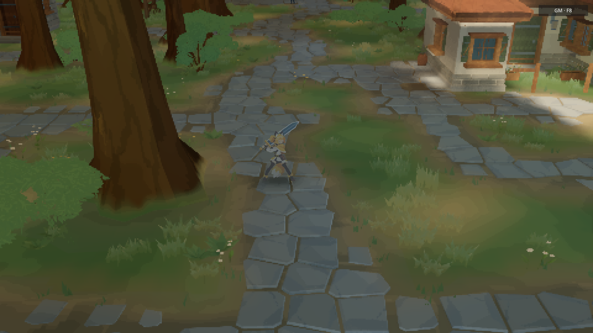

**一致性复核**：已重看三组过渡共 27 张正向帧，人物服装、发色、尾巴、腰包与大剑设计一致；原上↔中剑刃孔洞、细线问题未复现。六向共 54 帧通过导入逐像素校验，首尾与对应 idle 首帧完全一致；中间帧仍有透视和细微轮廓变化。粒子使用独立特效场景，不改人物与剑的贴图或精灵材质。

当前制作资源

| 架势 | 可编辑动画 | 无损预览 |
| --- | --- | --- |
| 上段 | [Aseprite](../../assets/textures/sprites/amber_fox_style_v2/greatsword_stance_idle/high/sources/idle.aseprite) | [APNG](../../assets/textures/sprites/amber_fox_style_v2/greatsword_stance_idle/high/idle.apng) |
| 中段 | [Aseprite](../../assets/textures/sprites/amber_fox_style_v2/greatsword_stance_idle/mid/sources/idle.aseprite) | [APNG](../../assets/textures/sprites/amber_fox_style_v2/greatsword_stance_idle/mid/idle.apng) |
| 下段 | [Aseprite](../../assets/textures/sprites/amber_fox_style_v2/greatsword_stance_idle/low/sources/idle.aseprite) | [APNG](../../assets/textures/sprites/amber_fox_style_v2/greatsword_stance_idle/low/idle.apng) |

- [三段静帧源文件](../../assets/textures/sprites/amber_fox_style_v2/greatsword_stance_idle/sources/stances.aseprite) · [武器母版](../../assets/textures/sprites/amber_fox_style_v2/greatsword_stance_idle/sources/greatsword-master.aseprite)。各架势目录保留透明 PNG 序列、图集及实际使用的制作基准 `source.aseprite`。
- [三段待机 Godot 资源](../../assets/resources/sprites/amber_fox_style_v2/greatsword_stance_idle/sprite_frames.tres) · [幅度参数](../../assets/resources/sprites/amber_fox_style_v2/greatsword_stance_idle/motion.json) · [制作清单](../../assets/resources/sprites/amber_fox_style_v2/greatsword_stance_idle/manifest.json)。仅包含 `idle_high`、`idle_mid`、`idle_low`。
- [选定视频、输入、工作流和种子](../../assets/resources/sprites/amber_fox_style_v2/greatsword_stance_idle/sources.json) · [中文制作说明](../art/prompts/protagonist-idle.prompt.txt) · [待机核验脚本](../../scripts/tools/art/validate_protagonist_idle.gd)。PNG/APNG 为像素基准，GIF 仅供观看；自动检查未包含独立全轮廓标注，临时报告输出到 `.godot/art-validation/greatsword_stance_idle/`。
- [基础备用动作](../../assets/resources/sprites/amber_fox_style_v2/greatsword_v4/sprite_frames.tres) · [大剑配置](../../assets/resources/weapons/greatsword_animation.tres)。基础备用动作为 256×256、脚底 (128,219)；现用三段攻击与新跳跃均为 512×384、脚底 (256,347)，与 idle、移动及过渡按脚底对齐。
- [三段移动资源与帧映射](../../assets/resources/sprites/amber_fox_style_v2/greatsword_stance_movement/manifest.json) · [当前资源目录](../../assets/textures/sprites/amber_fox_style_v2/greatsword_stance_movement/) · [制作配置](../../assets/resources/sprites/amber_fox_style_v2/greatsword_stance_movement/production.json)。v13：上、中段起步均为 0–11、循环 12–47；下段沿用 17–50，只调整帧率。帧号从 0 开始，起步与对应循环直接连续。
- [移动核验脚本](../../scripts/tools/art/validate_stance_movement.gd) · [人物复核](../../assets/resources/sprites/amber_fox_style_v2/greatsword_stance_movement/visual-review.json)。每段保留原始 RGB、透明 PNG、无损 APNG、Aseprite、精简全帧对照和核验摘要；工作流、提示词、种子与原视频已归档，原始检查报告输出到 `.godot/art-validation/greatsword_stance_movement/`。上段另有握剑修补层和逐帧位移配置。
- [三段攻击资源与帧映射](../../assets/resources/sprites/amber_fox_style_v2/greatsword_stance_attack/manifest.json) · [制作配置、视频及种子](../../assets/resources/sprites/amber_fox_style_v2/greatsword_stance_attack/production.json) · [逐帧复核](../../assets/resources/sprites/amber_fox_style_v2/greatsword_stance_attack/visual-review.json)。各段保留原视频、推理输入、工作流、透明 PNG、APNG、Aseprite 和全帧对照。
- [三段跳跃资源与帧映射](../../assets/resources/sprites/amber_fox_style_v2/greatsword_jump/manifest.json) · [制作配置、视频及种子](../../assets/resources/sprites/amber_fox_style_v2/greatsword_jump/production.json) · [逐帧与实机复核](../../assets/resources/sprites/amber_fox_style_v2/greatsword_jump/visual-review.json)。各段保留可编辑 Aseprite、独立 RGBA 导出、透明 PNG、图集、完整 APNG 和原视频；自动报告保存在 `.godot/art-validation/greatsword_jump/`。
- 后续修改同步本页图片、GIF 和参数。[动作表同步工具](../../scripts/tools/art/export_protagonist_docs.lua)只更新上方自动生成区，保留用户添加的需求。

### 新需求与状态

- **架势参考，候选已整理、尚未重制**：优先找与现用上段额前高举、中段肩后斜架、下段胸前交叉斜持相近的动作。已整理 [10 组 Bilibili 参考及具体分集](../art/greatsword-attack-references.md#下一轮架势参考候选2026-11-18)，附主角三段设定和两张带来源、时间点的参考截图，分别标注轮廓差异与核验程度，尚未完成整段逐帧分析。
- **骨骼来源，允许离线转帧**：用户允许寻找骨骼动画参考，再调整、渲染成序列帧；游戏内沿用序列帧方案。已取消的实时骨骼迁移不作为当前制作方向。
- **战斗系统，方案阶段**：上、中、下段为核心，关卡中放置木桩验证战斗；切到任意另一段均可按时机弹反。切段间隔可加长，攻击后摇完整结束才能切段，允许配套调整动画。当前先做参考研究，木桩、伤害和弹反尚未接入。
- **跳跃改为行走基础，已接入**：“我希望跳跃是在行走的基础上做，不是战力”——按上下文理解为“不是站立”。三段以现用行走帧重新制作，从前后脚步态迈步蹬地，落地后直接接回行走循环。
- **跳跃重做，已接入**：“跳跃需要做个新的”——用户选择“轻快自然：小幅屈膝蓄力、腾空收腿、落地缓冲”和“三段分别制作：跳跃节奏一致，各自保持原架势持剑”。已制作三套完整跳跃，保留当前人物、大剑和各自架势，接入真实起落时序。
- **攻击已确认**：“可以了”——采用上方 v27。保持各 64 帧、快下劈慢提架、中段向前横砍及惯性收势；前移发生在下劈中，触地停步，身体与剑连贯一致。
- **项目清理**：“清理一下项目里的过时文档，提示词，资源”——清理已被替换的预览、输入关键图、工作流与旧参数，保留现用资源、重建来源和未处理需求。
- **暂缓，保留原始需求**：“按 idle 的人设重新生成跑步动画，这次跑步时步幅别那么大，偏慢跑”，随后“算了，你先别生成”；四向朝向保留斜向移动的方案也暂缓。
- **尚未接入**：受击、倒地与伤害/命中判定；年龄、身世和人物关系尚未确定。
- **仍需跟踪**：移动 v11 的退出访问异常尚未确认修复。保存崩溃的已完成修复与另一原生文档扫描异常见[排查记录](../tools/godot-save-crash-2026-11-08.md)。

> 可直接在这里追加主角需求，或引用上方 GIF 指出要调整的位置。已完成的旧迭代反馈归并为当前参数，不再作为并行制作要求。

### 改动记录

| 日期 | 当前有效改动 |
| --- | --- |
| 2026-11-18 | 整理与现有三段轮廓相近的 Bilibili 候选与参考配图，记录骨骼源离线转帧许可及战斗系统需求；现用动画仍为 v27 |
| 2026-11-15 | 三段跳跃 v2 改用行走姿势重做，共 88 帧；移动中落地直接接行走循环，完成左右朝向实际录制、导入与武器/架势回归检查 |
| 2026-11-15 | 三段独立跳跃首次接入：80 毫秒预备、腾空收腿、200 毫秒落地缓冲；支持短跳、移动跳跃和换势排队；素材现已由 v2 替换 |
| 2026-11-15 | 确认攻击 v27：上段使用全身一致的站定收势，修正下砸后晃动；下劈进身、触地停步，各 64 帧；清理旧版文档、提示词与资源 |
| 2026-11-09 | 移动 v13：三分之四朝向、小幅腰肩扭转，修正上段握剑；下段循环 34 帧 / 1.1 秒 |
| 2026-11-08 | 三段待机、六向过渡、仁王式直选与外置周身粒子接入；人物及武器母版统一，待机增加呼吸和尾摆 |
| 2026-11-07 | 主角仅使用大剑，移除冲刺；跳高约 0.6 米，全程保留平移；人物档案统一到本页 |
