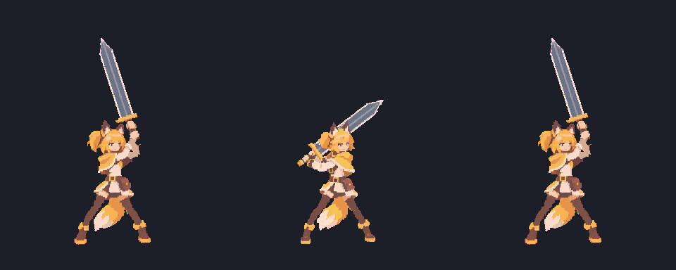
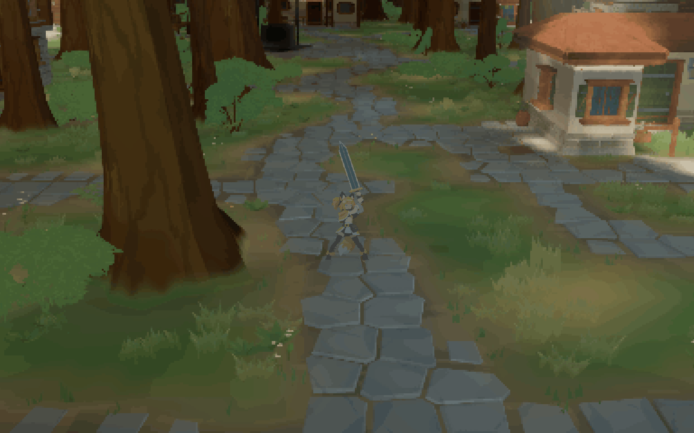
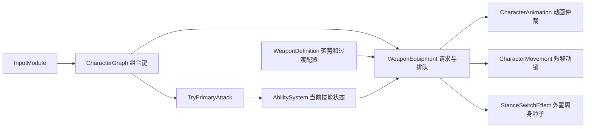

# 大剑架势切换

更新：2026-11-09。当前实现上、中、下段切换、三段待机、持剑移动、各段一招普攻与六向过渡。默认中段；旧 `idle` 动画条目已移除。残心、精力、属性相性、石火和连招不在本轮范围。

## 操作

| 架势 | 键鼠 | PlayStation | Xbox |
| --- | --- | --- | --- |
| 上段 | Shift + 滚轮上 | R1 + △ | RB + Y |
| 中段 | Shift + 左键 | R1 + □ | RB + X |
| 下段 | Shift + 滚轮下 | R1 + × | RB + A |

按最新要求恢复仁王式三段直选。Shift + 左键只切中段，普通左键普攻；未按 Shift 时滚轮不切架势。

InputMap 按滚轮事件发生时的 Shift 状态判断，立即松开 Shift 也不会丢失换势。手柄保留[《仁王2》官方操作表](https://www.gamecity.ne.jp/manual/t2wNiSht/steam/usa/2020.html)的三段直选，经独立节点检查 R1/RB；此处仅配置架势组合键。

## 动作和时序

预览从左到右为上↔中、中↔下、上↔下。三个方向使用首尾姿势约束生成的收剑、抬剑动作，反向按相反帧序播放，共六条切换边。播放速度在 48 fps 的基础上再提高 1.3 倍，为 62.4 fps；上↔中四张中间帧只修正剑刃，保留人物和握持姿势。

| 架势对 | 帧数 | 帧率 | 切换时长 |
| --- | --- | --- | --- |
| 上↔中 | 7 | 62.4 fps | 0.112 秒 |
| 中↔下 | 10 | 62.4 fps | 0.160 秒 |
| 上↔下 | 10 | 62.4 fps | 0.160 秒 |

- `CurrentStance` 在过渡播放结束后提交。过渡期间 `TransitionTarget` 记录正在前往的架势，`PendingStance` 只保留最后一次选择；回选原架势会在当前过渡完成后回切。
- 不增加切换冷却。连续输入只等当前过渡完成，就执行最后一次目标；用户曾提出的 0.3 秒冷却已取消。
- 重选当前静止架势不会重播 idle。重选正在前往的架势会清除后续排队。
- 地面换势短暂限制移动、跳跃和武器普攻，使脚底站稳。空中输入等待落地，继续保留现有跳跃过程。
- Ability 运行期间排队，技能结束后开始过渡。技能被取消时清除排队；由其他入口启动的能力优先，终止过渡并释放移动锁。
- 切换不重新授予技能、不重建 AbilityRuntime，也不修改普攻冷却。
- 读档和初始装备直接恢复对应 idle，不播放过渡。中途存档只保存已完成的当前架势；不保存动画进度、排队和移动锁。

### 周身粒子特效

每次实际开始换势时，在贴近头、肩、腰和腿的位置发出 18 个金色亮芯粒子，约 0.32 秒内微微上飘并淡出。没有大光圈、全身染色或轮廓闪光。连续换势会重启这一小撮粒子；重选当前架势、初始化与读档不触发。该时长只控制视觉，移动和攻击仍在过渡动作结束时恢复。

特效是独立的 [stance_switch_particles.tscn](../../assets/scenes/vfx/stance_switch_particles.tscn)，由 EC 组件实例化并触发原生 CPUParticles3D，跟随角色位置。它不采样角色动画、不修改精灵材质；结束、读档、换武器及对象池回收时停止和清理。发射点分布、数量、尺寸、颜色和速度可直接在特效场景里调节。

粒子在 Relink 中保留细节，避免被森林的 3×3 / 4×4 像素合并吞掉亮芯；继续参与电影曲线、泛光和场景遮挡。预览使用 Forward+、场景 MSAA 和真实后处理；录制使用 `--fixed-fps 60`，避免截图耗时把 0.32 秒特效跳过去。`-- --forest-capture` 使用森林场景和原生相机，仅生成预览；不加该参数运行玩法检查。

## Weapon 与 Skill/Ability 接线

- [WeaponDefinition](../../scripts/gamelogic/weapons/WeaponDefinition.cs)：`DefaultStance`、`StanceIdleAnimations`、`StanceMoveAnimations`、`StancePrimaryAttacks`、`StanceTransitions`，转移键形如 `high>mid`。配置了过渡时，所有架势对必须有非循环动画；配置了移动映射时，必须覆盖所有架势并引用循环动作。
- [WeaponEquipmentComponent3D](../../scripts/gamelogic/weapons/WeaponEquipmentComponent3D.cs)：每个角色拥有独立状态；键鼠、手柄与 AI 都通过 `RequestStance(string)` 直选。过渡使用动画请求优先级 50，现有技能动画为 100；用 `AnimationFinished` 提交架势，避免硬编码延时。`StanceSwitchStarted` 在实际播放开始时通知特效。
- [StanceSwitchEffectComponent3D](../../scripts/gamelogic/weapons/StanceSwitchEffectComponent3D.cs) 与 [粒子 Shader](../../assets/shaders/vfx/stance_switch_particle.gdshader)：前者触发独立特效场景，后者只绘制小菱形粒子；不增加冷却或技能状态。
- [WeaponAnimationProfile](../../scripts/gamelogic/weapons/WeaponAnimationProfile.cs)：按装备实例合成基础动作、三段 idle、`ActionFrames` 移动集、`AttackFrames` 攻击集和过渡帧；共享资源保持只读。每个动画按实际画布和脚底锚点对齐。
- [CharacterAnimationInstance](../../scripts/gamelogic/character/animation/CharacterAnimationInstance.cs)：把逻辑 `idle` 和 `run` 分别映射到当前武器架势的 `idle_high/mid/low` 与 `run_high/mid/low`，沿用既有 HFSM 和动画仲裁。武器可用 `StanceMoveStartAnimations` 为部分架势指定一次性起步片段；上、中段先播 `run_start_high/mid`，完成后进入循环，连续移动不重复转身。起步使用原移动请求的优先级，可以被停止、跳跃和技能打断，不增加移动控制锁。移动中换势结束后按目标架势起步，松键回到对应待机。
- [大剑配置](../../assets/resources/weapons/greatsword.tres)通过 `StancePrimaryAttacks` 映射三招独立能力：上段 `greatsword_attack_high` 下劈（0.680 秒）、中段 `greatsword_attack` 横扫（0.540 秒）、下段 `greatsword_attack_low` 前刺（0.474 秒）。`CurrentPrimaryAttack` 在普通左键时选择已完成架势的能力；各技能一次授予，时间轴播放同名架势动画。冷却等于完整动作时间，收招后可再次使用；切换不重置运行时与冷却。未配置映射的武器回退到 `PrimaryAttack`。

## 资源与保存

三段 idle 各 72 帧、24 fps、3 秒循环。Idle、持剑移动和换势统一为 320×384、脚底 (160,347)；基础备用跑步、跳跃和攻击仍为 256×256、脚底 (128,219)，由动画配置计算显示偏移。三段攻击扩宽为 512×384、脚底 (256,347)，人物尺度不变。移动资源和步法参考见[主角动作](../characters/protagonist.md)与[双手大剑参考](../art/greatsword-movement-references.md)。

- [过渡 SpriteFrames](../../assets/resources/sprites/amber_fox_style_v2/greatsword_stance_transition/sprite_frames.tres)
- [攻击 SpriteFrames](../../assets/resources/sprites/amber_fox_style_v2/greatsword_stance_attack/sprite_frames.tres) · [双手大剑攻击参考](../art/greatsword-attack-references.md)
- [移动 SpriteFrames](../../assets/resources/sprites/amber_fox_style_v2/greatsword_stance_movement/sprite_frames.tres) · [移动帧映射及来源](../../assets/resources/sprites/amber_fox_style_v2/greatsword_stance_movement/manifest.json)
- [源视频、工作流、帧映射和检查范围](../../assets/resources/sprites/amber_fox_style_v2/greatsword_stance_transition/manifest.json)
- [Aseprite 封装工具](../../scripts/tools/art/build_stance_transitions.lua)
- [主角动作与未完成需求](../characters/protagonist.md)

角色存档的 `equipment.stance` 为可选字符串；旧档缺失或不支持的值回退到武器默认架势。装备格式仍为 `loadout_version = 1`，角色分区格式仍为第 5 版。

## 验证

`dotnet build yu.csproj`；通过 Godot 运行 [weapon_stances.tscn](../../assets/scenes/tests/weapon_stances.tscn)。集成检查覆盖键鼠与手柄直选、同帧按下/松开、立即松开 Shift、中段输入不误触攻击、UI 消费、攻击排队与技能冷却、无额外换势冷却、六向过渡、空中排队、读档、双角色隔离、对象池重生、脚底锚点、精灵材质保持原样及独立特效清理。`-- --capture`、`-- --forest-capture` 和 `-- --attack-capture` 是独立录制模式，跳过玩法集成检查；不要把录制通过当作玩法检查通过。

攻击 v4 覆盖三招、左右两向的刀光发射、准备阶段不发光、攻击中不转身、前方粒子坐标、取消与收招清理，以及角色间粒子池隔离和回收后不重复创建。`-- --attack-capture --left-facing` 录制左向效果；当前文档 GIF 先展示右向，再展示左向，使用实际 Godot 粒子与像素后处理。73 张攻击帧的颜色、alpha、非循环标记、逐帧时间、蓄力与顿帧区间由[攻击导入检查](../../scripts/tools/art/validate_stance_attacks.gd)核对。

当前 v13 保留 v12 的步法、轻微身体扭转及上段握剑修正，仅加快下段步频。上、中段步行各 36 帧 / 36 fps / 1 秒，起步各 12 帧 / 0.333 秒；下段 34 帧 / 30.909091 fps / 1.1 秒，比原来 1.4 秒提高约 27%。本轮[移动导入检查](../../scripts/tools/art/validate_stance_movement.gd)核对全部 130 帧的不透明 RGB、alpha、帧率及循环标记。v12 已通过构建及完整武器/架势玩法检查，包含一次性起步、停止后重启、高优先级打断、输入、保存和实例隔离；该步频调整本身未改代码；随后接入三段攻击时已重新运行并通过完整玩法检查。

移动录制以固定 30 fps 展示 5 秒待机、起步、持续移动和停止，不替代玩法检查。v13 重新录制以展示下段新步频。v11 曾在断言通过后于 GodotObject.Dispose/Finalize 出现 0xC0000005；此前保存场景或退出异常尚未确认完全修复。

本轮重看了三组图集的全部 27 张正向帧；人物的发色、服装、腰包、单尾及剑的灰蓝剑身、金色护手保持同一设计，没有再发现原上↔中剑刃的孔洞或细线问题。六向共 54 帧通过导入逐像素核验，每个方向的起止帧与对应 idle 首帧完全一致。中间帧仍有动作带来的透视与细微轮廓变化；这些检查不等于逐像素人体或刚性武器标注。

## 后续范围

已参考《仁王2》大太刀和《浪人崛起》大剑演示，完成三段移动与各段一招普攻；新攻击按实际动作独立定时。目前不实现残心、闪刃、属性克制、精力、石火、命中伤害、连招或转势攻击。当前切换仍由武器组件管理，不新建平行 Skill 执行系统。
