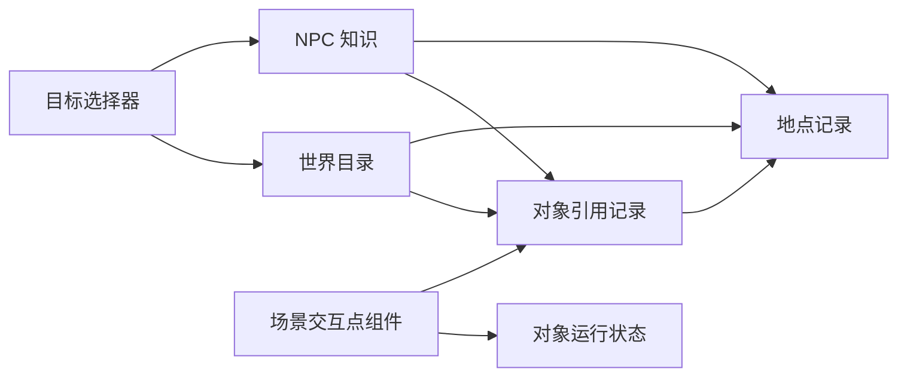

# NPC 跨关卡地点与对象引用规划

日期：2026-10-19  
状态：规划草案，尚未实施。

NPC 需要在多个关卡之间认识地点、引用对象并安排活动。为此，拟建立项目级世界目录，供编辑器按名称选择地点和对象；场景中的交互点组件绑定目录记录，在关卡加载后提供实际位置和交互能力。

跨关卡对象的身份应当独立于场景加载状态。场景读取可用于登记和校验摆放信息，AI 配置的引用来源则统一为世界目录。本规划先解决引用和知识，再处理跨关卡行走与离屏活动。

## 当前实现与限制

当前行为与配置方式见 [NPC 图配置与运行指南](NPC_GRAPH_GUIDE.md)。相关入口如下。

| 入口 | 当前职责 |
| --- | --- |
| [NpcPerceptionDefinition](definitions/NpcPerceptionDefinition.cs) | `PointTags` 和 `KnownPointIds` 均为字符串数组，将感知参数与初始已知地点放在同一资源中 |
| [AiInteractionPointComponent3D](runtime/AiInteractionPointComponent3D.cs) | 在场景中定义 `PointId`、显示名称、标签及实际交互能力；未填写 `PointId` 时使用宿主的 `PersistentId` |
| [AiWorldComponent3D](runtime/AiWorldComponent3D.cs) | 在 `Points` 中登记已加载的交互点组件，按 ID 查询并保存交互点状态 |
| [AiAgentComponent3D](runtime/AiAgentComponent3D.cs) | 感知时遍历当前登记的交互点；已知 ID 可以绕过距离和视线判断，但仍经过感知标签过滤 |
| [NpcPointBindingAdapter](runtime/NpcBindingAdapters.cs) | 从当前登记的组件获取候选、库存、占用、距离和可达性；执行验证要求实际组件存在 |

因此，在 `KnownPointIds` 中加入另一个关卡的 ID，目前仍无法获得该关卡中尚未加载的对象。只将输入框改成当前场景下拉菜单，可以改善填写体验，但不能解决跨关卡引用。

当前已知地点也会被加入感知结果。后续需要明确区分“知道对象存在”和“正在观察对象”，迁移时应检查既有目标选择器的行为。

## 天际的参考机制

以下概念来自《上古卷轴 V：天际》的 Creation Kit，作为本项目的设计参考。

### 数据记录与具体引用

天际的数据文件包含对象定义、对象摆放、地点和 AI 等记录。Base Object 表达一种对象，Reference 表达该对象在世界中的一次具体实例；同一种床可以有多张具体的床，各自具有独立的引用身份和摆放数据。游戏通过 FormID 识别记录，编辑器还提供 EditorID 和名称帮助查找。[数据文件说明](https://ck.uesp.net/wiki/Data_file)、[Reference 说明](https://ck.uesp.net/wiki/Reference)

本项目可借鉴这层区分：床的类型资源和 Resident 使用的某张床应有不同的身份。具体编号格式无需照搬 FormID，其运行时编号还涉及数据文件的加载顺序。

### 地点与空间分块

Location 是表达地点含义的记录，可以配置父地点、关键词、标记和 Location Ref Type，并关联多个 Cell 与角色。Cell 则组织具体空间。Location 并不要求与一个空间分块一一对应。[Location 文档](https://ck.uesp.net/w/index.php?title=Location&mobileaction=toggle_view_desktop)

对应到本项目，一个城镇可以包含街道关卡和多个室内关卡；一间酒馆可以有自己的地点记录，并归属于该城镇。对地点层级的查询不应依赖当前场景树的父子关系。

### 行为目标与别名

Creation Kit 的 Alias 是一个可绑定对象或地点的具名槽位。它既可以指定具体引用，也可以在任务启动时根据条件填写。全世界查找引用仍有边界：未加载区域中的普通引用，并非都能被任意查询找到。[Quest Alias 文档](https://ck.uesp.net/wiki/Quest_Alias_Tab)

Bethesda 的 Radiant Quest 教程演示了先筛选“有首领的强盗营地”，再将该地点的首领绑定为任务目标。行为因此可以复用到不同地点和对象。[Radiant Quests 教程](https://ck.uesp.net/wiki/Bethesda_Tutorial_Radiant_Quests)

本项目已经有目标选择器和计划变量，可以在这些机制上接入世界目录，优先复用现有的候选查询与本次计划绑定。

### 引用保留与区域连接

天际通常只将附近的普通引用保留在内存中，需要远程访问的引用可使用持久化机制。持久化有实际内存和处理成本，不应据此推导出所有世界对象都必须常驻。[持久化说明](https://ck.uesp.net/wiki/Persistence_(Creation_Kit))

它的门可以通过 Teleport 数据连接到世界中的另一个门，并配置角色经过后出现的位置。这提供了区域之间连接的明确数据。[门的 Teleport 配置](https://ck.uesp.net/wiki/Reference#Teleport)

## 拟议的数据分层

世界目录只登记需要被 AI、任务或存档长期引用的地点与对象。普通装饰物可以继续由场景直接管理。

| 层次 | 主要内容 | 生命周期 |
| --- | --- | --- |
| 地点定义 | 名称、自动生成的稳定 ID、父地点、地点标签、关联关卡 | 独立于关卡是否加载 |
| 世界对象引用 | 具体对象的稳定 ID、名称、对象类型、所属地点、静态标签、摆放归属 | 独立于实际场景节点 |
| 世界目录 | 地点与对象记录的查询索引，以及记录与关卡的关联 | 可在编辑器和运行时查询 |
| 世界对象状态 | 库存、开放状态、销毁状态等需要持续保存的变化 | 按对象 ID 保存 |
| 场景交互点组件 | 绑定世界对象引用，提供实际位置、导航落点和现场交互能力 | 随关卡加载和卸载 |
| NPC 知识 | 初始已知地点和对象、运行时发现、最后观测及其时间 | 每个 NPC 独立保存 |

静态信息应有一个明确的编辑来源。例如所属地点与静态标签由记录资源定义，场景组件引用它；目录索引可由这些记录生成，避免记录与组件各保存一份可独立修改的静态标签。

具体 Resource 与服务的类名留待实施时确定。场景中的执行能力继续遵循现有 GameObject 和 Component 结构。

## 标识与资源引用

每个地点和具体对象使用自动生成并持久保存的 ID。显示名称、场景节点名称和节点路径均可以变化，存档与 AI 引用仍通过稳定身份解析。

编辑器优先提供类型明确的资源选择或搜索入口，底层 ID 由系统维护。记录只需保存关卡的资源标识和摆放关联；AI 图引用记录时，不应因此递归加载所有目标关卡。

复制一个具体对象放置到世界中时，默认生成新的对象身份；让另一个组件代表同一个对象，则需要明确的绑定操作。对于同一场景被实例化为多个独立关卡的情况，需要在实施前确定是否采用“关卡实例身份与摆放身份”的组合。

已有 `PointId` 与存档键需要迁移映射。迁移应保留原引用关系，不能简单重新生成 ID 后丢弃旧存档中的对象状态。

## 编辑器配置方式

编辑 AI 图时明确选定所使用的世界目录。即使当前只打开 Resident 的独立角色场景，也可以搜索跨关卡记录。

已知地点和对象按地点路径显示，例如：

- 河畔镇 → 食物商店。
- 河畔镇 → 居民住宅 → Resident 的床。
- 北方城镇 → 旅店 → 客房休息点。

同名记录通过所属地点和对象类型区分。选择列表按字段支持的类型筛选；ID 可以作为诊断信息查看，正常配置流程无需手填。

标签从已登记的标签定义中选择。感知标签、地点标签和交互能力需要有清楚的用途说明，避免把“这是酒馆”和“这个对象能供人休息”混为同一条件。

场景读取可用于登记对象、检查绑定和定位实际节点。删除记录、缺少目录或关卡暂时不可用时，界面保留原引用并提示原因；不能静默清空配置，也不能因为同名而自动绑定另一个对象。

## NPC 知识与感知

项目中的 NPC 知识、现场感知和事件记忆拟按以下边界处理。

| 信息 | 示例 | 更新方式 |
| --- | --- | --- |
| 地点知识 | 知道北方城镇存在一家旅店 | 初始配置、探索、任务或交流 |
| 对象知识 | 知道自己家中的具体床铺 | 初始配置或发现对象 |
| 当前感知 | 现在能看到商店和门口的人 | 对已加载对象进行距离、视线等现场检测 |
| 最后观测 | 昨天下午看见商店有库存 | 带时间记录的历史信息，可失效 |
| 事件记忆 | 曾在旅店与某人交谈 | 使用现有事件记忆机制记录 |

世界目录收录一个对象，不会自动让所有 NPC 知道它。目标选择器需要明确候选来自已知地点、已知对象、当前感知，还是某种允许查询世界信息的业务规则。

知道地点也不代表知道该地点的所有对象，更不代表实时知道所有库存和占用情况。远处的动态数据必须说明来自权威模拟状态、最后观测，还是未知；未知库存不能自动当作零，未知占用也不能当作空闲。

角色初始知识配置与运行时新增知识分开保存。感知与知识的编辑入口可以拆分，实际字段迁移需与现有选择器的候选来源一起处理。

## 未加载对象的解析与执行

引用解析至少需要区分以下情况。

| 解析结果 | 可以做什么 |
| --- | --- |
| 已加载 | 取得现场组件，读取允许访问的实际状态并执行交互 |
| 未加载 | 查询静态地点与对象记录，并读取已有的持久状态或观测记录 |
| 已删除或销毁 | 保留对象身份与必要的历史状态，拒绝不再成立的交互 |
| 未找到记录 | 报告配置或存档引用失效，保留原始引用供修复 |

关卡卸载只解除记录与实际组件的绑定，不删除对象记录、NPC 知识或需要保存的状态。重新加载时，同一身份的组件重新绑定并恢复状态。

具体交互仍需验证实际组件、资源占用和当前条件。第一阶段不对未加载对象直接提交现场交互结果；未来如有远程交易或离屏活动，由相应的模拟规则明确授权和更新状态。

当前地点之间的三维直线距离不能直接用于不同关卡。未加载对象也不能用零坐标或零距离代替，避免 GOAP 将其错误地视为已到达或最低成本目标。

## 实施阶段

### 第一阶段 跨关卡引用与知识

1. 定义地点记录、具体对象引用与目录的资源结构，确定静态数据的编辑来源。
2. 提供名称搜索、地点层级选择和标签选择，支持在独立 NPC 图中配置。
3. 为现有交互点建立记录与迁移映射，保留现有身份关系和存档状态。
4. 增加记录查询与已加载实例绑定，区分未加载、销毁和失效引用。
5. 将 NPC 知识与现场感知分开，接入现有目标选择器和计划变量。

本阶段允许 NPC 配置并保留其他关卡中的目标引用。涉及到达和现场交互的行动，仍需具备可执行的路线与实际目标组件。

### 第二阶段 跨关卡行动与离屏活动

1. 定义关卡之间的入口、出口与抵达点，建立区域连接图。
2. 规划先经过哪些入口，再在当前关卡内部寻路；距离与成本使用相应路段的数据。
3. 处理 NPC 穿越入口时的关卡迁移、角色状态交接和目的地实例绑定。
4. 明确 NPC 离屏时的时间推进、行动结果和世界对象状态更新规则。
5. 保证详细执行与离屏模拟切换时，对象身份、角色状态、计划变量和资源占用保持一致。

后续动态目标角色或任务槽位，优先复用目标选择器和计划变量；确有跨任务绑定需求时，再扩展对应的长期角色绑定。

## 验收条件

- 只打开 NPC 的独立场景，也能按名称选择其他关卡的已登记地点与对象。
- 更改显示名称或场景内节点路径后，原有引用与存档身份仍有效。
- 卸载目标关卡后，NPC 保留知识；重新加载后绑定回同一对象。
- 复制摆放对象时不会意外复用另一个独立对象的身份。
- 界面能区分同名对象、未加载对象和失效引用，并保留可修复的信息。
- NPC 不会因目录存在某条记录而自动获得相关知识或实时动态数据。
- 未知库存、占用和跨关卡距离不会作为零值参与错误规划。
- 原有单关卡目标选择、交互效果和存档行为可通过迁移与回归验证。
- 第二阶段中，跨入口行动和离屏活动不会重复生成角色或重复提交行动结果。

## 实施前需要确定的问题

1. 同一场景是否会同时存在多个独立实例，以及这些实例怎样获得各自身份。
2. NPC 的跨关卡移动是否要求全程实际行走，哪些情况允许离屏推进。
3. 库存、占用和开放时间中，哪些状态由全局模拟持续维护，哪些只在关卡加载时更新。
4. 现有存档需要保留的范围，以及旧 `PointId` 映射的维护周期。

