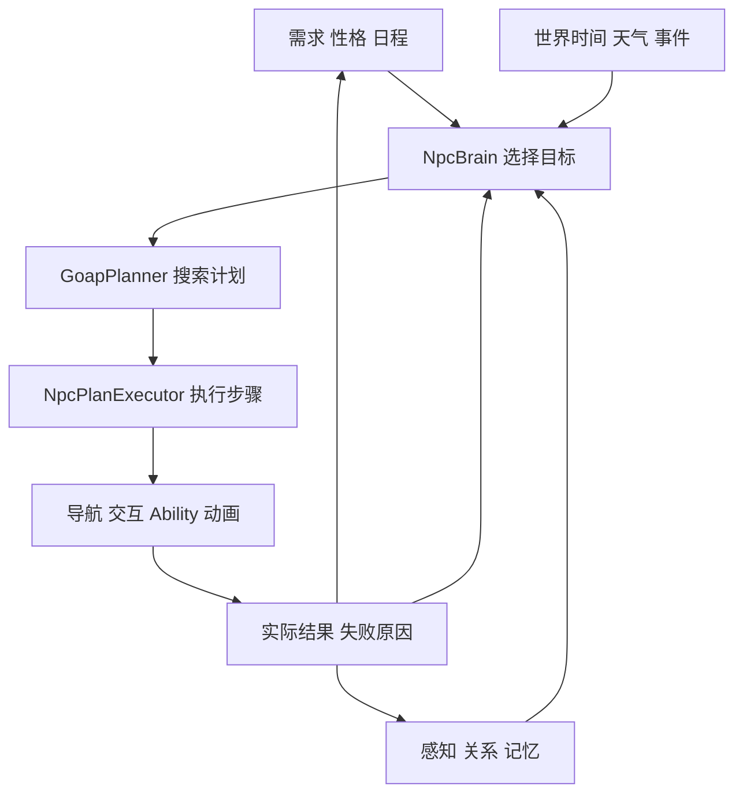

# SpaceLevel NPC GOAP 实施计划

更新时间：2026-10-17。状态：实施任务待开始。

在 SpaceLevel 中建立能够自主生活、调整行动路线并响应环境事件的 NPC 系统。采用需求与日程驱动目标、Utility 选择目标、GOAP 规划步骤、动作任务执行的架构。先让一名居民完成取食和购买两种生活路线，再扩展到商人、守卫、工人、居民、旅人共五名角色。

第一阶段的完成标志是：居民原本准备去商店买食物，途中商店关闭后，能够根据已知的家庭库存重新规划，回家取食并吃饭；没有可行食物来源时能够安全等待。

## 范围和交付顺序

| 阶段 | 交付内容 | 完成条件 |
| --- | --- | --- |
| P0 规划基础 | 状态模型、目标与动作定义、可分帧搜索、核心验证器 | 能用相同目标在不同状态下生成不同有效计划 |
| P1 单 NPC 生活闭环 | 导航、交互点、持物与购买、重规划、基础存档、GM 诊断 | 一名居民完成取食与购买，正确处理关店、缺货、堵路和读档 |
| P2 五名 NPC 自主生活 | 休息、职业、班次、工作报酬、性格、多人竞争 | 五人能够完成一天生活，库存和报酬不会重复结算 |
| P3 环境与社会反应 | 避雨、交谈、关系、记忆、危险中断 | NPC 对同一事件作出符合身份与性格的反应，并能恢复生活 |
| P4 规模与跨场景行为 | 远处简化模拟、跨场景生活、守卫战斗 | 快进和切场景后的状态连贯，规划开销受控 |

最小可交付版本包含 P0 和 P1。P2 完成首批五人城镇生活。烹饪在 P2 加入，依赖食材与厨房交互点；完整经济、犯罪执法、家庭模拟和多角色联合规划作为后续独立扩展。

## 当前实现和复用边界

| 已有实现 | 复用方式 |
| --- | --- |
| [SpaceLevel 场景](../../../assets/scenes/spacelevel.tscn) | 集成新 NPC、导航区域和生活交互点；已有两个 AIRunner 提供移动对照 |
| [SimpleAICharacterControllerComponent3D](SimpleAICharacterControllerComponent3D.cs) | 保留简单巡逻用途；新生活 NPC 使用独立 Brain |
| [GraphActionTask](../../../addons/GraphPlugin/runtime/core/GraphActionTask.cs) | 复用 Tick、成功与失败、Cancel 生命周期，增加 GOAP 执行适配 |
| [CharacterMovementComponent3D](../character/movement/CharacterMovementComponent3D.cs) | 接受导航输出，继续统一执行移动、重力和碰撞 |
| [CharacterAnimationComponent3D](../character/animation/CharacterAnimationComponent3D.cs) | 承接移动和生活动作表现 |
| [AbilitySystemComponent3D](../abilities/runtime/AbilitySystemComponent3D.cs) | 后续承接战斗技能、冷却、打断和执行规则 |
| [WorldClock](../timeofday/WorldClock.cs) | 提供日程、需求和生活活动的统一游戏时间 |
| [天气系统](../weather/README.md) | 提供雨雪和环境状态，P3 接入生活决策 |
| [ISaveSection](../saves/ISaveSection.cs) | 注册 NPC、交互点及账本的持久状态 |
| [Runtime GM](../gm/README.md) | 在现有 F8 面板中添加 NPC 诊断页 |

构建配置以当前 [yu.csproj](../../../yu.csproj) 为准，目前为 Godot.NET.Sdk 4.8.0-beta 和 net10.0。后续实现前复核实际引擎与 SDK；导航接线需在当前运行引擎中验证。

## 决策和执行架构



`NpcBrainComponent3D` 是目标与计划生命周期的唯一入口。Utility 决定当前最值得实现的目标，GOAP 决定实现目标的行动顺序，执行器负责实际任务及结果校验。行为树可作为某个复杂动作的局部执行器，例如战斗或交谈，不独立改变城镇生活目标。

紧急危险和明确的剧情指令通过优先级规则进入 Brain。普通生活目标综合需求紧迫程度、性格、作息、关系偏好和预计代价评分，并设置最短承诺时间、切换阈值及失败冷却。持续变化的需求数值不应使 NPC 每帧推翻当前计划。

## 模块和目录

新增代码先保留在 GameLogic，规划核心使用纯 C#，不依赖 Godot 节点或场景查询。场景行为采用 GameObject3D 和 Component3D，原生节点由组件控制。

```text
scripts/gamelogic/ai/
  NPC_GOAP_IMPLEMENTATION_PLAN.md
  goap/                   状态 条件 效果 目标 搜索 计划

scripts/gamelogic/npc/
  runtime/                Brain 执行器 需求 感知 记忆
  navigation/             导航和堵路恢复
  interactions/           交互点 预约 库存和交易
  definitions/            Godot 配置资源及其运行时编译
  persistence/            NPC 和世界交互状态存档
  gm/                     NPC 诊断页
  README.md               接线 使用和验证说明

assets/resources/npc/     角色 目标 动作 需求 日程配置
assets/scenes/npc/        NPC 模板和生活测试场景
scripts/tools/npc/       规划与运行时验证器
```

| 类型 | 职责 | 引入阶段 |
| --- | --- | --- |
| GoapWorldState 和 GoapPlanner | 不可变搜索快照、条件与效果、搜索队列、计划结果 | P0 |
| NpcBrainComponent3D | Utility 仲裁、规划请求、计划失效和中断管理 | P1 |
| NpcPlanExecutor | 步骤执行、动作任务适配、结果验证、取消和清理；由 Brain 驱动 | P1 |
| NpcNeedsComponent3D | 连续需求值和规划用需求档位 | P1 起步，P2 扩展 |
| NpcPerceptionComponent3D | 已知地点、附近候选与变化通知；P3 扩展视听事件 | P1 起步，P3 扩展 |
| NpcNavigationComponent3D | 路径跟随、到达与失败报告、避让接入 | P1 |
| NpcInteractionPointComponent3D | 能力标签、位置、权限、容量、营业状态和预约 | P1 |
| NpcWorldComponent3D | 场景注册表、规划调度、预约服务和共享状态协调 | P1 |
| NpcPersistenceComponent3D | 个人生活状态和存档恢复准备状态 | P1 |
| NpcMemoryComponent3D | 关系、目击事件和有限持久记忆 | P3 |

配置使用资源定义，身份模板与实例 PersistentId 分开。搜索上下文、需求、持物、任务进度和预约句柄由实例持有，不放入共享资源。

组件在 OnInit 解析依赖，在 OnUpdate 调度生活决策，在 OnPhysicsUpdate 执行导航与移动意图，在销毁和回收时取消任务、释放预约并解绑事件。规划器和执行器不创建独立更新循环。

宿主按 Priority 降序更新。Brain 和导航意图应在 Movement 之前提交；依赖数据在初始化完成后通过准备状态统一启用。跨宿主的世界注册与存档恢复不能依赖组件 Priority，应有显式就绪检查。

## 状态和动作契约

### 状态来源

| 状态层 | 内容 | 使用规则 |
| --- | --- | --- |
| 真实业务状态 | 实际库存、金币、物件容量、权限、工作记录 | 由对应业务服务维护，是交易和交互的校验依据 |
| NPC 认知状态 | 自己的状态、已知地点、观察或通知得到的环境信息 | 作为规划输入；未知值不等同于 false |
| 搜索预测状态 | 对认知快照应用动作效果后的副本 | 只用于搜索，不改真实世界和其他 NPC |

P1 配置居民已知的家、商店和食物点；这些公共或个人地点无需逐个探索。即时危险、私人行为和陌生人物的信息在 P3 通过感知获得。

实际饥饿和精力保持连续数值，规划使用带迟滞阈值的 Hungry、Tired 等档位。地点以一个明确的 LocationId 或 TargetId 表示，移动效果替换旧位置。库存和金币支持数量条件及增减，搜索表示按当前领域的相关阈值进行有限化，真实数量保持完整。

快照携带涉及事实和目标的版本。无关事件不使整个计划失效；关键库存、权限或目标变化会使相关步骤失效。跨帧搜索得到结果后，再检查快照是否仍适用。

### 目标定义

| 目标 | 满足条件 | 引入阶段 |
| --- | --- | --- |
| SatisfyHunger | 饥饿低于退出阈值 | P1 |
| RestoreEnergy | 精力达到恢复阈值 | P2 |
| FulfillWork | 对应日期和班次的工作要求完成 | P2 |
| ReturnHome | 到达有效家庭交互点或进入抽象住宅状态 | P2 |
| SatisfySocial | 社交需求得到恢复 | P3 |
| StayDry | 到达当前有效的遮蔽交互点 | P3 |
| StaySafe | 当前威胁解除或脱离危险范围 | P3 |

作息提供班次、营业时段和目标约束。首版规划基于当前可观察条件；营业时段可用于预计到达检查，但不承诺完整的未来时间搜索。到达后仍需复核，等待开门的复杂计划后续再加入。

### 动作定义

每个动作声明稳定 ID、参数与目标绑定、前置条件、预测效果、非负代价、执行任务工厂、完成校验、超时和中断规则。

| 动作 | 主要前置条件 | 成功后的业务效果 | 阶段 |
| --- | --- | --- | --- |
| MoveTo | 已知目标、导航可用 | 更新实际位置和到达状态 | P1 |
| TakeFood | 到达来源、有权限、有库存和使用权 | 来源库存减少，持有食物增加 | P1 |
| BuyFood | 到达柜台、正在营业、有钱、有库存和使用权 | 原子扣款并获得食物 | P1 |
| EatFood | 持有食物、允许进食 | 消耗食物，降低饥饿 | P1 |
| Rest | 到达休息点、有使用权限 | 按活动时间恢复精力 | P2 |
| Work | 到达工作点、符合职业和班次条件 | 推进对应日期与班次的工作记录 | P2 |
| CollectPay | 对应工作已完成、报酬未领取 | 增加金币并标记已领取 | P2 |
| CookFood | 到达厨房、有食材、有设施使用权 | 消耗食材并获得食物 | P2 |
| Chat | 双方同意、距离和场所合适 | 恢复社交并更新关系 | P3 |
| UseShelter | 到达当前有效的遮蔽点、有容量 | 更新避雨状态 | P3 |

BuyFood、TakeFood 和 MoveTo 绑定明确的柜台或使用点 ID。执行器可在接近目标前预约即将使用的一个交互位置，并在移动及使用期间续租；不会为整条计划提前锁住所有资源。

## 搜索和执行规则

### 搜索

采用可分帧的前向 A* 框架，初始启发函数设为零，先验证状态、代价和闭集逻辑。后续根据实际数据加入有依据的启发和裁剪。

动作先按目标相关性和能力筛选，再绑定有限候选地点。使用累计代价去重，限制计划深度、展开节点数和候选数量；相同输入以稳定 ID 打破平分，方便复现。

结果至少区分 Pending、Found、AlreadySatisfied、NoPlan、LimitReached 和 Invalidated。每帧预算耗尽返回 Pending 并保留搜索；配置上限触发 LimitReached；只有领域搜索结束且不存在解时返回 NoPlan。经过候选裁剪的无解结果只表示当前候选范围内无解。

NpcWorld 轮流调度规划请求，避免五名 NPC 同时进行完整搜索。导航路径查询由主线程服务处理，不在每个搜索节点中重复调用 Godot API。搜索预算、候选上限和耗时统计通过 GM 暴露，数值在运行验证后确定。

### 执行与重规划

执行步骤依次检查真实条件、获取或校验预约、创建动作任务、逐帧推进、验证实际结果、更新认知并推进计划。只有实际业务操作成功，才把对应效果作为事实使用。

重规划触发包括目标实体消失、营业或权限改变、库存不足、预约失败、导航失败、任务超时、结果不满足以及紧急事件。失败记录包含动作、目标、原因和重试条件；相同失败组合采用冷却，条件明确变化时可提前解除冷却。

取消动作时清理当前任务、导航意图、动画请求和预约。预约释放必须可重复调用。租期使用不受日历回拨影响的运行计时，并在游戏整体暂停时冻结；回收和目标销毁直接释放。

交易在主线程业务方法内先完成校验，再一次提交库存与金币变化，并记录操作 ID。已完成的购买不会因随后取消动画而重复扣款或丢失食物。持续活动保存已结算进度，恢复后仅处理新增时间。

### 导航接线

新 NPC 显式使用 Free3D，保留 CharacterBody3D 与纸片美术。导航区域根据小镇实际行走面和碰撞设置生成，复核河流、桥面、建筑边界、窄道和使用点的连通性。

当前 Movement 会将 PhysicsBody 设为 TopLevel，并在物理步结束同步宿主位置。NavigationAgent3D 建议放在 PhysicsBody 下，其位置以真实物理体为准；导航组件解析该路径，不另外维护移动代理。

等待导航地图同步后开始查询。到达路径终点不自动等于到达交互目标，执行器还要验证距离、朝向及使用点合法性。局部避让输出统一交给 Movement 执行，并验证信号时序、速度单位与命令优先级；目标未变化时不每帧重新设置路径。

## 实施任务

### P0 规划基础

依赖：现有 EC 与角色执行层。交付：纯 C# 规划核心、领域配置契约和可重复运行的断言验证器。

- [ ] P0-01 固定首版事实键、值类型、未知值、位置覆盖、数量条件和需求迟滞规则。
- [ ] P0-02 定义目标、动作、绑定目标、代价、计划步骤及搜索结果类型。
- [ ] P0-03 实现状态快照、预测效果、状态哈希和不可达状态去重，保证搜索不修改输入。
- [ ] P0-04 实现可续算前向搜索、稳定平分规则、取消、深度和节点上限。
- [ ] P0-05 用取食与购买领域验证单步、多步、替代路线、已满足、无解、循环和预算耗尽。
- [ ] P0-06 定义最小持物、金币、食物库存和操作 ID 账本接口，明确成功与失败后的状态。

退出条件：同一饥饿目标可根据持物、家庭库存和商店条件产生不同计划；所有预测状态与输入隔离；分帧与一次搜索的结果在相同预算范围内一致。

### P1 单 NPC 生活闭环

依赖：P0。先接通世界服务与导航，再接通 Brain 和执行器；最后验收动态变化与持久化。

- [ ] P1-01 建立独立生活测试场景、NPC 模板、稳定 ID、Free3D 组件和最小动作表现。
- [ ] P1-02 添加 NpcWorld、交互点注册、家庭食物点、柜台、营业条件、预约和库存服务。
- [ ] P1-03 配置导航区域与使用点，接通 NavigationAgent3D、Movement 和失败报告。
- [ ] P1-04 实现 Needs、最小 Perception 和 Brain，支持饥饿目标与安全等待。
- [ ] P1-05 通过 GraphActionTask 适配实现 MoveTo、TakeFood、BuyFood、EatFood 和结果验证。
- [ ] P1-06 加入条件变化通知、重规划、失败冷却、超时、取消及资源释放。
- [ ] P1-07 接入个人与共享交互状态存档、交易操作记录，以及恢复完成后的统一启动检查。
- [ ] P1-08 在 F8 增加 NPC 列表、目标、计划、事实、预约、失败和搜索统计。
- [ ] P1-09 在独立测试场景通过验收后，将一名居民与必要交互点接入 SpaceLevel。
- [ ] P1-10 回归现有 Player、AIRunner、GM、时间和天气行为，并补齐模块使用文档。

退出条件：买饭途中关店可切换为回家取食；无解不会持续忙等搜索；购买和吃饭在中断与读档后不会重复结算。

### P2 五名 NPC 自主生活

依赖：P1 的导航、共享状态和持久化全部通过验收。

- [ ] P2-01 增加精力、Rest、家庭入口和按世界时间推进的生活日程。
- [ ] P2-02 增加职业与班次、Work、CollectPay 和按日期与工作 ID 去重的报酬记录。
- [ ] P2-03 增加食材、厨房与 CookFood，使购买和烹饪成为可替换的取食路线。
- [ ] P2-04 配置商人、守卫、工人、居民、旅人的能力集合、已知地点和性格权重。
- [ ] P2-05 验证多人预约、最后一份食物竞争、窄道会车与失效目标回收。
- [ ] P2-06 运行完整游戏日，验证工作、吃饭、休息及日程切换，记录规划耗时与失败分布。

守卫在此阶段实现值勤和巡逻生活，战斗能力在 P4 接入。住宅首版可通过门口交互表达进入与休息，进入抽象状态时解除门口占用，并规定退出时的合法落点。

### P3 环境与社会反应

依赖：P2 的多人生活稳定。

- [ ] P3-01 从天气服务获取降雨状态，配置真实有效的遮蔽交互点并接入 StayDry。
- [ ] P3-02 增加玩家招呼、双向聊天邀请、接受与拒绝、双方中断和社交效果。
- [ ] P3-03 增加关系、目击事件与有容量和过期规则的持久记忆，区分亲眼目击和转述。
- [ ] P3-04 接入视线、声音或业务事件感知，以及危险抢占和安全后的目标恢复。
- [ ] P3-05 用相同事件验证商人、居民和守卫的不同选择，以及聊天和危险后的重新规划。

### P4 规模与跨场景行为

依赖：P3，并先记录五人场景的实际开销。

- [ ] P4-01 增加近处完整模拟、远处简化模拟和离场持久状态，保持统一业务结算规则。
- [ ] P4-02 定义快进时的日程边界处理、活动推进上限和跨场景恢复位置。
- [ ] P4-03 为守卫接入 AbilitySystem 和局部战斗行为树，验证战斗与生活目标的交接。
- [ ] P4-04 在明确的 NPC 数量、地图和目标硬件上制定并验证性能预算。

远处简化模拟可以跳过实际行走表现，但需要结算真实资源与活动条件。玩家可见区域的恢复与位置变化必须通过明确规则处理。

## 时间和存档规则

需求、班次和持续生活活动以 WorldClock.TotalHours 为时间源；导航、动作演出、失败冷却和预约租期按运行时间推进。游戏整体暂停时停止两者。仅暂停日历时，需求、班次和生活时间收益冻结，移动及交互演出可继续；动作不能仅凭演出结束获得冻结期间的生活收益。

WorldClock 快进只通知最终状态，NPC 必须保留上次结算时间并主动处理跨过的日程边界。P1 支持前进、暂停和回拨后的安全重新评估；P2 增加跨班次结算。日历回拨不撤销已发生的交易和已领取报酬，也不补发历史收益；需要回到历史状态时加载对应存档。

角色位置、朝向和 Ability 状态继续由 CharacterPersistenceComponent3D 保存。NpcPersistence 使用独立的 npc 分区和相同 PersistentId 保存需求、持物、金币、已知地点、工作记录、关系及当前目标。共享交互点和账本使用自己的分区与稳定 ID，避免一个字段由多个分区同时维护。

搜索队列、任务对象、导航路径和预约句柄不存档。加载后先恢复时间、共享交互状态及个人状态，等待相关分区和宿主就绪，再重新规划和预约。由于现有 SaveModule 会在注册分区时立即恢复待应用数据，Brain 必须使用显式恢复就绪条件，不能假定注册顺序。

交易和存档采集之间保持明确提交边界。加载后通过操作 ID 和已结算状态防止扣款、食物消耗或薪酬重复执行。存档版本迁移在各自分区提供默认值与校验。

## 验收矩阵

| 编号 | 场景 | 必须观察到的结果 | 首次验收 |
| --- | --- | --- | --- |
| V01 | 身上有食物 | 直接吃饭，不绕路购买 | P0 与 P1 |
| V02 | 家中有食物，商店也可用 | 按配置代价选择合法路线，改变代价后结果可解释 | P0 与 P1 |
| V03 | 买饭途中关店，家中有食物 | 原动作取消，释放预约，重新规划回家取食 | P1 |
| V04 | 所有食物来源不可用 | 返回当前领域无解或限制结果，安全等待并在条件变化后重试 | P1 |
| V05 | 路径终点未到柜台，或目标被删除 | 不执行购买，报告可解释失败并清理状态 | P1 |
| V06 | 两名 NPC 购买最后一份食物 | 仅一人成功，库存与金币无负数或重复变更 | P2 |
| V07 | 购买提交后中断或存读档 | 食物和金币各结算一次，随后计划与实际状态一致 | P1 |
| V08 | 中途销毁、回收并复用 NPC | 无遗留预约、移动输入、事件订阅或旧任务 | P1 |
| V09 | 暂停、快进跨班次、回拨日期 | 需求和班次遵循时间规则，报酬不会重复领取 | P1 与 P2 |
| V10 | 下雨或聊天对象拒绝 | 切换合法避雨地点或其他目标，保留合理失败记录 | P3 |
| V11 | 生活过程中出现危险 | 清理当前交互，进入紧急目标，安全后重新规划 | P3 |
| V12 | 多人同时需要规划 | 请求公平推进，预算耗尽不会误报无解或长期饿死某个请求 | P2 |

纯规划器验证覆盖条件与效果、数量资源、输入隔离、状态去重、等价路线、有限搜索结果和确定性。运行验证覆盖真实导航、交互事务、中断、生命周期与存读档；对实际故障路径设置断言，避免只验证配置字段。

后续每次代码改动运行 `dotnet build yu.csproj`。涉及场景和资源时，还需使用当前 Godot 引擎重扫资源并运行受影响测试场景；构建成功不能代替导航和资源加载验证。临时日志、截图和性能记录放在忽略目录 `.godot/npc/`，维护的验证器放在 scripts/tools/npc，并在模块 README 中记录真实命令。

## 第一项实施任务

从 P0-01 到 P0-05 开始，先用纯状态快照和四种动作验证饥饿目标，不修改 SpaceLevel。核心搜索通过后实施 P0-06，再进入 P1 的独立生活场景。各阶段完成时勾选对应任务，并记录通过的验收编号和仍需处理的问题。

## 参考

- [现有 AI 角色示例](../../../docs/AI_CHARACTER_EXAMPLE.md)
- [角色执行层](../character/README.md)
- [存档模块](../saves/README.md)
- [昼夜与世界时间](../timeofday/README.md)
- [Three States and a Plan](https://www.gamedevs.org/uploads/three-states-plan-ai-of-fear.pdf)
