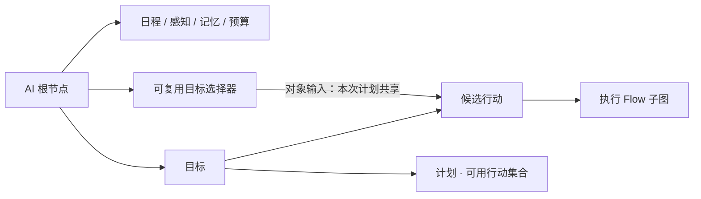

# NPC 图配置与运行指南

2026-10-19，可配置初版。本文替代旧 GOAP 计划和设计稿，描述当前实现。

2026-10-21 精简配置：移除 Plan 变量及旧 Action 顶层目标/资源字段。Plan 只配置适用条件、优先级和行动集合；Action 的全部对象目标统一通过选择器节点连线提供，普通参数使用表达式或常量。

世界会话、关卡切换、对象目录与角色知识已接入，配置见 [世界配置指南](../world/README.md)，后续范围见 [世界框架实施计划](../world/WORLD_FRAMEWORK_PLAN.md)。

## 配置入口

打开 `assets/scenes/levels/whitebox_test.tscn`，选择根节点下的 `Resident` 或 `Courier`，在 Components 中打开 `AiAgentComponent3D.Graph` 的图编辑器。

- 灰绿居民：`assets/resources/npc/gray_green_resident/npc_graph.tres`。
- 女性跑腿员：`assets/resources/npc/ochre_courier/npc_graph.tres`。

角色直接保存在 WhiteboxTest 根节点下；World 提供 NPC 世界与平面导航。旧小镇场景、交互点和生活行为已清空，两个 NPC 图只保留人物根节点、感知、记忆和决策预算模块。空目标图合法，角色正常待机。

**AI 组件提供 AI 节点。** `AiAgentComponent3D` 实现通用的 `IGraphNodeProvider`，提供 NPC 配置节点和执行能力。`GraphPlugin` 负责画布、连线、检查器、组件提供者与保存，不包含人物职业或生活行为规则。普通图的全局菜单不显示 AI 专属能力；进入 NPC 的执行子图后，菜单由所属 AI 组件提供。

节点标题读取定义的 `DisplayName`，改名后立即更新。选中节点，在右侧原生资源检查器编辑字段；嵌套的表达式、需求、日程等资源可以继续展开。目标、行动、计划节点直接编辑各自的定义，不显示切换定义的下拉框；行动节点保留“进入执行图”按钮。AI 模块节点仍可用下拉框绑定同类型的共享定义。人物根节点的检查器显示整张图及定义库。定义库按中文分类折叠，支持名称搜索、进入配置和添加已有外部共享资源；被节点或其他配置引用的定义需要先处理引用，未引用的定义可以移除。进入需求、输入、效果等子资源时，标题使用配置名称，并显示用途摘要；底层定义类型和 ID 保持不变。

图节点的 `Id` 同时用于 Godot 画布节点名，不能包含 `.`、`/`、`:` 等非法字符；定义资源的 `DefinitionId` 可以保留点分名称，两者独立。`DefinitionId` 由系统自动生成并保存，在检查器中隐藏，无需手动配置。当前示例已统一修正节点与连线端点，验证器会拒绝非法节点 ID，避免出现节点断线、选中后检查器为空的问题。

## 图的连接



人物根节点的“模块”端口连接模块，“目标”端口连接目标，“目标选择器”端口连接可复用查询。目标的“候选行动”端口限定自己的行动库，“计划”端口连接该目标允许采用的方案。每个计划从行动库中选择可用行动，由 GOAP 组合顺序。同一行动定义可以被多个目标引用。未连接的定义不会参与角色运行。

选择器节点输出可以连接多个 Action 的目标输入，表示本次计划共享一个选定对象。Action 输入类型选“目标 · 场景交互点”后，画布自动显示对应的命名输入端口。Plan 仍需手工选择 ActionIds，空列表不表示使用全部行动。

行动节点的“进入执行图”在当前窗口进入子图，通过面包屑返回。子图和节点定义随 NPC 根图保存，图 JSON 只保存节点、位置、连线及定义 ID，字段值保存在资源里。

复制粘贴 NPC 节点会创建独立配置，包括条件、效果和行动执行图；修改副本不会影响原节点。一起复制计划与行动时，副本计划会引用副本行动；一起复制选择器与行动时，内部目标输入连线指向副本选择器。只复制行动时，不复制通往外部选择器的连线，需要重新连接。跨图粘贴时应同时复制依赖并连接人物根节点。多次粘贴分别产生独立副本，撤销/重做同时处理节点和定义资源。需要共用行动时，将同一个行动节点连接到多个目标。

## 角色数据与 AI 决策的边界

Player 和 NPC 的角色参数、需求、性格、关系、情绪和业务事实统一在 `CharacterDataComponent3D.Profile` 中配置。
运行状态由该组件独立更新并保存，AI 图不再包含这些数据节点，也不管理角色外观。
配置说明见 `scripts/gamelogic/character/data/CHARACTER_DATA_GUIDE.md`。

AI 图只保留：

| 配置 | 用途 |
| --- | --- |
| 日程窗口 | 当前允许采用的行为时段 |
| 感知 | 视距、检测间隔、视线、对象标签和已知交互点 |
| 记忆 | AI 事件记忆类别、容量与有效期 |
| 决策预算 | 搜索节点数、深度、候选数量、承诺时间、切换差值、重试与 LOD |
| Goal / Plan / Action / 选择器 | 行为选择、规划与执行 |

根节点“模块”端口连接这些 AI 配置。角色属性列表从当前选择的场景宿主读取，按原参数名称用于公式。
同一张 AI 图可以供不同角色使用，各自读取自己的 Profile 和 State；打开独立图文件时，应在图编辑器中选择配置了角色数据的场景宿主。
角色数据不会随 AI 图保存；修改角色数据后保存 Profile / 角色场景。

## 通用需求预设与自定义需求

通用预设位于 `assets/resources/character/presets/common_needs.tres`，包含 thirst、hunger、fun、fatigue。
在角色数据组件的 Profile → Needs 中编辑需求，使用“补充所选预设”或“+ 自定义需求”。
每条需求资源包含“基础数值”和“紧迫度规则”两组。基础数值配置范围、初值、每小时变化率与变化倍率；紧迫度规则配置数值越高／越低越紧急、进入／解除阈值及曲线指数。AI 图不再提供独立的需求决策规则节点，也无需重复添加需求引用。
新建需求自动具备默认规则：高值紧急时在范围的 65% 处进入、25% 处解除；低值紧急时在 35% 处进入、75% 处解除。默认曲线指数为 1。勾选 `UseDefaultThresholds` 时阈值随范围和紧急方向变化；取消后可直接填写绝对阈值。高值紧急要求解除阈值低于进入阈值，低值紧急则相反。
AI 编译时从当前角色的 Needs 读取规则，以 `needs.<id>.urgent` 和 `needs.<id>.urgency` 提供给目标、评分和条件公式。紧急状态的进入／解除记忆仍由各角色的 AI 控制器独立保存。修改规则后保存 Profile；同一张 AI 图可以读取不同角色各自的需求规则。
现有示例四项初始需求均为 0.2，低于目标激活阈值；验证行为时可在运行状态中提高对应需求。
玩家可以使用相同需求模块，而不挂 AI。

## 配置目标

目标包含三种表达式：

- `Activation`：布尔值，当前是否允许参与选择；留空为允许。
- `Utility`：数值，越高越优先；非正值不参与选择。
- `Completion`：布尔值，是否已经完成。

例如新建“读书”目标，可声明 `needs.reading.value`，用需求值乘以 `personality.curiosity` 作为评分，用需求值小于阈值作为完成条件。新增名称不需要改运行时。目标可以不依赖需求，改用私有事实或其他模块输出。

目标切换受承诺时间和差值控制。无可行计划或行动失败时，该目标进入配置的失败冷却，其他目标可以参与选择。F8 的 NPC 页显示候选目标的评分、排除原因、行动、计划和失败记录。

## 配置行动

Action 使用通用结构，按需配置零个或多个输入，不再提供“共用目标、必须已到达、执行后到达、预约目标、距离系数”开关。

| 字段 | 用途 |
| --- | --- |
| 行动输入 Inputs | 目标通过选择器连线传入；普通输入仅用于需要显式传入的数据，固定数量和时长直接在执行图节点配置 |
| Preconditions | 搜索与实际开始、提交结果前要满足的条件 |
| SuccessConditions | 执行图成功结束后，验证实际结果的条件；不作用于搜索预测 |
| Cost | 完整数值成本公式，例如 `1 + 输入地点的距离 × 0.2`；必须非负 |
| 高级预算 DurationSeconds / TimeoutSeconds | 没有可推导图内时长时的规划估计，以及整个行动的超时上限；不替代执行图中的实际等待秒数 |
| Predictions | 只改变搜索快照；交互节点声明的库存／液体扣减自动生成，不重复手填 |
| Results | 执行成功并通过验证后提交的真实数据效果 |
| ExecutionGraph | 执行 Flow 子图，必须返回 `Success` |

对象输入下面有可选的“资源要求”：点击“+ 添加资源要求”，从该对象适配器注册的能力中选择，例如“使用容量”。留空只引用对象；配置后在本行动执行期间占用，完成、失败、超时或取消时自动释放。数字、布尔、普通文本输入隐藏此项。多个行动即使连接同一选择器节点，仍可分别配置资源要求，例如“前往”留空、“睡觉”占用床的使用容量。Action 顶层不再保留资源占用列表。

行动输入通过一个“输入类型”选项区分：

- **目标 · 场景交互点**等已注册对象类型：自动生成命名输入端口，必须连接对应类型的选择器；不显示表达式或来源选项。多个输入连接同一节点时，在本次计划中使用同一对象；不同节点独立选择，即使共用查询定义。
- **数字、布尔、文本**：显示“表达式或常量”，从人物、世界的已注册参数取值或直接填写常量；不生成画布端口。每步开始时解析，执行期间冻结。

固定数值直接在执行图对应节点填写，例如交互数量 5、等待秒数 3；需要计算时点击“编辑数值／公式”，不必创建 Action 普通输入。普通输入继续供需要显式传入的角色／世界数据使用。固定使用某张床时，在选择器中选“固定对象”，再连到目标输入。普通文本参数不能代替导航等能力要求的对象输入。

输入名自动注册为 `input.<名称>`。对象适配器还提供成员；内置交互点包括 `.id / open / available / stock / liquid / distance / at`，分别表示标识、开放可用、有空余容量、库存、液体体积、到导航参考位置的距离、自身是否在 Area3D 交互区域。它们可用于本行动和执行图的公式，其他行动的输入不会混入。库存／液体等信息未获准读取或缺少对应能力时仍为 Unknown。Results 不能直接写目标状态；实际对象变化通过“执行对象交互”节点提交到玩家与 NPC 共用的入口。

**到达是一组普通配置**：移动行动的 Predictions 设置“当前位置 = 输入地点”，SuccessConditions 选择“输入地点 · 自身已在范围内”；使用地点的行动把该范围条件放进 Preconditions。实际位置始终由场景观测，Results 不能写位置或使角色传送。已到达时，GOAP 可以直接选择使用地点的行动。

效果支持 Set 或 Add，可修改已声明的私有事实、需求和对象适配器提供的可写成员。打开效果条目，点击“修改参数”从当前可写列表选择，点击“效果值”配置表达式。数值才支持 Add；布尔、文本支持 Set。`self.location` 只出现在预测效果中。多个输入指向同一对象时，效果按稳定对象标识累计；全部类型、范围、成功条件和资源占用验证通过后才提交。取消或失败不提交尚未完成的 Results。

执行图内“前往输入地点”“附近活动或原地踏步”“记录记忆”的输入引用也按名称选择。能力节点只负责引擎执行，需求变化、天气条件、成本等由外层配置决定。当前还提供等待、Ability、关系和情绪能力；它们由 AI 组件提供，复用 GraphActionTask 的 Tick/Cancel 生命周期。记忆、关系、情绪等即时能力在执行时生效；需要整体提交的数据放在 Results 中。

“附近活动或原地踏步”使用现有导航和行走动画：Radius 大于 0 时在输入地点附近移动，范围受交互区域限制；无地点输入时以自身为中心。Radius 为 0 时原地播放动画。Seconds 在此节点填写常量或公式，结束、取消时释放动画请求并停止导航。“等待图内时长”同样在节点的 Seconds 配置实际秒数；旧 DurationOverride 字段已移除。

### 数量、时长与图内计算

最简单的取用行动只需要一个目标输入 `source`，连接物资选择器；执行图添加“执行对象交互”，选择 `source`、按名称选择“使用物资”，数量直接填 `5`。节点会推导当前 Action 所需操作并在候选截断前筛选，不要求选择器重复填写操作；选择器的 RequiredOperations 仍可表达额外限制，不会把所有候选 Action 的操作合并成全局交集。

能够独立判断的数量与容量要求也会在路径估算和候选截断前检查，避免空库存对象占满短名单。同一选择器连接不同 Action 时，分别按本行动要求查询；依赖其他目标或路线的数量留到具象化阶段判断，不假设尚未绑定的值。

需要多个节点共用计算结果时：

1. 在本 Action 执行图的本地黑板声明 Float 变量 `take_count`，初值 0。它不是 NPC 根图全局变量，也不是 Plan 变量。
2. 添加“计算并保存图内数值”：选择 `take_count`，公式为 `min(input.source.stock, 5)`。
3. 后面的“等待图内时长”可使用 `local.take_count * 0.1`；“执行对象交互”的数量使用 `local.take_count`。
4. 执行图返回 Success；取消或失败不提交交互，成功后按同一数量检查并扣减库存。

公式支持数字常量、人物／世界数值、角色参数、本行动输入成员、四则运算、最小／最大及 Clamp01。人物和对象数值读取本次行动开始时的快照；首次读取的节点数值在本次执行内固定，图内计算结果各 NPC、各次执行独立，停止执行后清理，不写入 Plan 或存档。

编译器只提取纯数值声明，不执行 Flow。图内局部计算会展开为规划表达式；库存／液体预测自动扣减节点数量，不要再给相同目标填写 Predictions。未知数量不能当作零，数量必须大于零，时长不能为负数。所有成功路径必经且无循环的等待／附近活动时长会累加为 `action.duration`；无法推导时继续使用高级预算估计，整体仍受 TimeoutSeconds 限制。

当前支持本 Action 执行图中的顺序和可证明的分支：局部变量先计算后读取，每个计算变量一个赋值节点，不混用通用黑板写入；交互节点必须位于所有成功路径上，失败不能绕回 Success。包含这些数值参数的图暂不支持并行连线和子图；编译时明确报错，需要拆分 Action。数量预留尚未实现，库存及液体在成功提交时重新检查；资源占用仍只有已实现的使用容量。

## 配置选择器与输入

常规流程是：**选择器节点提供候选并表达共享关系，Action 输入接收参数，运行时计划保存具体选择**。查询定义不保存当前选中值，Plan 不声明变量。

在 NPC 图中新建“目标选择器”，连接人物根节点第三个端口。为 Action 点击“+ 添加目标输入”，输入类型选“目标 · 场景交互点”，再把选择器的“本次计划共享目标”输出接到该命名端口。不同对象类型、缺少连线或同一输入多条连线会报告错误。点击“+ 添加普通参数”可配置数字、布尔、文本。

Action 始终只有一个“候选行动”结构入口，额外端口数量等于当前目标输入数量。输入用稳定 ID 维护连线：改名或排序不改变绑定；删除或改成普通参数时同步移除端口和连线；在本次编辑中撤销可恢复同一输入的原连线。新输入不会继承已删除输入的连线，反复增减不会积累占位端口。

例如“前往床铺.destination”和“睡觉.bed”连接同一个床铺选择器节点，GOAP 可比较床 A/B，选定 B 后两步都使用 B。前往行动仍需预测到达并验证实际成功，睡觉仍需到达条件与容量要求；共享目标本身不定义顺序和占用。独立用途使用不同选择器节点。

搜索分支的共享身份参与状态去重，不能将第一个枚举到的候选写入共享资源。找到计划后，每个 NPC 保存自己的节点绑定；执行中保持身份并刷新动态条件。取消、完成、更换目标或读档时清理绑定，新计划可重新选择。

| 配置 | 作用 |
| --- | --- |
| 对象适配器 Adapter | 从已注册适配器中选择；当前内置“场景交互点” |
| 世界对象类型 ObjectType | 可选的 WorldObjectTypeDefinition；按名称选择，按稳定 Id 匹配；留空不限类型 |
| 必需对象能力 RequiredCapabilities | 从已配置能力中选择，必须全部提供，例如库存、液体或使用容量；留空不限 |
| 必需交互操作 RequiredOperations | 从类型及 Scene 覆盖提供的操作中按名称选择，必须全部提供对应操作 Id；留空不限 |
| 候选来源 | 感知对象、当前已加载对象、角色参数指定对象、当前位置、已知对象、固定对象、角色对象绑定、世界目录 |
| 目标角色参数 | 从已注册文本角色参数中选择，例如 `home`，其值对应对象标识 |
| 固定对象 | 从默认世界目录或当前编辑场景的名称列表选择，内部保存稳定身份；不保存节点引用 |
| 角色对象绑定 | 选择 Profile.World.Objects 中的具名绑定 |
| 世界目录 | 选择地点范围与知识权限；具体字段及公开服务规则见世界配置指南 |
| AllTags / AnyTags / ExcludedTags | 全部标签满足、至少一个标签满足、排除标签；空数组不限制 |
| MaximumDistance | 最大距离，0 表示不限制 |
| RequireUsable / RequireReachable | 过滤不可用或不可到达的候选 |
| Filter | 布尔条件；可引用本适配器提供的候选 `target.*` 以及人物、世界参数 |
| 选择策略 | 动态来源可提供多候选交给 GOAP 比较，或先选最近、评分最低、评分最高的一个；单对象来源隐藏此项 |
| Score | 数值评分公式，例如候选库存；仅评分策略使用 |
| CandidateLimit | 仅多候选策略显示；0 使用人物预算，且受 TargetLimit 限制 |

固定对象、角色对象绑定、角色参数和当前位置都是单对象来源，隐藏策略、评分和候选上限，仍需满足配置的类型、能力、操作、标签与条件。对象不存在或未加载时，现场适配器返回空候选及诊断；关闭 RequireReachable 不能绕过实例要求。缺失的引用保留并提示修复。当前感知来自附近空间查询与有界视线检测，已知对象来自角色世界知识，不再由感知模块配置 KnownPointIds。候选身份在运行时计划中固定，执行时重新验证条件，失效后取消。

类型与能力／操作筛选在短名单和路径估算前执行。Scene 覆盖后的有效操作决定是否匹配；操作 Id 表示已实现业务，不能填写一个名字就生成新操作。筛选只确认对象支持范围，实际库存、范围、权限与占用由公共交互入口在执行时检查。选择器的“必需对象能力”不等于 Action 输入的“资源要求”：前者筛对象，后者在本行动执行期间申请资源。两步共享目标时，例如两步都要求对象支持 `take_stock`，只在取物资这一步执行该操作。

例如“家里或镇上玩”：

1. 选择器“娱乐场所”返回家和镇上两个候选。
2. “前往”添加目标输入“目的地”，连接“娱乐场所”选择器；预测当前位置变为目的地，实际成功条件为已在目的地范围，执行图导航到该输入。
3. “玩”添加对象输入“场所”，也连接“娱乐场所”节点；前置条件为已在场所范围，执行图执行活动，预测与结果降低娱乐需求。
4. Plan 手动选择这两个候选行动。GOAP 会比较不同地点并组合顺序；已在场所时只执行“玩”。

“来源”和“去处”等独立选择使用不同节点。一个行动可以同时声明对象、数量和布尔开关等输入；数字和布尔值从表达式或常量读取，每步开始时解析并在该步执行期间固定。Plan 不额外冻结跨步骤的标量参数。多输入候选会组合搜索，总数超过 MaximumExpanded 时明确报告 `GroundingLimitReached`；应缩小候选范围或调整预算。成本按搜索中的位置计算，初始路段采用导航估算，预测后续路段采用冻结位置的直线近似。

对象扩展实现并注册 `INpcBindingAdapter`：提供候选与事实快照、输入成员及类型、可写数据地址与提交、对象验证、资源能力与租约。`INpcResourceLease` 负责续约和幂等释放；多项资源中一项获取失败，会释放已经获取的项。框架不依赖职业或具体行为。当前生产适配器只接入场景交互点；角色、背包物品与自由坐标仍需要各自的适配器/值类型和执行能力，新增输入不会自动实现这些系统。

NpcActionInputDefinition 保存输入类型、名称、稳定身份、普通参数值和目标资源要求。对象来源只通过选择器连线配置；按当前格式制作，不提供旧绑定或 Plan 变量兼容入口。

## 配置计划

所有方案统一使用 GOAP。每个启用目标必须连接候选行动和至少一个启用 Plan；Plan 是可用行动集合。

在 Plan 检查器点击“+ 添加可用行动”，从所属 Goal 已连接且启用的 Action 中按名称选择；点击已有项可替换，点击“移除”取消选择。列表不排序、不重复添加，GOAP 会按实际需要省略、排列或重复使用其中的行动。计划由多个 Goal 共用时，只提供这些目标共同拥有的候选行动。

`Eligibility` 是方案适用条件，可留空；`Priority` 越大越优先。系统按优先级、内部 ID 顺序依次尝试适用方案，每个方案只用自己选择的行动搜索。高优先级方案无解或达到搜索限制时，尝试下一方案；不会混合不同 Plan 的行动，也不会绕过方案条件回退到整个 Goal 行动库。执行前和执行中还会检查方案适用条件，失效后取消并重规划。

`ActionIds` 仅在内部保存稳定引用，无需查看、填写或复制 ID。重复引用编译时去重，行动改名不改变引用。行动被禁用、移出候选领域或删除后，原引用保留并标记不可用，应重新选择或修复连线。

娱乐场所的组合示例见上节。也可以保留“去家里”“去镇上”两个移动行动，再由“玩”的前置条件限定当前位置。`self.location` 由感知周期按实际位置与交互点使用半径更新，离开交互点后清空；这里只表示具体交互点，不表示整栋房屋或城镇区域。移动中的路径和播放动作仍在各自执行 Flow 中配置。

## 表达式和事实

在 NPC 图检查器中，`Activation`、`Completion`、`Preconditions`、模板条件等使用“参数 / 运算符 / 参数”条件行配置。点击左右参数按钮，从当前人物已装配且启用的模块中搜索选择已注册项，也可以选择数字、布尔或文本常量。数值支持大小比较；布尔与文本支持相等和不相等，右侧选项按左侧类型筛选。

检查器中的公式显示为中文参数名、运算符和括号组成的摘要，长公式可悬停查看完整内容。点击“编辑公式…”打开可调整大小的窗口，主检查器不再展开整棵公式树。

1. 点击公式中的参数或常量旁的“⋯”，在左侧参数库按中文名、分类或 ID 搜索，单击参数填入选中位置；只显示此位置支持的类型。数字、布尔、文本常量以及数值计算也可从参数库选择。
2. 数字直接在输入框修改；数值计算采用中缀排列，括号标出嵌套范围，可添加或删除多项运算中的项。切换成二元减法或除法时保留所有原运算项，按从左到右组合；限制到 0～1 会包住原计算。
3. “＋ 条件”添加条件行，“全部满足（AND）/任一满足（OR）”切换组关系，“＋ 分组”增加嵌套组。每组用边框和编号区分。
4. 顶部实时显示完整公式摘要，底部报告类型、未注册参数、常量除零等配置错误；错误公式不能应用。运行时仍可能产生未知值或动态除零，编辑器不会假设运行时数据。
5. 修改只在草稿中进行，可撤销/重做编辑。点击“应用公式”一次性提交到原生检查器，支持原生撤销；取消或关闭窗口放弃草稿。原公式在其他位置被修改后，旧草稿不能覆盖它。

`Utility`、`Cost`、需求倍率、效果值和输入表达式共用此编辑器。行动只提供本行动的 `input.<名称>`、对象成员和 `action.duration`，选择器提供候选 `target.*`，目标与计划条件不提供未绑定的行动输入。移除的参数引用会保留并提示，不会自动换成其他参数。


这些控件仍保存为原有表达式资源，旧配置可以直接编辑，修改支持检查器撤销。空的 AND 组为真，空的 OR 组为假；清空必填表达式后必须重新配置，才能通过图验证。

表达式支持 Literal、Fact、Parameter，四则运算、Min/Max、Clamp01、比较、All/Any/Not 和 Known。字段类型、参数和事实引用在编译时校验。未知值与 false、0 分开处理；`Not(unknown)` 仍为 unknown。

常用事实：

| 键 | 类型 |
| --- | --- |
| `needs.<id>.value / urgency / urgent` | 数值 / 数值 / 布尔 |
| `personality.<dimension>`、`preference.<key>` | 配置的标量类型 |
| `trait.<id>`、`schedule.<tag>` | 布尔 |
| `affect.<dimension>`、`relations.<dimension>.max` | 数值 |
| `memory.<category>.count` | 数值 |
| `private.<key>` | 声明的布尔、数值或符号 |
| `world.hour / rain` | 数值 |
| `input.<名称>` | 输入声明的类型；仅属于该行动 |
| `input.<对象>.id / open / available / stock / distance / at` | 对象引用及适配器成员 |
| `target.*` | 选择器候选成员；仅属于选择器 |
| `self.location`、`action.duration` | 符号、数值 |

需求在运行时连续变化，搜索时按需求范围的 1/20 投影。私有数值事实用配置的 Step 离散化，避免连续值搜索空间无限增长。不要用小于搜索精度的差值作为完成条件。

## 场景、存档和预算

`AiAgentComponent3D` 只装配 NPC 图、实例参数覆盖和独立状态；移动、导航、动画与技能继续使用已有 EC 组件。`WorldObjectComponent3D` 绑定身份与状态，`WorldInteractionComponent3D` 提供 Area3D 交互区域与导航参考位置；玩家与 NPC 使用同一套区域、权限、遮挡和操作校验。库存、开放时段和使用容量由 Type 声明的独立能力组件提供。

所有 Plan 的 GOAP 搜索均由 `AiWorldComponent3D` 按帧共享毫秒预算、轮换角色推进；目标数量、每方案搜索深度和展开数量可配置，依次尝试多个方案也按帧切片。所有方案失败时，只要有一个达到搜索限制，最终结果会保留“达到限制”，不误报为已证明无解。

远处角色使用同一套目标、计划、执行图和结果规则。移动能力改用经过导航检查的旅行时间，在旅行结束时同步位置；进入详细距离或退出抽象距离时取消当前任务重新规划。初版只处理已加载场景中的角色，没有独立的跨场景人口模拟器。

角色存档保存需求、迟滞状态、私有事实、关系、记忆、情绪、位置意图及最后推进时间。世界存档保存交互点库存与开放覆盖。读取后取消运行中的任务、释放预约并重新规划。新框架使用新的存档 section，不读取旧固定生活原型的业务状态。

## NPC GM

运行后按 F8 → NPC，顶部显示世界时钟、NPC 运行/待机数、交互点数和规划耗时。先选择角色，再查看五个页签：

- **状态**：用中文区分待机、暂停、规划、移动、执行和初始化失败；显示原因、当前目标/计划/行动、后续步骤、绑定、导航状态、速度、动画和最近失败。
- **目标与计划**：每项目标的启动/完成条件包含当前实际值、原始评分和失败冷却；列出方案优先级、适用条件和可用行动。
- **角色数据**：需求值、范围、变化率和紧迫阈值，以及情绪、业务事实和参数。选择需求后可读取当前值或输入数值，再“应用并重规划”；不会在刷新时覆盖未应用的输入。
- **交互点**：开放来源、占用/容量、库存、归属可用性、可达距离、已知/感知和标签。操作仅作用于下拉框选中的交互点，可恢复自动日程。
- **事件日志**：按最新事件在前显示此角色的运行轨迹。“复制诊断”包含所有分区的当前内容，即使尚未打开该分区。

暂停 AI 会立即取消行动并释放导航、预约和动画请求；通用角色需求仍由世界时钟推进。显式重规划会清除目标失败冷却，重新感知并选择目标。AI 降雨下拉框只覆盖决策读取的 `world.rain`，实际画面天气由“天气”页控制。需求和交互点修改属于当前运行状态，之后保存游戏时会写入存档；这些操作不修改 `.tres` 配置。

### 为什么 NPC 开局不动

白盒阶段尚未配置 Goal、Plan、Action 或目标选择器，两个 NPC 正常保持 idle。GM 显示“尚未配置启用目标”；提高需求不会自动创建行为。角色需求、性格和动画仍保留，已移除旧小镇的 home 参数、已知交互点和完成访问计数。

## 白盒关卡

当前关卡为 `assets/scenes/levels/whitebox_test.tscn`。地面具有碰撞和平面导航，玩家和两个 NPC 使用真实 EC 组件；NPC 尚未配置目标，保持正常待机。测试图、测试交互点夹具、配置重置脚本和截图工具已移除。

美术说明见 `docs/art/npc_resident.md` 和 `docs/art/npc_courier.md`。旧 Brain/Perception/Executor 生活分支、Guard、Population、LifeSimulation、旧职业配置和对应测试场景已经移除；保留通用导航适配器。

本版尚未包含图内运行状态着色、配置预演面板、通用角色/威胁传感器和跨场景人口系统。当前运行诊断位于 F8 的 NPC 页；这些扩展应继续通过通用提供者和适配器实现。

## 选择器连线回归验证

`scripts/tools/npc/graph_values_validation.tscn` 新增 47 项图参数回归，覆盖常量／公式、本图变量、自动操作与数量筛选、候选截断、库存与液体预测、时长成本、类型与分支校验、保存重载、编辑器入口、双 NPC 隔离、精度、取消、最终校验和幂等提交；成功输出 `NPC_GRAPH_VALUES_OK`。临时资源及日志位于 `.godot/npc-graph-values-validation/`。

构建后，用当前项目对应的 Godot Mono 引擎运行：

```powershell
dotnet build yu.csproj --no-restore
& '<Godot Mono 引擎路径>' --headless --path . --rendering-method gl_compatibility --audio-driver Dummy res://scripts/tools/npc/selector_binding_validation.tscn
```

成功时输出 `NPC_SELECTOR_BINDINGS_OK`。2026-10-22 通过 100 项，覆盖分支选择、状态去重、节点共享/独立、固定对象及角色参数来源、类型／能力／操作筛选、实例操作覆盖、目录知识权限、只读快照、普通输入、退役字段移除、条件字段显隐、名称选择、现有角色图加载、手动 Plan 行动范围、反复增减输入后的端口数量、排序与撤销的连线重映射、原生画布同步、保存重载、复制粘贴、双 NPC 隔离、执行中目标／操作失效，以及完成/取消/暂停后的绑定清理。夹具不改变关卡或角色资源；临时保存文件位于 `.godot/npc-selector-validation/`。F8 的 NPC 状态页另有“共享目标”摘要，可查看当前执行计划选定的节点目标。

示例角色图正在编辑时，可将已提交的两份示例图复制到忽略目录，再在测试命令末尾传入 `-- --scaffold-root=res://.godot/<夹具目录>`；该目录下保持 `gray_green_resident/npc_graph.tres` 和 `ochre_courier/npc_graph.tres` 两条相对路径。本次 100 项使用已提交的示例副本，保留工作区正在编辑的角色图；其余检查使用当前代码与临时夹具。
