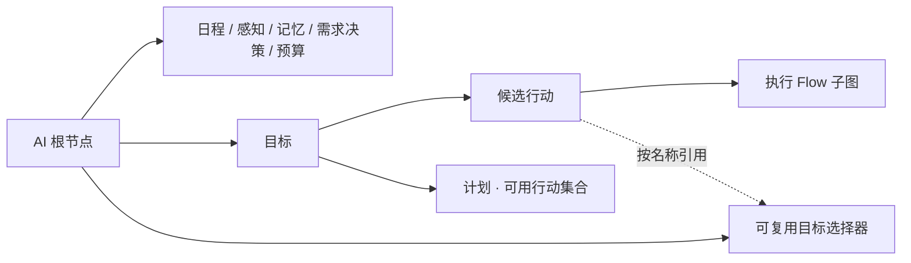

# NPC 图配置与运行指南

2026-10-19，可配置初版。本文替代旧 GOAP 计划和设计稿，描述当前实现。

## 配置入口

打开 `assets/scenes/spacelevel.tscn`，选择根节点下的 `Resident` 或 `Courier`，在 Components 中打开 `AiAgentComponent3D.Graph` 的图编辑器。

- 灰绿居民：`assets/resources/npc/gray_green_resident/npc_graph.tres`。
- 女性跑腿员：`assets/resources/npc/ochre_courier/npc_graph.tres`。

角色直接保存在 SpaceLevel 场景里。城镇下的 `NpcLife` 只保留世界、导航和交互点，不生成角色。

**AI 组件提供 AI 节点。** `AiAgentComponent3D` 实现通用的 `IGraphNodeProvider`，提供 NPC 配置节点和执行能力。`GraphPlugin` 负责画布、连线、检查器、组件提供者与保存，不包含人物职业或生活行为规则。普通图的全局菜单不显示 AI 专属能力；进入 NPC 的执行子图后，菜单由所属 AI 组件提供。

节点标题读取定义的 `DisplayName`，改名后立即更新。选中节点，在右侧原生资源检查器编辑字段；嵌套的表达式、需求、日程等资源可以继续展开。目标、行动、计划节点直接编辑各自的定义，不显示切换定义的下拉框；行动节点保留“进入执行图”按钮。AI 模块节点仍可用下拉框绑定同类型的共享定义。人物根节点的检查器显示整张图及定义库。定义库按中文分类折叠，支持名称搜索、进入配置和添加已有外部共享资源；被节点或其他配置引用的定义需要先处理引用，未引用的定义可以移除。进入需求、输入、效果等子资源时，标题使用配置名称，并显示用途摘要；底层定义类型和 ID 保持不变。

图节点的 `Id` 同时用于 Godot 画布节点名，不能包含 `.`、`/`、`:` 等非法字符；定义资源的 `DefinitionId` 可以保留点分名称，两者独立。`DefinitionId` 由系统自动生成并保存，在检查器中隐藏，无需手动配置。当前示例已统一修正节点与连线端点，验证器会拒绝非法节点 ID，避免出现节点断线、选中后检查器为空的问题。

## 图的连接



人物根节点的“模块”端口连接模块，“目标”端口连接目标，“目标选择器”端口连接可复用查询。目标的“候选行动”端口限定自己的行动库，“计划”端口连接该目标允许采用的方案。每个计划从行动库中选择可用行动，由 GOAP 组合顺序。同一行动定义可以被多个目标引用。未连接的定义不会参与角色运行。

行动节点的“进入执行图”在当前窗口进入子图，通过面包屑返回。子图和节点定义随 NPC 根图保存，图 JSON 只保存节点、位置、连线及定义 ID，字段值保存在资源里。

复制粘贴 NPC 节点会创建独立配置，包括条件、效果和行动执行图；修改副本不会影响原节点。一起复制计划与行动时，副本计划会引用副本行动；一起复制选择器与行动或计划时，副本输入、变量引用副本选择器；只复制行动时，计划变量的可读名称保留。未复制的引用保持原样，跨图粘贴时应同时复制依赖并连接人物根节点。多次粘贴分别产生独立副本，撤销/重做同时处理节点和定义资源。需要共用行动时，将同一个行动节点连接到多个目标。

## 角色数据与 AI 决策的边界

Player 和 NPC 的角色参数、需求、性格、关系、情绪和业务事实统一在 `CharacterDataComponent3D.Profile` 中配置。
运行状态由该组件独立更新并保存，AI 图不再包含这些数据节点，也不管理角色外观。
配置说明见 `scripts/gamelogic/character/data/CHARACTER_DATA_GUIDE.md`。

AI 图只保留：

| 配置 | 用途 |
| --- | --- |
| 日程窗口 | 当前允许采用的行为时段 |
| 感知 | 视距、检测间隔、视线、对象标签和已知交互点 |
| 记忆 | AI 事件记忆类别、容量与有效期 |
| 需求决策规则 | 按 NeedId 配置紧急进入/退出阈值及紧迫度曲线；同类节点可以有多个 |
| 决策预算 | 搜索节点数、深度、候选数量、承诺时间、切换差值、重试与 LOD |
| Goal / Plan / Action / 选择器 | 行为选择、规划与执行 |

根节点“模块”端口连接这些 AI 配置。角色属性列表从当前选择的场景宿主读取，按原参数名称用于公式。
同一张 AI 图可以供不同角色使用，各自读取自己的 Profile 和 State；打开独立图文件时，应在图编辑器中选择配置了角色数据的场景宿主。
角色数据不会随 AI 图保存；修改角色数据后保存 Profile / 角色场景。

## 通用需求预设与自定义需求

通用预设位于 `assets/resources/character/presets/common_needs.tres`，包含 thirst、hunger、fun、fatigue。
在角色数据组件的 Profile → Needs 中编辑需求，使用“补充所选预设”或“+ 自定义需求”。
需求的范围、初值、每小时变化率与变化倍率属于角色；AI 图的“需求决策规则”只配置如何判断紧迫程度。
现有示例四项初始需求均为 0.2，低于目标激活阈值；验证行为时可在运行状态中提高对应需求。
玩家可以使用相同需求模块，而不挂 AI。

## 配置目标

目标包含三种表达式：

- `Activation`：布尔值，当前是否允许参与选择；留空为允许。
- `Utility`：数值，越高越优先；非正值不参与选择。
- `Completion`：布尔值，是否已经完成。

例如新建“读书”目标，可声明 `needs.reading.value`，用需求值乘以 `personality.curiosity` 作为评分，用需求值小于阈值作为完成条件。新增名称不需要改运行时。目标可以不依赖需求，改用私有事实或其他模块输出。

目标切换受承诺时间和差值控制。无可行计划或行动失败时，该目标进入配置的失败冷却，其他目标可以参与选择。F8 的 NPC 页显示候选目标的评分、排除原因、行动、计划和失败记录。

## 配置行动

Action 使用通用结构，按需配置零个或多个输入，不再提供“共用目标、必须已到达、执行后到达、预约目标、距离系数”开关。

| 字段 | 用途 |
| --- | --- |
| 行动输入 Inputs | 有名称、类型、来源的参数列表；点击条目编辑，引用按名称选择 |
| Preconditions | 搜索与实际开始、提交结果前要满足的条件 |
| SuccessConditions | 执行图成功结束后，验证实际结果的条件；不作用于搜索预测 |
| Cost | 完整数值成本公式，例如 `1 + 输入地点的距离 × 0.2`；必须非负 |
| DurationSeconds / TimeoutSeconds | 默认行动时长和整体超时 |
| Predictions | 只改变搜索快照的预测效果 |
| Results | 执行成功并通过验证后提交的真实数据效果 |
| ExecutionGraph | 执行 Flow 子图，必须返回 `Success` |

对象输入下面有可选的“资源要求”：点击“+ 添加资源要求”，从该对象适配器注册的能力中选择，例如“使用容量”。留空只引用对象；配置后在本行动执行期间占用，完成、失败、超时或取消时自动释放。数字、布尔、普通文本输入隐藏此项，计划变量也不提供此项。多个行动即使引用同一计划变量，仍可分别配置资源要求，例如“前往”留空、“睡觉”占用床的使用容量。Action 顶层已移除资源占用列表，旧列表打开或编译时迁移到对应输入，不改变已有占用行为。

输入数据类型支持布尔、数字、文本。对象引用使用文本标识加已注册的对象适配器，编辑器按名称提供对象类型。来源可以是：

- **表达式或常量**：从人物、世界的已注册参数取值，也可以直接输入数字、布尔或文本。每步开始时解析，执行期间冻结。
- **选择器候选**：此行动独立选择一个对象；两个输入即使使用同一个选择器，也可分别选择。
- **本次计划变量**：从所属计划声明的同类型变量中选择；多个步骤或多个输入引用同一变量时，使用同一个值。

输入名自动注册为 `input.<名称>`。对象适配器还提供成员；内置交互点包括 `.id / open / available / stock / distance / at`，分别表示标识、开放可用、有空余容量、库存、距离、自身是否在使用范围。所有这些项都出现在本行动的条件、成本、效果值选择器中；其他行动的输入不会混入。`.stock` 可写，其余成员只读。

**到达是一组普通配置**：移动行动的 Predictions 设置“当前位置 = 输入地点”，SuccessConditions 选择“输入地点 · 自身已在范围内”；使用地点的行动把该范围条件放进 Preconditions。实际位置始终由场景观测，Results 不能写位置或使角色传送。已到达时，GOAP 可以直接选择使用地点的行动。

效果支持 Set 或 Add，可修改已声明的私有事实、需求和对象适配器提供的可写成员。打开效果条目，点击“修改参数”从当前可写列表选择，点击“效果值”配置表达式。数值才支持 Add；布尔、文本支持 Set。`self.location` 只出现在预测效果中。多个输入指向同一对象时，效果按稳定对象标识累计；全部类型、范围、成功条件和资源占用验证通过后才提交。取消或失败不提交尚未完成的 Results。

执行图内“前往输入地点”“附近活动或原地踏步”“记录记忆”的输入引用也按名称选择。能力节点只负责引擎执行，需求变化、天气条件、成本等由外层配置决定。当前还提供等待、Ability、关系和情绪能力；它们由 AI 组件提供，复用 GraphActionTask 的 Tick/Cancel 生命周期。记忆、关系、情绪等即时能力在执行时生效；需要整体提交的数据放在 Results 中。

“附近活动或原地踏步”使用现有导航和行走动画：Radius 大于 0 时在输入地点附近移动，范围受交互点使用半径限制；无地点输入时以自身为中心。Radius 为 0 时原地播放动画。时长默认读取 Action.DurationSeconds，结束、取消时释放动画请求并停止导航。

## 配置选择器、计划变量与输入

三者职责分别是：**选择器提供候选，计划变量保存本次选择，行动输入接收使用的值**。选择器不承担共享变量身份。

在 NPC 图中新建“目标选择器”，连接人物根节点第三个端口。Action 的对象输入或 Plan 的对象变量按名称引用该选择器。

| 配置 | 作用 |
| --- | --- |
| 对象类型 Adapter | 从已注册适配器中选择；当前内置“场景交互点” |
| 候选来源 | 感知对象、世界对象、角色参数指定对象、当前位置对应对象、已知对象 |
| 目标角色参数 | 从已注册文本角色参数中选择，例如 `home`，其值对应对象标识 |
| AllTags / AnyTags / ExcludedTags | 全部标签满足、至少一个标签满足、排除标签；空数组不限制 |
| MaximumDistance | 最大距离，0 表示不限制 |
| RequireUsable / RequireReachable | 过滤不可用或不可到达的候选 |
| Filter | 布尔条件；可引用本适配器提供的候选 `target.*` 以及人物、世界参数 |
| 选择策略 | 多候选交给 GOAP 比较，或先选最近、评分最低、评分最高的一个 |
| Score | 数值评分公式，例如候选库存；仅评分策略使用 |
| CandidateLimit | 多候选上限；0 使用人物预算，且受 TargetLimit 限制 |

角色参数、当前位置找不到对象时返回空候选。候选值与查询规则在规划开始时冻结；执行时重新验证对象、标签和条件，失效后取消。场景交互点的感知和已知来源沿用感知模块。

在 Plan 的“计划变量”中添加命名变量，选择类型与来源；变量可从选择器或表达式取值，不能再引用另一个计划变量。变量在搜索分支第一次使用时绑定，此后该分支保持一致；未使用的变量不要求取得候选。不同计划可为同名、同类型变量配置不同来源，因此同一个行动可以跨计划复用。

Action 输入选择“本次计划变量”时，列表只提供包含此行动的各计划共同声明的同类型变量；缺失或类型不符会报告错误。名称是可读的配置名称，不需要手填定义 ID。改名后需要重新选择相关引用；失效引用会保留并提示，不会静默改选。完成、取消、换目标或读档时清空运行实例的变量，其他 NPC 不受影响。

例如“家里或镇上玩”：

1. 选择器“娱乐场所”返回家和镇上两个候选。
2. Plan 添加对象变量“活动地点”，来源为该选择器。
3. “前往”添加输入“目的地”，来源为计划变量“活动地点”；预测当前位置变为目的地，实际成功条件为已在目的地范围，执行图导航到该输入。
4. “玩”添加输入“场所”，也引用“活动地点”；前置条件为已在场所范围，执行图执行活动，预测与结果降低娱乐需求。
5. Plan 选择这两个候选行动。GOAP 会比较不同地点并组合顺序；已在场所时只执行“玩”。

两个独立变量可以引用同一个选择器，例如“来源”和“去处”。也可以在一个行动中同时声明对象、数量和布尔开关等输入。多输入候选会组合搜索，总数超过 MaximumExpanded 时明确报告 `GroundingLimitReached`；应缩小候选范围或调整预算。成本按搜索中的位置计算，初始路段采用导航估算，预测后续路段采用冻结位置的直线近似。

对象扩展实现并注册 `INpcBindingAdapter`：提供候选与事实快照、输入成员及类型、可写数据地址与提交、对象验证、资源能力与租约。`INpcResourceLease` 负责续约和幂等释放；多项资源中一项获取失败，会释放已经获取的项。框架不依赖职业或具体行为。当前生产适配器只接入场景交互点；角色、背包物品与自由坐标仍需要各自的适配器/值类型和执行能力，新增输入不会自动实现这些系统。

旧 TargetTags / TargetIdParameter / TargetSelectorId 和目标开关仅作为隐藏的单向迁移入口。打开或编译旧图时，保留名字、连线、执行图和业务效果，迁移为输入、计划变量、条件、预测、成功检查、输入资源要求和完整成本公式。运行时已不读取这些旧开关。两个示例 NPC 已保存为新配置。

## 配置计划

Goal 已移除 `PlanMode`，所有方案统一使用 GOAP。每个启用目标必须连接候选行动和至少一个启用 Plan；Plan 是可用行动集合，不是固定执行序列。

在 Plan 检查器点击“+ 添加可用行动”，从所属 Goal 已连接且启用的 Action 中按名称选择；点击已有项可替换，点击“移除”取消选择。列表不排序、不重复添加，GOAP 会按实际需要省略、排列或重复使用其中的行动。计划由多个 Goal 共用时，只提供这些目标共同拥有的候选行动。

`Eligibility` 是方案适用条件，可留空；`Priority` 越大越优先。系统按优先级、内部 ID 顺序依次尝试适用方案，每个方案只用自己选择的行动搜索。高优先级方案无解或达到搜索限制时，尝试下一方案；不会混合不同 Plan 的行动，也不会绕过方案条件回退到整个 Goal 行动库。执行前和执行中还会检查方案适用条件，失效后取消并重规划。

`ActionIds` 仅在内部保存稳定引用，无需查看、填写或复制 ID。旧配置直接作为候选集合使用，重复引用编译时去重，行动改名不改变引用。行动被禁用、移出候选领域或删除后，原引用保留并标记不可用，应重新选择或修复连线。旧的模式字段和固定序列执行路径已删除。

娱乐场所的组合示例见上节。也可以保留“去家里”“去镇上”两个移动行动，再由“玩”的前置条件限定当前位置。`self.location` 由感知周期按实际位置与交互点使用半径更新，离开交互点后清空；这里只表示具体交互点，不表示整栋房屋或城镇区域。移动中的路径和播放动作仍在各自执行 Flow 中配置。

## 表达式和事实

在 NPC 图检查器中，`Activation`、`Completion`、`Preconditions`、模板条件等使用“参数 / 运算符 / 参数”条件行配置。点击左右参数按钮，从当前人物已装配且启用的模块中搜索选择已注册项，也可以选择数字、布尔或文本常量。数值支持大小比较；布尔与文本支持相等和不相等，右侧选项按左侧类型筛选。

检查器中的公式显示为中文参数名、运算符和括号组成的摘要，长公式可悬停查看完整内容。点击“编辑公式…”打开可调整大小的窗口，主检查器不再展开整棵公式树。

1. 点击公式中的参数或常量旁的“⋯”，在左侧参数库按中文名、分类或 ID 搜索，单击参数填入选中位置；只显示此位置支持的类型。数字、布尔、文本常量以及数值计算也可从参数库选择。
2. 数字直接在输入框修改；数值计算采用中缀排列，括号标出嵌套范围，可添加或删除多项运算中的项。切换成二元减法或除法时保留所有原运算项，按从左到右组合；限制到 0～1 会包住原计算。
3. “＋ 条件”添加条件行，“全部满足（AND）/任一满足（OR）”切换组关系，“＋ 分组”增加嵌套组。每组用边框和编号区分。
4. 顶部实时显示完整公式摘要，底部报告类型、未注册参数、常量除零等配置错误；错误公式不能应用。运行时仍可能产生未知值或动态除零，编辑器不会假设运行时数据。
5. 修改只在草稿中进行，可撤销/重做编辑。点击“应用公式”一次性提交到原生检查器，支持原生撤销；取消或关闭窗口放弃草稿。原公式在其他位置被修改后，旧草稿不能覆盖它。

`Utility`、`Cost`、需求倍率、效果值和输入表达式共用此编辑器。行动只提供本行动的 `input.<名称>`、对象成员和 `action.duration`，选择器提供候选 `target.*`，目标与计划条件不提供未绑定的行动输入。移除的参数引用会保留并提示，不会自动换成其他参数。


这些控件仍保存为原有表达式资源，旧配置可以直接编辑，修改支持检查器撤销。空的 AND 组为真，空的 OR 组为假；清空必填表达式后必须重新配置，才能通过图验证。

表达式支持 Literal、Fact、Parameter，四则运算、Min/Max、Clamp01、比较、All/Any/Not 和 Known。字段类型、参数和事实引用在编译时校验。未知值与 false、0 分开处理；`Not(unknown)` 仍为 unknown。

常用事实：

| 键 | 类型 |
| --- | --- |
| `needs.<id>.value / urgency / urgent` | 数值 / 数值 / 布尔 |
| `personality.<dimension>`、`preference.<key>` | 配置的标量类型 |
| `trait.<id>`、`schedule.<tag>` | 布尔 |
| `affect.<dimension>`、`relations.<dimension>.max` | 数值 |
| `memory.<category>.count` | 数值 |
| `private.<key>` | 声明的布尔、数值或符号 |
| `world.hour / rain` | 数值 |
| `input.<名称>` | 输入声明的类型；仅属于该行动 |
| `input.<对象>.id / open / available / stock / distance / at` | 对象引用及适配器成员 |
| `target.*` | 选择器候选成员；仅属于选择器 |
| `self.location`、`action.duration` | 符号、数值 |

需求在运行时连续变化，搜索时按需求范围的 1/20 投影。私有数值事实用配置的 Step 离散化，避免连续值搜索空间无限增长。不要用小于搜索精度的差值作为完成条件。

## 场景、存档和预算

`AiAgentComponent3D` 只装配 NPC 图、实例参数覆盖和独立状态；移动、导航、动画与技能继续使用已有 EC 组件。`AiInteractionPointComponent3D` 提供标签、开放时间、所有权、容量和库存。

所有 Plan 的 GOAP 搜索均由 `AiWorldComponent3D` 按帧共享毫秒预算、轮换角色推进；目标数量、每方案搜索深度和展开数量可配置，依次尝试多个方案也按帧切片。所有方案失败时，只要有一个达到搜索限制，最终结果会保留“达到限制”，不误报为已证明无解。

远处角色使用同一套目标、计划、执行图和结果规则。移动能力改用经过导航检查的旅行时间，在旅行结束时同步位置；进入详细距离或退出抽象距离时取消当前任务重新规划。初版只处理已加载场景中的角色，没有独立的跨场景人口模拟器。

角色存档保存需求、迟滞状态、私有事实、关系、记忆、情绪、位置意图及最后推进时间。世界存档保存交互点库存与开放覆盖。读取后取消运行中的任务、释放预约并重新规划。新框架使用新的存档 section，不读取旧固定生活原型的业务状态。

## 初版内容与验证

灰绿居民沿用原人设及现有动画；第二名为用户确认的女性跑腿员，栗色短发、赭黄外套、米白内搭、深色长裤和邮包。人物的食物、休息、散心/投递示例全部保存在各自 NPC 图中，核心没有按这些名称分支。

灰绿居民的“散步放松”目标目前配置为：

| Plan | Eligibility | 可用行动 |
| --- | --- | --- |
| 无雨 · 镇上或湖边散步 | world.rain ≤ 0.05 | 前往散步地点、散步 |
| 下雨 · 原地散步 | world.rain > 0.05 | 原地散步 |

“散步地点 · 镇上或湖边”选择器从已知交互点中筛选 `stroll` 标签及 `town/lakeside` 标签，提供两个候选供 GOAP 比较。户外 Plan 的“散步地点 · 镇上或湖边”变量从该选择器取值；“前往散步地点”和“散步”的“地点”输入引用此变量。前者预测位置变化并实际检查到达，后者用范围前置条件约束；附近移动范围为 0.6 米，持续 8 秒，成功后把娱乐需求设为 0.15。已在其中一个地点时可直接散步。新的交互点位于 `assets/scenes/npc/riverside_life.tscn` 的 `town_stroll` 和 `lakeside_stroll`。

“原地散步”是雨天 Plan 的单步行动，无输入、无资源占用、无移动，Radius 为 0，播放行走动画 8 秒，成功后降低娱乐需求。下雨会使户外 Plan 条件失效，取消当前移动/散步并释放绑定和预约，再选择雨天 Plan；取消的行动不提交未完成的效果。降雨阈值、时长、范围和需求效果均可在图中修改。跑腿员的投递配置保持原样。

```powershell
scripts/tools/npc/validate_npc.ps1
scripts/tools/npc/capture_resident.ps1
```

第一条运行纯 GOAP 回归及真实 SpaceLevel 框架检查，包括对象查询来源/筛选/评分、多输入组合、变量独立和共享、参数类型/作用域、适配器扩展、输入资源要求编辑/迁移/复制/保存、多资源获取失败/取消/超时清理、实际成功验证、已到达时跳过移动、动态成本、配置冻结、迁移、复制与保存，以及两个角色的移动/行动/取消和精灵导入。散步回归还覆盖两个地点实际到达与附近移动、行走动画、途中下雨切换原地活动、位置保持及动画/预约清理。第二条用 Vulkan 捕获实际场景，输出在 `.godot/npc/art/`。

美术说明见 `docs/art/npc_resident.md` 和 `docs/art/npc_courier.md`。旧 Brain/Perception/Executor 生活分支、Guard、Population、LifeSimulation、旧职业配置和对应测试场景已经移除；保留通用导航适配器。

本版尚未包含图内运行状态着色、配置预演面板、通用角色/威胁传感器和跨场景人口系统。当前运行诊断位于 F8 的 NPC 页；这些扩展应继续通过通用提供者和适配器实现。
