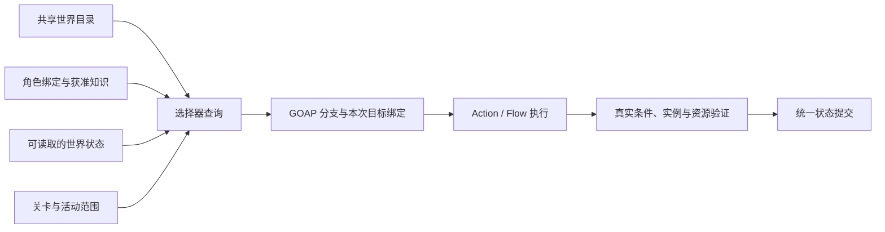

# 世界框架、关卡切换与 NPC 世界引用实施计划

更新：2026-10-23。状态：首期世界、选择器、行动检查点、自主跨关卡旅行、离屏事件模拟、活动上下文与远处候选已实现。入口任务条件和完整玩法性能验收仍待专门实施。

本文保留世界系统的实施范围与设计约束。对象与关卡制作见 [世界配置与关卡切换](README.md)，本次人口功能配置、支持范围与实测见 [NPC 世界旅行、活动与离屏模拟配置](WORLD_NPC_SIMULATION.md)，角色图基础配置见 [NPC 图配置与运行指南](../ai/NPC_GRAPH_GUIDE.md)。下文“实施任务”表记录实施前的替换位置；以当前交付和配置文档判断实际状态。

2026-10-22 能力组合重构：对象身份由 WorldObjectComponent3D 绑定；Type.Capabilities 声明可选能力，Scene 上 WorldObjectComponent3D.Overrides 仅覆盖已声明能力。库存、开放时段、使用容量和液体分别有自己的配置、状态与组件。公共 WorldInteractionComponent3D 使用 Area3D 交互区域与导航参考位置，Interaction 能力声明 Operations；玩家按 E 与 NPC Action 都调用公共操作入口，不再允许 NPC 结果直接改目标库存。新增能力不往通用记录添加字段；世界存档使用 schema 3，直接拒绝旧 schema 1／2。本文后续提及初始库存、容量等均指对应可选能力的配置。

### 当前交付

- 已实现共享目录、唯一世界会话、统一对象状态和现场身份校验。
- 已实现显式关卡切换、同一玩家交接、失败回退、取消及迟到请求隔离。
- 已接入新游戏、继续游戏、返回菜单、独立 F6 会话和卸载状态保存。
- 已实现角色世界绑定／知识、获准目录查询、感知分离、局部快照、路径与射线预算。
- 已实现选择器 ObjectType、RequiredCapabilities、RequiredOperations；按名称选择配置，目录按类型／能力／操作索引筛选，现场候选与执行阶段使用相同限制。
- 已实现 Action Graph 内的交互数量、等待／活动时长公式与执行图局部计算；目标继续通过选择器连线。编译提取操作与库存／液体消耗预测，实际成功后统一按请求数量提交，不重复填写数量和目标预测效果。
- 已提供 Scene 自动身份／独立复制与自动生成关卡目录、目录校验、F8 世界诊断和城镇／工坊示例。
- 已实现对象操作配置、公共交互区域、玩家 E 键入口和 NPC 共用操作提交；专门的交互回归覆盖 37 项。
- 已实现现场行动语义检查点：等待／休息计时、本地移动意图、冻结数值、共享目标与剩余计划恢复；完成步骤与提交标记防止重放，复杂／自定义执行图明确取消重规划。配置与限制见 [NPC 行动检查点与恢复](../ai/NPC_ACTION_CHECKPOINTS.md)。
- 已实现 WorldActor 唯一角色名册、WorldRoute 路线图、多段旅行与途中恢复、到达后原 Scene 生成及迁出防重复。
- 已实现共享角色图的轻量 EC 代理、稳定事件队列、有界快进、精度交接及有限关注请求；现场和远处使用同一对象状态与容量。
- 已实现日程／任务／紧急请求共用的活动上下文，组合时段、地点、Goal、允许操作、承诺、中断和回退。
- 已实现远处候选的可选空间距离、路线旅行时间、后端能力和成本来源，及观测来源／到期。内置库存和液体交互可在语义后端执行。
- 世界、能力组合与角色图已有维护中的自动回归；已有目录 1,000／10,000 条及现场同时规划基线。本次另有 44 项世界人口回归和 24 NPC 快进基础测试，完整玩法人群、显存及长期稳定性仍需验收。

### 尚未实施的范围

- 入口的钥匙、任务进度和角色权限判断后续由任务图负责；当前 WorldTransitionComponent3D 只执行触发和关卡交接，不新增独立通行条件系统。
- 任意技能、动画、物理战斗和复杂自定义执行图没有通用离屏后端；需要实现对应的语义业务能力，不能仅声明名称。
- 结构化材料／工具／库存事务、动态长期对象生成、多关卡并行及重复关卡实例不是当前交付。
- 完整玩法人群、加载分阶段与资源驻留峰值、显存、长期内存稳定性仍需目标硬件验收。

## 1. 交付范围

| 阶段 | 交付 |
| --- | --- |
| 首期 | 唯一世界会话、世界目录与状态、关卡上下文、玩家关卡切换、存档交接、角色世界绑定与知识、世界目标查询、配置编辑器与双关卡验证 |
| 本次已交付 | NPC 自主跨关卡旅行、可恢复行动、远处模拟、事件调度、活动上下文及有界关注请求 |

首期同一会话激活一个游戏关卡，允许准备目标关卡资源；采用有加载过渡的显式切换。多关卡并行流式加载、重复住宅或地下城实例不是首期验收范围；当前没有运行时关卡实例身份系统，后续需引入独立实例身份，避免把模板身份当成全部实例的唯一身份。

未加载对象可以成为可执行候选；需要 WorldActor、获准路线、有效位置与受支持的语义行动。只知道对象身份不会绕过权限、库存、容量或操作能力检查。

### 已确定的角色图约定

- Goal 配置激活、评分和期望完成状态。
- Plan 配置适用条件、优先级和手动选择的 Action 集合；空列表不代表全部行动。
- 全部对象目标通过选择器节点连到 Action 目标输入。
- 固定数量、时长与数值公式在 Action Graph 节点配置；多个节点共用的计算结果使用本执行图局部数值，每次执行独立。普通输入仅用于显式传入数据，Plan 不保存这些局部值。
- 同一选择器节点在本 NPC、本次运行时计划中共享选定身份；不同节点独立选择。
- 普通数字、布尔、文本参数继续使用 Action 输入表达式或常量。
- 运行时计划由 GOAP 生成，保存具体目标；不恢复手工 Plan 变量。
- 对象声明可提供的能力，不自动生成角色 Goal 或将 Action 加入 Plan。条件、成本和效果继续复用既有行动定义。

## 2. 当前实现与替换位置

| 代码入口 | 当前行为 | 实施任务 |
| --- | --- | --- |
| [PreloadProcedure](../procedures/PreloadProcedure.cs) | 固定加载 spacelevel.tscn，进入前调用存档 Load | 调用世界会话，按新游戏配置或已保存关卡进入 |
| [LevelProcedure](../procedures/LevelProcedure.cs) | 返回菜单时直接释放 gameplay_level | 走统一退出、取消与状态交接流程 |
| [AiWorldComponent3D](../ai/runtime/AiWorldComponent3D.cs) | 全局分组注册；管理已加载点、角色和搜索预算 | 长期状态和调度归入会话，关卡提供局部上下文 |
| [WorldInteractionComponent3D](components/WorldInteractionComponent3D.cs) | 公共交互区域与导航参考位置 | 玩家与 NPC 共用区域判定、操作执行及能力状态 |
| [AiAgentComponent3D](../ai/runtime/AiAgentComponent3D.cs) | 全量感知、捕获事实、生成候选；固定路径读取 Player | 接入关卡环境、知识、按范围查询与局部快照 |
| [NpcBindingAdapters](../ai/runtime/NpcBindingAdapters.cs) | 遍历已加载点，逐个估算路径 | 按查询请求生成短名单，区分记录与实例 |
| [NpcTargetPlanning](../ai/runtime/NpcTargetPlanning.cs) | 候选必须有坐标、距离和布尔可达性 | 增加关卡归属、可选空间信息、未知状态和成本来源 |
| [CharacterDataComponent3D](../character/data/CharacterDataComponent3D.cs) | 通过全局环境组读取位置和天气 | 按角色所属关卡解析环境，保留 CharacterState 数据模型 |
| [SaveModule](../saves/SaveModule.cs)、[TimeOfDayModule](../timeofday/TimeOfDayModule.cs) | 已有注册式存档和世界时钟 | 复用它们，明确会话状态所有权，不另建存档文件系统或时钟 |

当前库存等状态随组件存在。对象卸载后必须保留最后状态；仅保存读档时缓存的旧快照，会丢失随后发生的变化。当前 SaveModule 保存已注册 section；应由长期存活的状态持有者保存未加载对象与角色。

## 3. 世界结构与生命周期

```text
Root
├─ 全局模块：资源、存档、世界时钟、世界会话与关卡服务
├─ WorldSessionRoot
│  ├─ Actors：玩家等跨关卡保留的角色实例
│  └─ Levels：当前激活的关卡实例
└─ UI
```

世界会话内包含共享目录及索引、对象与角色状态存储、关卡上下文、现场实例注册表、查询和调度预算。退出世界时统一释放，关卡切换期间保持存活。目录和索引由所有 NPC 共享，不随角色图复制。

玩家由会话持有，关卡提供出生点和落点。切换时保留已实现的角色数据、背包、技能与冷却，交接物理体、导航、镜头和环境引用。关卡不能再内嵌第二份玩家。

本地 NPC 和对象可随关卡加载，卸载前保留状态。WorldActor 角色由逻辑名册决定唯一实例所在位置，原场景摆放不能在角色迁出后重复生成它。

场景行为继续使用 GameObject3D 与 Component3D。纯数据协调接入 ModuleSystem，现场组件经 OnInit/OnDestroy 注册和解绑。组件优先级只保证同一宿主内顺序；跨宿主依赖通过关卡就绪状态和显式注册解决。

## 4. 世界记录与唯一编辑来源

| 数据 | 字段与职责 | 制作与运行归属 |
| --- | --- | --- |
| 世界入口配置 | 目录、初始关卡和入口、玩家场景资源标识 | 世界配置资源 |
| 地点记录 | 稳定身份、名称、父地点、标签、公开服务 | 地点资源，独立于加载 |
| 关卡记录 | 稳定身份、名称、场景资源标识、关联地点、默认入口 | 关卡资源 |
| 对象类型 | 默认标签、可选能力及其默认参数；能力声明支持的适配器 | 可复用类型资源 |
| Scene 对象配置 | 类型、名称、标签、所有者、可选地点与覆盖 | Scene 上 WorldObjectComponent3D；自动摆放身份 |
| 关卡对象目录 | 稳定身份和 Scene 配置快照 | 自动生成 WorldLevelCatalog，运行时解码为 WorldCatalogEntry |
| 世界状态 | 库存、开放覆盖、销毁标记、占用及版本 | 会话统一持有，按身份保存 |
| 现场绑定 | 身份对应的 EC 组件、关卡与实例代次 | 随加载解绑，不能成为长期身份 |
| 角色世界数据 | 地点／对象绑定、初始知识、发现与最后观测 | 角色配置及独立运行状态 |

地点表达语义范围，关卡组织加载和导航。一个地点可跨多个关卡，一个关卡可包含多个地点。首期场景根绑定关卡记录，对象显式选择所属地点；不凭节点名或坐标推断住所、工作区和营业规则。

名称、类型、归属与静态标签在 Scene 组件和类型中编辑。场景负责摆放、实体碰撞、Area3D 交互区域及自动移动参考位置 UsePosition。库存、开放时段等只出现在显式添加的能力资源中；Scene 组件可为同一种能力提供独立覆盖。类型与现场提供者必须匹配；仅保存内容的瓶子可只有液体能力，需要角色操作时再声明 Interaction，仍无需营业时间。

目录不持有 Node、组件或会递归加载关卡的 PackedScene。场景用资源标识按需加载；编辑器从登记目录生成名称列表，不为打开一个属性面板遍历或实例化全部关卡。必要的摆放索引由编辑器构建，运行时共享只读索引。

只有 AI、任务或存档需要长期引用的对象进入目录。装饰、特效和临时表现保持普通场景资源。

### 身份规则

- 静态对象的身份来自各级 Scene 摆放键；编辑器自动生成并保存。旧手工对象记录已移除。
- 名称、节点路径和文件名不作为存档身份。场景资源标识失效单独报告。
- 配置好模板 Scene 后直接拖入关卡；普通保存／运行／导出自动更新身份与目录，无手动烘焙。
- 复制对象或嵌套房间自动给新摆放生成键，既有实例保持不变；共享模板和类型不共享状态。
- 重复注册同一身份报告冲突，不能按同名猜测、静默覆盖或运行时随机改号。
- 后续动态生成的长期对象由世界服务分配并保存身份；当前自动身份只覆盖已保存 Scene 的静态摆放，短期实例无需进入长期状态。
- 多个组件对应同一对象时指定唯一现场执行入口，并验证实例代次，拒绝旧实例迟到解绑或提交。
- 新结构明确存档版本；不添加已经退役的图输入或 Plan 变量兼容分支。旧存档迁移作为明确需求另行实施。

## 5. 状态、绑定与存档

静态记录提供默认配置，世界状态是变化的唯一权威。默认库存仅在该身份首次进入当前存档时应用，重载场景不得覆盖现有状态。

| 解析结果 | 行为 |
| --- | --- |
| 记录存在且已加载 | 读取获准信息，验证后执行现场能力 |
| 记录存在但未加载 | 保留身份、静态资料、状态及知识；按能力判断是否可执行 |
| 已销毁 | 保存必要历史和销毁标记，禁止交互 |
| 记录缺失 | 保留原引用并报告制作错误，允许修复 |

卸载不是销毁。长期状态和角色知识不随现场节点消失。状态存储可只保存相对定义发生变化的数据，但现有存档仍整体写出 section，不将其描述成已实现磁盘增量写入。

加载：建立目录 → 恢复会话状态 → 注册关卡上下文 → 绑定角色和对象 → 开始现场执行。

卸载：停止接收新执行 → 交接或取消行动 → 保留必要状态 → 解除绑定 → 释放场景和资源。

对象和角色状态各有唯一保存责任方；现场组件与会话不能分别保存并恢复同一份业务状态。复用 CharacterState，保留未加载角色条目，避免 SaveModule 注销组件后再保存导致条目丢失。

读档先停止现场 Flow 任务、释放临时预约，再从受支持行动的语义检查点重建执行并申请占用；不支持的执行图明确取消重规划。不序列化任意 Flow 栈或原生节点引用。跨关卡旅行的路段检查点待旅行系统实现后接入。

## 6. 关卡切换

### 配置入口

| 配置 | 内容 |
| --- | --- |
| 关卡上下文组件 | 关卡记录、导航、环境引用与局部注册 |
| 出生点组件 | 关卡内稳定入口键、位置和朝向，控制原生 Marker3D |
| 切换入口组件 | 目标关卡、目标入口、Area3D 自动触发或显式 Activate；会话提供重触发保护，业务通行条件后续由任务图控制 |

门、任务、调试入口与后续旅行能力统一调用关卡服务。服务提供进入世界、切换关卡、退出世界、进度和取消准备阶段请求等入口；调用者不自行释放当前关卡。

### 切换事务

```text
接受请求并限制重复触发
→ 校验目录与目标关卡
→ 异步准备目标资源，保留当前关卡
→ 预检目标结构、入口和身份
→ 暂停控制及影响交接的现场执行
→ 保存切换前状态
→ 交接旧关卡、目标关卡和玩家
→ 等待必要导航与物理同步
→ 提交当前关卡和玩家位置
→ 恢复控制并释放旧资源
```

- 资源加载复用 IResourceModule/SceneHandle，明确每个句柄的持有者、转移与释放。
- 准备阶段使用请求版本与取消令牌；迟到的旧请求不能实例化到新会话。
- 提交阶段串行执行，后续请求排队或明确拒绝，不中途打断状态交接。
- 暂存目标实例在运行树外预检；仅关闭 Process 并不能阻止初始化注册。激活和注册需要明确的关卡生命周期屏障。
- 准备失败保留原关卡；提交失败恢复旧关卡及切换前状态，必要时重建旧现场实例。成功前不覆盖最近有效存档或已提交关卡位置。
- 出生点同步朝向、物理体、导航和镜头目标，增加短暂重触发保护，防止刚落地便切回。
- 错误区分未配置目标、资源加载失败、入口缺失、身份冲突和导航未准备，不静默放到原点。
- 天气、导航图、视线和玩家距离读取角色所属关卡上下文；不同关卡的同坐标对象不能互相影响。
- 首期暂停交接期间相关模拟的推进，并明确超时、控制恢复和时钟策略；不通过读档回退世界时间。

### 游戏流程

- 新游戏：清理旧会话 → 初始化新世界 → 按入口配置进入初始关卡。
- 继续游戏：取消旧加载并清理旧会话 → 读取存档 → 进入保存的关卡及位置。
- 切换关卡：保留会话和世界时钟，不重新 Load 整份存档。
- 返回菜单：取消待完成加载和现场执行 → 保留必要状态 → 关闭世界会话。
- 独立运行关卡：显式初始化测试会话与上下文，避免每个场景重复创建全局服务。

PreloadProcedure 和 LevelProcedure 都接入上述入口。后续多关卡并行加载沿用注册和上下文设计，但需另行验证导航、环境、实例恢复和内存预算。

## 7. 角色绑定、知识与活动范围

角色数据提供具名世界绑定，地点与对象槽位分开。例如住所、工作地点属于地点；偏好床铺属于对象。制作时按名称选择，运行时可保存关系变化；绑定表达归属或偏好，不授予容量占用。

| 信息 | 来源与使用方式 |
| --- | --- |
| 初始知识 | 配置已知地点、具体对象、公开服务 |
| 新增知识 | 探索、任务或明确交流规则，按身份去重并保存 |
| 当前感知 | 同关卡附近空间查询与必要视线检测 |
| 最后观测 | 数值、时间、来源与失效策略 |
| 事件记忆 | 继续使用现有记忆系统，不以对象选择器替代 |

目录存在不授予知识；知道旅店不暴露全部房间与实时库存。全局业务状态与 NPC 获准读取的信息分开。未知库存不填零，未知占用不填空闲，未知路线不填零距离；沿用 GOAP Unknown，并在编辑器提供明确的已知性条件。

初始知识与发现分开保存，远处知识不参加本地视线检测。现有 KnownPointIds 从感知配置整理到角色世界知识配置，不让“知道”直接变成“现在看见”。

现有 self.location 继续表示具体交互点。新增当前关卡与语义地点信息，不改变旧事实含义。

日程、任务和紧急事件后续提供活动上下文：时段、地点范围、许可交互、引用 Goal、承诺时间、中断和回退规则。期望完成状态由 Goal 表达，继续使用现有 Utility/Plan 机制，不建立竞争的活动执行器。

## 8. 选择器与执行衔接



### 选择器制作字段

| 配置组 | 内容 |
| --- | --- |
| 对象适配器 | Adapter：注册的对象适配器，首批保持交互点 |
| 来源 | 固定世界对象、角色对象绑定、感知、已知、获准目录查询 |
| 地点范围 | 当前地点、指定地点、住所／工作地点、后续活动范围 |
| 静态条件 | ObjectType：可选单一世界对象类型；RequiredCapabilities、RequiredOperations：必须全部提供的能力键和操作 Id；另有全部／任一／排除标签 |
| 动态条件 | 已实现获准读取的条件表达式与 Known 已知性；观测时效筛选尚未实现 |
| 策略 | 最近、评分或有限候选交给 GOAP |
| 上限 | 候选、范围扩大和路径预算，按来源显示 |

固定使用自己的床也经选择器连接；普通配置在选择器中先解析地点范围再筛对象，不强制新增地点节点或 Plan 变量。

查询按顺序执行：来源与知识 → 地点／类型／标签索引 → 权限及粗成本 → 短名单 → 有界本地路径或后续跨关卡路线 → 局部事实快照 → GOAP 具象化。

全部短名单不可达时可在预算内扩大范围；区分预算耗尽与已确认无解。候选截断后的 GOAP 只比较保留方案，不保证全世界最优。

后续候选模型不再强制给未加载对象填坐标和数值距离，并明确区分可引用、路线已知与当前能力可执行。当前 point 候选仍要求现场实例和空间数据；目录可保留未加载身份，但不会生成可执行候选。关闭 RequireReachable 不能绕过现场能力缺失，执行前仍校验对象及关卡。

查询定义不保存选中结果。搜索分支保留各自绑定，绑定参与状态去重；胜出计划按 NPC、运行实例和选择器节点隔离。执行中刷新动态状态，目标失效后取消或重规划，不悄悄替换对象。

类型、能力、操作和标签限制同时生效，适用于动态查询及固定对象／角色绑定等单对象来源。ObjectType 留空或要求数组为空即不限制；按稳定类型 Id 匹配，不按资源实例或显示名称。目录索引读取每个 Scene 对象覆盖后的有效能力及操作，筛选在短名单与路径估算前完成；编译后的要求和候选元数据是只读快照，执行时再次读取现场支持范围验证。声明支持某项操作不代表此刻满足库存、区域或权限；真实执行继续调用公共交互检查。筛选不申请容量、不执行操作，也不授予对象知识。

## 9. 对象能力、占用与状态提交

首批将现有使用容量接入统一世界状态，保留 Action 输入的资源要求制作方式。对象类型提供默认容量，具体对象可以覆盖；前往阶段通常不长期占用，使用阶段申请并在完成、失败、超时或取消时释放。

对象能力可引用已有行动模板，发现能力不会自动创建 Goal、Action 或 Plan 配置。交互节点在 Action Graph 声明操作与数量，编译器提取本行动的操作约束、资源消耗预测及可推导的图内时长，不运行 Flow。Results 只提交角色数据，对象业务变化由公共交互操作在行动成功时按请求数量提交；选择、抵达和精度切换本身不发放收益。

后续材料数量、工具槽位、库存预留和消耗，需要结构化要求、数量、事务及取消语义，不能只往下拉框添加名称。动态资源种类的注册与提供者机制作为独立扩展，不在世界目录中复制行动效果。

现场与离屏已共用业务占用，行动取消和交接释放租约。多座家具仍需要可区分落点，可拆成独立交互点；不能只有多个容量名额却让所有 NPC 重叠到同一落点。

## 10. 制作流程与实例

### 制作流程

1. 在 assets/resources/world/ 建立世界入口、目录、地点、关卡与对象类型。
2. 关卡根 GameObject3D 添加上下文；配置导航、环境和默认入口。
3. 可复用 Scene 的 GameObject3D 添加 WorldObjectComponent3D，配置类型、名称与可选覆盖，编辑器补齐能力组件；配置交互 Area3D、UsePosition 和碰撞。拖入登记关卡并保存，自动生成摆放身份和目录，无需逐个创建对象记录。
4. 配置门／区域入口的目标关卡、目标出生点及自动触发；重触发保护由会话提供。任务通行条件后续通过任务图控制显式调用入口。
5. 玩家由会话创建；角色数据配置地点／对象绑定与初始知识。
6. NPC 选择器配置来源、范围、ObjectType、必需能力／操作与标签／动态条件，连到 Action 目标输入；Goal 与 Plan 继续手动配置。
7. 使用关卡、引用、知识、状态和查询诊断检查成功及失败原因。

### 例一：自己的床

住宅地点关联住宅关卡，床 Scene 拖入住宅并保存后自动进入目录。角色住所绑定住宅，偏好床铺按名称绑定该床，初始知道它。选择器读取偏好床铺，前往和睡觉的目标输入连同一个节点；睡觉配置范围前置与使用容量。WorldActor 经路线前往未加载住宅，在语义后端完成等待和角色结果；加载后解析为同一对象。

### 例二：玩家往返住宅与旅店

配置住宅门与旅店出生点，返回门配置住宅出生点。玩家住宅→旅店→住宅后，角色数据、库存及世界时间保持。旅店中保存后退出，再继续游戏进入旅店的保存位置。门重触发、错误入口及加载失败均有专门验证。

### 例三：动态选择旅店床

选择器限制在获准知道的旅店范围，ObjectType 可选择床类型，RequiredCapabilities 选择使用容量，AllTags 填床标签，保留最多四张候选。若项目已实现休息交互操作，再将其加入 RequiredOperations；内置示例没有完整睡眠业务，不能填一个新操作名就得到实现。前往和休息连接同一节点；GOAP 比较整体成本。选定 B 后当前计划保持 B，另一 NPC 独立选择；床 B 失效后明确回退。先在家、无解后去旅店可用两个手动行动集合及不同 Priority；同一方案按成本比较时将两类候选放入同一查询。

### 例四：供货与收货

使用两个不同选择器节点表达来源与去处，相关 Action 分别连接对应节点。Plan 选择四步所需的行动集合，顺序由前置与效果约束。货物、订单、数量和库存转移仍需业务适配器与执行能力，不能仅配置名字便得到搬运系统。

## 11. 已实现：自主旅行与离屏活动

1. 入口与道路连接记录两端身份、方向、通行条件、成本和版本。地点树不代替路线图，不直接相减不同关卡的坐标。
2. 旅行保存 NPC、目标、当前关卡或路段、进度及下一事件。逻辑位置随路段推进，被观察时恢复现场实例；不为单个远处 NPC 加载整个关卡。
3. 现场等待／休息、本地移动与世界旅行已保存语义检查点及提交标记。不支持恢复的自定义行动明确取消重规划。
4. 详细、过渡和远处模式共用目标、规则及状态。能力层提供不同执行后端，NPC 图不复制三套业务逻辑。
5. 动画事件和简化计时使用同一语义事件；用行动实例及事件身份防止重复提交。
6. 远处按日程、到达、行动完成和需求阈值等事件推进；快进按稳定顺序分批补算，不逐帧重放或跳过重要后果。
7. 精度切换保留迟滞与驻留时间，提前恢复即将可见角色；任务关注和区域事件提升受预算与生命周期约束。
8. 已采用单线程权威状态；尚未引入工作线程。今后若压测需要并行，只计算纯数据快照，主线程验证提交，不在工作线程操作场景与物理。

配置步骤、运行边界、事件预算及可复现验收见 [NPC 世界旅行、活动与离屏模拟配置](WORLD_NPC_SIMULATION.md)。

## 12. 性能策略与测量

| 成本 | 实施策略 |
| --- | --- |
| 世界目录 | 一份共享索引；按身份平均常数查询，地点和能力查询仍取决于命中数 |
| 感知与位置归属 | 按关卡空间索引查询附近对象，视线检测错峰且有上限 |
| 候选与导航 | 先范围筛选和粗评分，再对短名单计算路径；保留有界扩大 |
| 事实快照 | 按候选、条件、成本和效果依赖捕获；同次更新复用，提交后刷新相关项 |
| 缓存 | 按角色位置、知识、对象状态、时段及导航版本失效，避免世界任一变化导致全失效 |
| 规划调度 | 注册变化时维护轮换队列，分项限制查询、导航、GOAP、事件和恢复 |
| 关卡切换 | 测量异步准备、实例化、交接、导航同步、首次恢复和双资源驻留内存峰值 |

实施后 PlanningMillisecondsPerFrame = 1.5 已包含候选构建和 GOAP 推进的软预算，单次操作不能抢占；LastPlanningMilliseconds 仍不代表总 AI 成本。会话每帧路径估算默认上限 8、感知射线上限 32，NPC 单次感知最多处理 8 个点；候选探测范围 16 至 128，默认 GOAP 目标上限 4。实际配置与测试方法见世界指南；按目标硬件压测调整，不承诺固定人数或总耗时。

异步资源读取不保证场景实例化与 GPU 上传无峰值。首期显式过渡允许分帧恢复；旧关卡与目标预加载同时驻留的内存成本单独报告。

压测包括：固定现场规模，将目录从 1,000 增至 10,000；固定目录增加现场 NPC 和同时重规划；后续增加远处角色并测试整点、批量到达、快进与读档。记录总 CPU、P95/P99、查询命中、路径次数、GC、规划等待、状态内存、存档体积及恢复积压。

## 13. 实施批次与验收

| 批次 | 交付 | 验收门槛 |
| --- | --- | --- |
| 1 | 世界定义、会话与目录索引 | 无 NPC 也可建立会话；未打开目标关卡可按名称选对象 |
| 2 | 状态、关卡上下文与实例绑定 | 库存修改后卸载／重载保持，不同关卡同坐标不串值 |
| 3 | 入口、玩家交接与切换事务 | A→B→A 正确；失败回退、取消、迟到请求和句柄释放可验证 |
| 4 | 新游戏、继续游戏、返回菜单与独立运行 | B 保存后启动回 B；新建和读档不串状态；菜单后不迟到生成关卡 |
| 5 | 角色绑定、知识、选择器与局部查询 | 同节点共享、不同节点独立，未知信息不产生假条件 |
| 6 | 编辑器闭环、诊断及双关卡压测 | 复制身份、缺失引用、状态和查询失败有明确诊断，原角色图回归通过 |
| 7，已实现 | NPC 旅行及路段检查点、事件调度、活动上下文与精度交接 | 基础回归覆盖无重复角色、占用或收益及逻辑连续；完整玩法性能待验收 |

验收还包括：

- 修改名称、节点路径和类型／关卡资源路径后身份不变；缺失场景标识可诊断。
- 删除、销毁和未加载分别显示；重复身份阻止错误注册。
- 未加载对象和角色的最新状态进入存档，默认库存不覆盖已保存值。
- 加载失败、缺失入口、快速连续切换、切换中返回菜单和重复触发都能清理资源并恢复可操作状态。
- 玩家、关卡和局部环境唯一；无重复存档注册、悬空组件或错误关卡导航。
- 目录不自动授予知识，过期观测不当实时事实，缺少路线不当已可达。
- 现有选择器连线、端口增减／排序／撤销、复制粘贴、资源租约和双 NPC 隔离继续通过维护中的回归验证。
- 世界目录增长不引发现场每帧全世界扫描，加载峰值和持续成本分别记录。

生产代码位于 scripts/gamelogic/world/，现场组件遵循 EC 结构，配置放 assets/resources/world/。验证器放 scripts/tools/world/，临时日志与生成夹具放 .godot/。不修改生成配置目录。

## 14. 设计参考

以下保留前期研究入口，作为设计背景；实现与性能按本项目验收，不将其他游戏的规模、距离或内部实现当成本项目承诺。

- 天际 Creation Kit：[Reference](https://ck.uesp.net/wiki/Reference)、[Location](https://ck.uesp.net/w/index.php?title=Location&mobileaction=toggle_view_desktop)、[Quest Alias](https://ck.uesp.net/wiki/Quest_Alias_Tab)、[Packages](https://ck.uesp.net/w/index.php?title=Bethesda_Tutorial_Packages&mobileaction=toggle_view_desktop)、[Sandbox](https://ck.uesp.net/wiki/Sandbox_(Procedure))。
- The Sims: Medieval 开发复盘：[GDC 原始演讲](https://www.gdcvault.com/play/1014569/AI-Development-Postmortems-Inside-DARKSPORE)。
- 天国拯救 II：[Combining GOAP and MBTs](https://www.gdcvault.com/play/1035576/Game-AI-Summit-Combining-GOAP)、[Supporting Thousands of NPCs](https://gdcvault.com/play/1035718/Supporting-Thousands-of-NPCs-in)、[开发者完整演讲](https://www.youtube.com/watch?v=yMlTT-yqdmc)。
